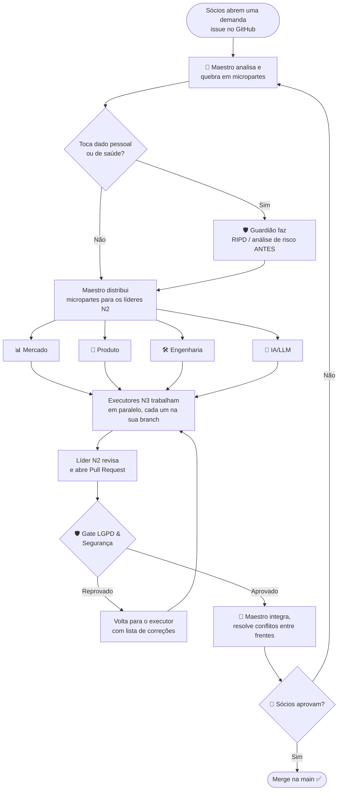
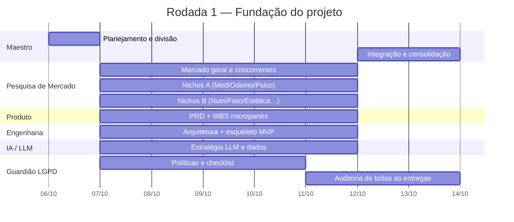
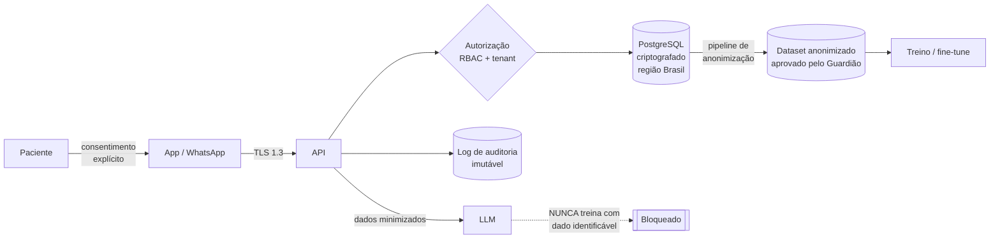
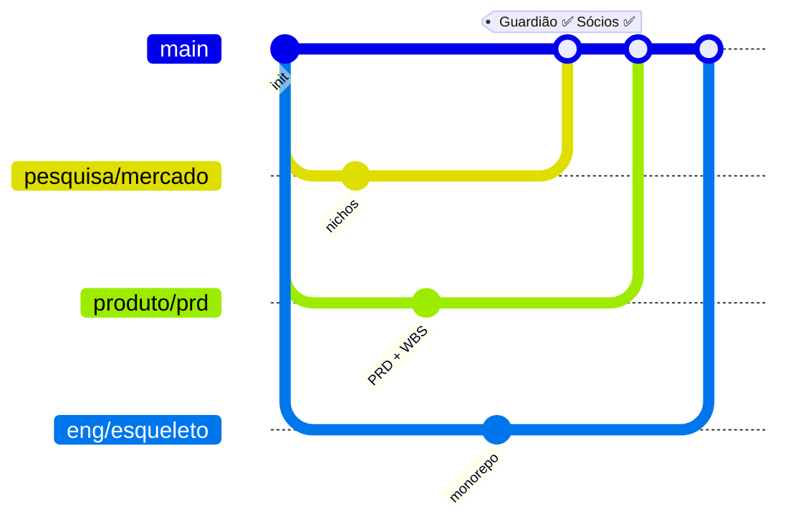

# Fluxograma de trabalho (como a orquestra toca)

## 1. Ciclo de uma demanda (do pedido ao merge)

## 2. Fluxo paralelo (linha do tempo de uma rodada)

## 3. Fluxo de dados de paciente (visão LGPD)

## 4. Git: branches e quem aprova

**Convenção de branches:** `<frente>/<microparte>` — ex.: `eng/agenda-api`, `ia/escriba-prompt`, `lgpd/ripd-teleconsulta`.
