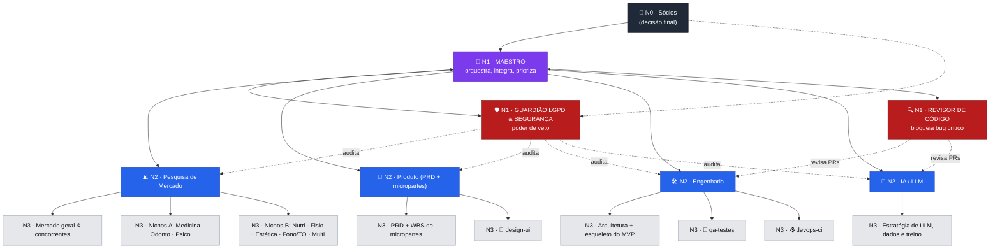

# Hierarquia dos agentes ("A Orquestra")

> O projeto funciona como uma orquestra: os **sócios** são os donos da obra,
> o **Maestro** rege, os **líderes de naipe** comandam cada frente,
> os **músicos** (executores) tocam as micropartes, e o **Guardião LGPD**
> é o "fiscal de segurança" que pode parar a música a qualquer momento.

## Níveis

| Nível | Papel | Quem | Pode | Não pode |
|---|---|---|---|---|
| **N0 — Donos** | Sócios | Humanos (Matheus + sócio) | Decisão final, aprovar merge na `main`, definir prioridades e orçamento | — |
| **N1 — Regente** | 🎼 **Maestro** | Agente líder / orquestrador | Quebrar o trabalho em micropartes, distribuir tarefas, integrar resultados, resolver conflitos entre frentes | Fazer merge na `main` sem aprovação humana; ignorar veto do Guardião |
| **N1 — Transversal** | 🛡️ **Guardião LGPD & Segurança** | Agente de compliance | **Vetar** qualquer entrega (doc, código, dataset, prompt de IA) que viole LGPD/segurança; exigir correções | Escrever features; aprovar o próprio trabalho |
| **N1 — Transversal** | 🔍 **Revisor de código** | Agente de qualidade | Bloquear merge com bug crítico; exigir evidência de testes | Revisar LGPD a fundo (é do Guardião); escrever features |
| **N2 — Líderes de frente** | 📊 Pesquisa de Mercado · 🧩 Produto · 🛠️ Engenharia · 🤖 IA/LLM | Subagentes | Planejar e executar sua frente, criar sub-tarefas para executores | Mudar escopo de outra frente sem passar pelo Maestro |
| **N3 — Executores** | Pesquisadores por nicho, devs por módulo, etc. | Subagentes efêmeros | Executar UMA microparte bem definida | Tomar decisões de arquitetura/escopo |

## Organograma

## Regras de ouro

1. **Cadeia de comando:** executor → líder de frente → Maestro → sócios. Ninguém pula nível.
2. **Veto do Guardião é absoluto:** só os sócios (N0) podem derrubar um veto, e por escrito no PR.
3. **Uma microparte = um dono.** Cada tarefa tem exatamente um agente executor responsável.
4. **Trabalho paralelo, integração serial:** frentes rodam ao mesmo tempo; só o Maestro integra.
5. **Nada de dado real de paciente** em repositório, prompt, log ou dataset de treino sem anonimização aprovada pelo Guardião.
6. **Tudo vira arquivo no git.** Conversa não é entrega; entrega é commit revisado.
