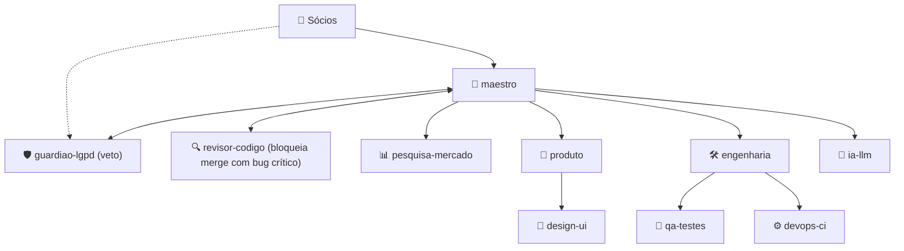
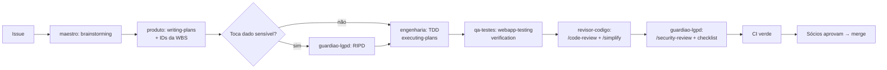

# Skills, agentes e automação — guia para os sócios

> Objetivo: qualquer um dos sócios abre o Claude Code neste repositório e sabe **quais ferramentas existem,
> qual agente chamar para cada tarefa e como automatizar CI e features**.
> Inventário feito em 08/10/2026 a partir da sessão do Matheus (Claude Code no app desktop).

---

## Parte 1 — Como usar

| Onde | Como chamar uma skill | Como chamar um agente |
|---|---|---|
| Claude Code (terminal, desktop, VS Code) | Digite `/nome-da-skill` ou peça em linguagem natural ("faça um code review") | Peça "use o agente `engenharia` para…" ou deixe o Claude escolher |
| Agentes do projeto | Ficam em `.claude/agents/*.md` e são carregados automaticamente ao abrir o repo | — |

**Importante — nem todo mundo tem as mesmas skills.** Há 4 origens:

| Origem | O que é | Como o sócio obtém |
|---|---|---|
| 🟢 **Nativas do Claude Code** | Vêm com o Claude Code | Já tem, basta instalar o Claude Code |
| 🔵 **anthropic-skills** | Skills da conta Claude (claude.ai) | Ativar em claude.ai → Settings → Capabilities/Skills |
| 🟣 **Plugins** (`frontend-design`, `apify`) | Plugins instalados | `/plugin` no Claude Code, ou catálogo de plugins |
| 🟠 **App desktop / Artifacts** | Só no app desktop / claude.ai | Usar o app Claude desktop (aba Code) |

---

## Parte 2 — Inventário completo de skills, por área

### 2.1 Engenharia e qualidade de código

| Skill | Origem | Para que serve neste projeto |
|---|---|---|
| `code-review` | 🟢 | Revisão de bugs do diff/PR. `--comment` posta no PR, `--fix` aplica. Níveis low→max; `ultra` = revisão multi-agente na nuvem (cobrada) |
| `simplify` | 🟢 | Limpeza: reuso, simplificação, eficiência (não caça bug) |
| `security-review` | 🟢 | Revisão de segurança das mudanças da branch — **rodar em todo PR que toca dado de paciente** |
| `init` | 🟢 | Gera/atualiza `CLAUDE.md` com a documentação do código |
| `run` | 🟢 | Sobe o app e verifica a mudança funcionando de verdade |
| `claude-api` / `llm-api-reference` | 🟢/🔵 | Referência de API de LLM, modelos, preços, cache, tool use — usar na frente de IA |
| `test-driven-development` | 🔵 | Escrever o teste antes do código |
| `systematic-debugging` | 🔵 | Processo de debug antes de propor correção |
| `verification-before-completion` | 🔵 | Exige rodar testes/comandos antes de dizer "pronto" |
| `receiving-code-review` | 🔵 | Como avaliar feedback de review com rigor (sem aceitar cegamente) |
| `webapp-testing` | 🔵 | Testes de interface com Playwright, screenshots, logs do navegador |
| `mcp-builder` | 🔵 | Criar servidores MCP (ex.: expor nossa API para agentes) |
| `changelog-generator` | 🔵 | Gera changelog para clientes a partir dos commits |

### 2.2 Planejamento e execução de features

| Skill | Origem | Uso |
|---|---|---|
| `brainstorming` | 🔵 | **Obrigatória antes de qualquer feature nova**: explora intenção, requisitos e design |
| `writing-plans` | 🔵 | Transforma requisito em plano de implementação passo a passo |
| `executing-plans` | 🔵 | Executa o plano com checkpoints |
| `doc-coauthoring` | 🔵 | Escrever specs, propostas e documentos de decisão em conjunto |
| `deep-research` | 🔵 | Pesquisa multi-fonte com relatório (usada na pesquisa de mercado) |
| `content-research-writer` | 🔵 | Textos com pesquisa e citações (blog, landing page) |

### 2.3 Design e frontend

| Skill | Origem | Uso |
|---|---|---|
| `frontend-design` | 🟣 | Direção visual própria, evita cara de "template" |
| `shadcn` | 🔵 | Componentes shadcn/ui (nossa stack de UI) |
| `web-artifacts-builder` | 🔵 | Protótipos React + Tailwind + shadcn como artifact |
| `web-asset-generator` | 🔵 | Favicons, ícones PWA, imagens Open Graph |
| `theme-factory` | 🔵 | Temas de cor/fonte para páginas e apresentações |
| `canvas-design`, `algorithmic-art` | 🔵 | Peças visuais estáticas / arte generativa |
| `artifact-design`, `artifact-diagramming`, `artifact-capabilities` | 🟠 | Páginas publicáveis (dashboards, fluxogramas interativos) |
| `dataviz`, `d3-viz` | 🔵 | Gráficos e dashboards (relatórios/BI do produto) |

### 2.4 Documentos, apresentações e planilhas

| Skill | Origem | Uso |
|---|---|---|
| `docs` | 🔵 | Documentos colaborativos (exporta Word/PDF/Google Docs) |
| `docx`, `pdf`, `pptx`, `xlsx` | 🔵 | Arquivos Office/PDF (contratos, DPA, planilha financeira, pitch) |
| `frontend-slides` | 🔵 | Apresentações HTML animadas (pitch para investidor) |
| `google-workspace` | 🔵 | Editar Docs/Sheets/Slides no Google Drive |
| `internal-comms` | 🔵 | Status report, atualização para sócios/investidores |

### 2.5 Negócio, vendas e marketing

| Skill | Origem | Uso |
|---|---|---|
| `lead-research-assistant` | 🔵 | Encontrar clínicas-alvo e estratégia de contato |
| `competitive-ads-extractor` | 🔵 | Analisar anúncios de concorrentes (iClinic, Feegow…) |
| `domain-name-brainstormer` | 🔵 | Nome do produto + domínios disponíveis |
| `apify-ultimate-scraper` | 🟣 | Raspagem pública (Google Maps de clínicas, reviews) — **atenção LGPD: só dados públicos de empresas, nunca de pacientes** |
| `apify-*` (actor-development, sdk-integration…) | 🟣 | Criar/integrar robôs de coleta |
| `twitter-algorithm-optimizer` | 🔵 | Posts para redes sociais |
| `meeting-insights-analyzer` | 🔵 | Analisar transcrições de entrevistas com clínicas (discovery) |
| `invoice-organizer` | 🔵 | Organizar notas fiscais da empresa |

### 2.6 Automação, agendamento e ambiente

| Skill | Origem | Uso |
|---|---|---|
| `schedule` (nuvem) | 🟢 | Agentes recorrentes na nuvem (cron) — ex.: auditoria semanal de dependências |
| `schedule` (local) / `loop` | 🔵/🟢 | Tarefas recorrentes locais / repetir um comando em intervalo |
| `update-config` | 🟢 | Hooks e permissões no `settings.json` (ex.: rodar lint após cada edição) |
| `fewer-permission-prompts` | 🟢 | Cria allowlist de comandos seguros para menos confirmações |
| `plugin-authoring` | 🟢 | Criar plugins/hooks próprios do Claude Code |
| `skill-creator`, `writing-skills` | 🔵 | **Criar skills do próprio projeto** (ex.: "gerar módulo NestJS com RLS") |
| `keybindings-help` | 🟢 | Atalhos de teclado |
| `built-in-browser`, `chrome-browser`, `computer-use` | 🟠 | Navegador e controle do computador pelo Claude |
| `consolidate-memory`, `import-memory` | 🔵 | Memória persistente do Claude |
| `explain-usage` | 🔵 | Onde os tokens/uso foram gastos |

### 2.7 Outras (pouco relevantes aqui)
`file-organizer`, `image-enhancer`, `raffle-winner-picker`, `slack-gif-creator`, `tailored-resume-generator`, `brand-guidelines` (marca Anthropic — não usar no nosso produto), `caveman` (respostas curtas), `academy-guide`, `setup-claude`, `morning`, `discernment-nudge`.

---

## Parte 3 — Agentes do projeto e quais skills cada um usa

| Agente | Nível | Skills principais |
|---|---|---|
| `maestro` | N1 | brainstorming, writing-plans, executing-plans, internal-comms |
| `guardiao-lgpd` | N1 (veto) | security-review, code-review, doc-coauthoring |
| `revisor-codigo` 🆕 | N1 transversal | code-review, simplify, receiving-code-review, verification-before-completion |
| `pesquisa-mercado` | N2 | deep-research, lead-research-assistant, competitive-ads-extractor, apify-ultimate-scraper |
| `produto` | N2 | brainstorming, doc-coauthoring, writing-plans, docs |
| `engenharia` | N2 | test-driven-development, systematic-debugging, run, mcp-builder |
| `ia-llm` | N2 | claude-api / llm-api-reference, deep-research |
| `design-ui` 🆕 | N3 (Produto) | frontend-design, shadcn, web-asset-generator, webapp-testing |
| `qa-testes` 🆕 | N3 (Engenharia) | test-driven-development, webapp-testing, verification-before-completion |
| `devops-ci` 🆕 | N3 (Engenharia) | update-config, schedule, security-review |

---

## Parte 4 — Pipeline automatizado de uma feature

**Prompt pronto para começar uma feature** (cole no Claude Code):
> Use o agente maestro. Feature: `<descrição>` (WBS: `<IDs>`). Siga o pipeline de `docs/00-governanca/skills-agentes-e-automacao.md` Parte 4: brainstorming → plano → TDD → QA → code-review → security-review → abrir PR com o checklist LGPD.

---

## Parte 5 — Dicas para acelerar CI

1. **Só testar o que mudou:** `turbo run test --filter=...[origin/main]` — em monorepo corta o tempo drasticamente.
2. **Cache:** `actions/setup-node` com `cache: pnpm` + **Turborepo Remote Cache** (Vercel ou self-hosted) — builds repetidos viram segundos.
3. **Jobs em paralelo:** lint, typecheck, test e gitleaks em jobs separados (matrix), não em sequência.
4. **Branch protection na `main`:** exigir CI verde + 1 aprovação de sócio + conversa resolvida; proibir push direto. *(Hoje os commits vão direto na main por pedido dos sócios — ligar isso quando o código começar.)*
5. **Segurança automática:** gitleaks (já existe), **CodeQL**, **Dependabot** (adicionado neste commit), `pnpm audit` com falha em severidade alta.
6. **Teste de RLS obrigatório:** job com Postgres efêmero (service container) que tenta ler dado de outro tenant e **precisa falhar**. É o teste mais importante do produto.
7. **Preview por PR:** deploy efêmero (Vercel/Render) com dados **sintéticos** para os sócios testarem antes do merge.
8. **Review por IA no PR:** GitHub Action oficial `anthropics/claude-code-action` — comentar `@claude revise com foco em LGPD` no PR; ou rodar `/code-review --comment` localmente.
9. **Releases automáticas:** Conventional Commits (já usamos) + `release-please` ou `changesets` para gerar versão e changelog (`changelog-generator` para a versão voltada ao cliente).
10. **Agentes agendados (`/schedule`):** auditoria semanal de dependências, revisão mensal de normas (ANPD/CFM/ANS) pelo `guardiao-lgpd`, atualização trimestral de preços de concorrentes pelo `pesquisa-mercado`.

## Parte 6 — Dicas para fatorar e acelerar features

1. **Feature flags desde o MVP** (NUC na WBS): liberar por clínica/nicho sem novo deploy.
2. **Módulos por nicho como plugins do prontuário:** núcleo comum (paciente, agenda, sessão, cobrança) + extensões (odontograma, antropometria, ABA). Um nicho novo = um pacote, não um fork.
3. **Construtor de formulários dirigido por schema (JSON Schema):** novas especialidades viram configuração, não código.
4. **Skills do projeto:** usar `skill-creator` para criar skills como "novo módulo NestJS com RLS + auditoria + testes", "novo template de prontuário", "novo importador de concorrente". Cada uma economiza horas e garante o padrão LGPD.
5. **Hooks do Claude Code** (`update-config`): rodar lint/format e gitleaks automaticamente após cada edição do agente.
6. **Contratos tipados compartilhados** em `packages/shared` (zod) entre API, web e bot de WhatsApp.
7. **Dados sintéticos versionados** (gerador de pacientes fictícios) para testes, demos e evals de IA — nunca dados reais.
8. **Eventos de domínio** (agendamento criado, atendimento finalizado) via fila: WhatsApp, NPS, NFS-e e IA ficam desacoplados e podem ser construídos em paralelo por agentes diferentes.
9. **Um agente por branch, em paralelo:** cada microparte da WBS em `<frente>/<ID>` com worktree isolado (`isolation: worktree`) — evita conflitos entre agentes.
10. **Definição de pronto única:** critério da WBS + testes + checklist LGPD + review. Sem isso, não abre PR.
