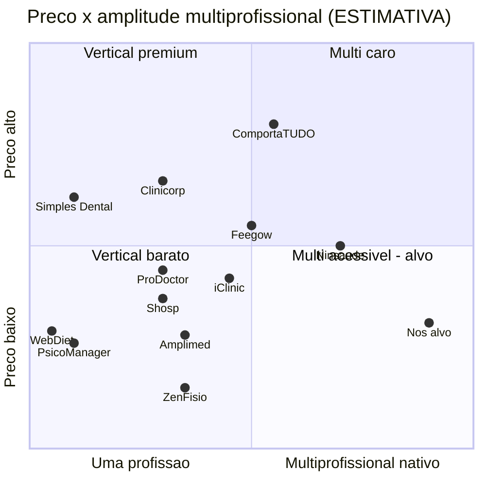

# Relatório Executivo de Mercado — Rodada 1 (consolidação)

> Frente: Pesquisa de Mercado (N2) · Data: **08/10/2026** · Destinatários: sócios (N0) e Maestro (N1)
> Base: consolidação de [`mercado-geral-e-concorrentes.md`](mercado-geral-e-concorrentes.md) e dos 8 arquivos de [`nichos/`](nichos/), que cobrem 11 segmentos (medicina, odontologia, psicologia/saúde mental, nutrição, fisioterapia, terapia ocupacional, fonoaudiologia, clínicas TEA/ABA, clínicas multiprofissionais, clínicas populares e estética). **Nenhuma pesquisa web nova foi feita para este relatório.** As URLs e datas de acesso de cada número estão nos arquivos de origem (acessos entre 06/10/2026 e 08/10/2026).
>
> **Convenções**
> - **[FATO]**: número publicado por fonte identificada. Indica-se o arquivo de origem, onde estão a URL e a data.
> - **[FATO-snippet]**: número visto no resumo do buscador, sem abrir a página. Precisa ser revalidado antes de ir para um investidor.
> - **[ESTIMATIVA]**: cálculo ou julgamento nosso, com a premissa explícita.
> - Abreviações de arquivo: **MG** = `mercado-geral-e-concorrentes.md`; **N-xxx** = `nichos/xxx.md`.

---

## 1. Sumário executivo

**Conclusões**

1. **É um mercado de troca de sistema, não de primeira adoção.** Segundo a TIC Saúde 2024/2025 (MG §1.4), 92% dos estabelecimentos já usam sistema eletrônico [FATO]. Para crescer, precisamos tirar clientes de concorrentes. Por isso migração assistida, exportação total dos dados e contrato sem pegadinha valem mais que funcionalidades.
2. **O mercado é grande, mas o recorte que conseguimos atender no início é bem menor.** O TAM de software de gestão por profissional fica entre **R$ 0,6 e 2,0 bi/ano** [ESTIMATIVA, MG §1.5]. O SAM das terapias de sessão recorrente (psico, fisio/TO, fono) fica entre **R$ 0,18 e 0,82 bi/ano** [ESTIMATIVA, §2]. A meta realista em 3 anos (SOM) é de **R$ 2 a 20 mi de receita recorrente anual (ARR)**, com R$ 6 mi no cenário base [ESTIMATIVA].
3. **Os líderes foram comprados por grandes grupos, o que abre espaço para um novo entrante.** Afya comprou o iClinic, Docplanner comprou o Feegow, RD Saúde comprou a Amplimed e Conexa comprou o Zenklub (MG §2.2). Desde então, as reclamações públicas se concentram em cancelamento, bloqueio de prontuário, cobranças extras e suporte lento. iClinic tem nota 6,4 no Reclame Aqui e 17,96% das reclamações da Doctoralia são de "não consegue cancelar" [FATO-snippet, MG §2.1].
4. **Nenhum concorrente é forte em todos os nichos.** Odonto, psico, nutri e fisio têm líderes verticais. Os sistemas "médicos" atendem as demais profissões de forma genérica (MG §2.2). Atender várias profissões é um diferencial real, mas sozinho não basta para vender.
5. **A IA de transcrição e resumo já é oferecida por quase todos (iClinic, Doctoralia, Amplimed, PsicoManager, ZenFisio, Vedius e outros).** A diferenciação vem da IA **por nicho e com lastro nos dados registrados**: relatório para operadora que só cita o que foi registrado e conformidade com a Res. CFM 2.454/2026 (MG §2.2, N-fono §7).
6. **A contradição entre as duas pesquisas é aparente e se resolve pela ordem de entrada.** A matriz ponderada (§4) coloca **Fisio/TO em 1º lugar em 3 de 6 cenários de pesos** e sempre entre os 2 primeiros. **TEA/ABA** tem o maior ARPA e a maior dor, mas depende de TISS e controle de carga horária, que no roadmap só chegam na Fase 2. Quando a complexidade de construção deixa de pesar, TEA/ABA passa ao 1º lugar. **Psicologia** lidera só quando o critério dominante é velocidade de MVP. Medicina, odonto, nutrição e estética ficam nas 4 últimas posições em todos os cenários.
7. **As três recomendações compartilham o mesmo núcleo do produto:** sessões recorrentes, pacotes com saldo, plano terapêutico, guia com saldo de sessões, assinatura do paciente por sessão e repasse por sessão. Esse núcleo serve a psico, fisio, TO, fono e TEA (N-fisio §4, N-fono §4, N-psico §4).

**Recomendação**

> **Primeiro nicho (beachhead): clínicas de fisioterapia e terapia ocupacional com 2 a 10 profissionais, atendimento particular ou misto.** O canal de autoatendimento para psicólogos autônomos roda em paralelo, sobre o mesmo núcleo, para trazer volume. A **onda 2 é TEA/ABA** (clínicas multidisciplinares), assim que o TISS SP/SADT e o controle de carga horária estiverem prontos (F2.1). Já no MVP, recrutar de 3 a 5 clínicas TEA como parceiras de design. Medicina, odontologia, nutrição e estética ficam para depois, porque exigem módulos próprios caros e enfrentam concorrentes consolidados.
>
> **Impacto no MVP:** antecipar para o MVP o controle de guia (saldo de sessões autorizadas, validade e assinatura do paciente por sessão), **sem o lote XML TISS**. Garantir agenda com vários pacientes no mesmo horário e repasse por sessão. Manter o escriba de IA restrito a evolução SOAP de fisio e psico.

---

## 2. Tamanho de mercado (TAM / SAM / SOM)

### 2.1 Bases factuais

| Base | Valor | Tipo | Origem |
|---|---|---|---|
| Médicos | 635.706 (projeção para o fim de 2025) | FATO | MG §1.1; N-medicina §1 |
| Dentistas | > 402 mil (CFO); > 450 mil (fonte secundária) | FATO-snippet / ESTIMATIVA | MG §1.1; N-odonto §1 |
| Psicólogos | ~437 mil (CFP, 2025) e "mais de 600 mil" (CFP, campanha de 2026). **As duas fontes divergem** | FATO-snippet / FATO | MG §1.1; N-psico §1 |
| Nutricionistas | 194.018 (fev/2024); 227.274 (1º tri/2025) | FATO / FATO-snippet | N-nutri §1; MG §1.1 |
| Fisioterapeutas | > 240 mil; o sistema COFFITO informa ~480 mil fisio + TO somados | FATO-snippet / FATO | MG §1.1; N-fisio §1 |
| Terapeutas ocupacionais | ~17.500 | **Não verificado** | N-fisio §1 |
| Fonoaudiólogos | 61.054 (ago/2026) | FATO | N-fono §1 |
| Biomédicos | 142 a 150 mil | FATO-snippet / Não verificado | MG §1.1; N-estética §1 |
| Estabelecimentos com sistema eletrônico | 92% | FATO | MG §1.4 |
| Preço dos concorrentes (entrada/intermediário) | R$ 89–170 por profissional/mês | FATO (preços públicos) | MG §2.2 |
| Custo das operadoras com terapias TEA/TGD | R$ 3,8 bi (2023); 9,13% dos custos médicos | FATO (Abramge, via imprensa) | N-fono §1 |
| ARPA de software ABA | R$ 59,90–99,90 por paciente/mês, mínimo de 10 pacientes (ComportaTUDO) | FATO | N-fono §6 |

### 2.2 TAM: todo o software de gestão por profissional [ESTIMATIVA]

- **Premissas:** base de ~2,19 mi profissionais com perfil de consultório: médicos, dentistas, psicólogos (437 mil), nutricionistas, fisios, fonos e biomédicos (MG §1.1). Ticket de R$ 90 a 150 e penetração paga de 25% a 50%.
- **Resultado:** cenário conservador **R$ 0,59 bi**, base **R$ 1,26 bi** e otimista **R$ 1,97 bi** por ano (MG §1.5).
- **Sensibilidade:** com 600 mil psicólogos, a base sobe para ~2,35 mi e o cenário otimista para ~R$ 2,1 bi/ano. O cálculo **não inclui** receita de pagamentos, WhatsApp, IA nem a cobrança por paciente das clínicas TEA.

### 2.3 SAM: terapias de sessão recorrente atendíveis pelo núcleo do MVP em 24 meses [ESTIMATIVA]

**Recorte:** psicólogos, fisioterapeutas, TOs e fonos. Profissionais de clínicas TEA já estão nessa base e não são contados de novo. Nutrição entra só no cenário otimista, porque exige motor de dieta (N-nutri §4).

| Cenário | Base de profissionais | Penetração paga | Ticket/mês | **SAM anual** |
|---|---|---|---|---|
| Conservador | 755,5 mil (psico 437 mil + fisio 240 mil + TO 17,5 mil + fono 61 mil) | 25% | R$ 80 | **≈ R$ 181 mi** |
| Base | 755,5 mil | 40% | R$ 100 | **≈ R$ 363 mi** |
| Otimista | 1,146 mi (psico 600 mil + nutri 227 mil + os demais) | 50% | R$ 120 | **≈ R$ 825 mi** |

**Ganho adicional não somado ao SAM:** na precificação por paciente, uma clínica TEA com 100 pacientes paga **R$ 6 a 10 mil/mês** (N-fono §6, inferência sobre os preços do ComportaTUDO). Isso equivale a 50–100 vezes o ARPA de um psicólogo autônomo. O número de clínicas TEA **não tem fonte** (lacuna L1), por isso esse ganho não foi somado.

### 2.4 SOM: meta para o 3º ano após o lançamento (GA em jun/2027 → meados de 2030) [ESTIMATIVA, de baixo para cima]

| Cenário | Profissionais pagantes (fisio/psico/fono) | Ticket | Clínicas TEA | Ticket por clínica TEA | **ARR** | % do SAM |
|---|---|---|---|---|---|---|
| Conservador | 1.200 | R$ 95 | 15 | R$ 3 mil/mês | **≈ R$ 1,9 mi** | 1,1% |
| Base | 3.000 | R$ 110 | 40 | R$ 5 mil/mês | **≈ R$ 6,4 mi** | 1,8% |
| Otimista | 8.000 | R$ 120 | 120 | R$ 6 mil/mês | **≈ R$ 20 mi** | 2,4% |

**Referências de plausibilidade:**
- PsicoManager declara mais de 40 mil psicólogos em ~10 anos, cerca de 7–9% da categoria [FATO autodeclarado, MG §2.1].
- Amplimed tinha 20 mil profissionais quando foi comprada [FATO, MG §2.1].
- O roadmap prevê 30 clínicas piloto no GA (`docs/02-produto/roadmap.md`).

O SOM base pressupõe ~250 novos profissionais pagantes por trimestre depois do GA e **precisa ser validado nas entrevistas** (H5 e H6 do §6).

---

## 3. Panorama competitivo

### 3.1 Mapa de posicionamento

| Concorrente (grupo) | Foco | Preço típico por prof./mês | Amplitude multiprofissional | Fraqueza explorável | Origem |
|---|---|---|---|---|---|
| iClinic (Afya) | Médico multiespecialidade | R$ 99–299; WhatsApp e tele cobrados à parte | Média: atende outras profissões de forma genérica | Reclame Aqui 6,4; bloqueio de prontuário; financeiro só a partir do plano Pro | MG §2.1 [FATO] |
| Feegow (Docplanner) | Clínicas médicas e populares | Não público | Média | Recursos vendidos e não entregues (relato de jul/2026) | MG §2.1; N-multi §6 |
| Amplimed (RD Saúde) | Médico | R$ 89–139 (fonte de concorrente) | Baixa a média | Suporte pós-venda lento | MG §2.1; N-medicina §6 |
| ProDoctor | Médico/convênio | A partir de R$ 135–215 | Baixa | Legado desktop; módulos extras caros | MG §2.1 |
| Shosp | Médico/popular | R$ 0–229 | Baixa | Escala pequena (5 mil profissionais) | MG §2.1 |
| Ninsaúde | Clínicas e franquias, inclusive ABA | Não público (R$ 199 individual, segundo terceiros) | Alta | Venda consultiva, sem preço público | MG §2.1; N-medicina §6 |
| Clinicorp | Odonto + estética | R$ 160–370 + implantação obrigatória | Baixa | Taxa de implantação; preço alto | MG §2.1 [FATO] |
| Simples Dental | Odonto | R$ 150–350 (comparador) | Muito baixa | Só odontologia | N-odonto §6 |
| PsicoManager | Psicologia | R$ 89–119 | Muito baixa | IA e WhatsApp limitados no plano base | MG §2.1 [FATO] |
| WebDiet / Dietbox | Nutrição | R$ 92–140 | Muito baixa | Pix só em planos longos (WebDiet) | N-nutri §6 |
| ZenFisio | Fisio/TO/pilates/estética | R$ 79 (1 prof.) a R$ 439 (20 prof.) + extras | Média | Extras cobrados à parte (financeiro, assinatura) | N-fisio §6 [FATO] |
| Vedius / Kynesia / Fisioly | Fisio | R$ 0–150 | Baixa | Pequenos; IA por voz já virou padrão | N-fisio §6 (fonte de fornecedor) |
| ComportaTUDO / BlueSmiles / AkivaTEA | ABA/TEA | R$ 60–100 **por paciente** | Média: só a clínica TEA | Jovens e pequenos; sem líder nacional | N-fono §6 |
| Voa Health (Prosus) | Escriba de IA | ~R$ 289–349 (fonte de terceiro) | Alta, mas só cobre a IA | Ferramenta avulsa, não é sistema de gestão | MG §2.1; N-medicina §6 |
| **Nós (alvo)** | Terapias de sessão recorrente, depois todas | R$ 99–149 com tudo incluído | **Alta, por desenho** | — | [ESTIMATIVA] |

### 3.2 Quadrante: preço × amplitude multiprofissional [ESTIMATIVA de posicionamento]

Eixo Y: preço típico por profissional/mês, normalizado (R$ 0 = 0; R$ 400 = 1). Eixo X: amplitude multiprofissional por julgamento nosso (0 = uma profissão; 1 = todas, com módulos nativos). Quando não há preço público, o ponto é estimado.

**Leitura:** o quadrante "multiprofissional acessível" (inferior direito) está **vazio**. Ninsaúde é o mais amplo, mas não divulga preço e vende de forma consultiva. ComportaTUDO é amplo só dentro da clínica TEA e caro por profissional, já que cobra por paciente.

### 3.3 Consolidação do setor

- **Compras:** Afya → iClinic (título da matéria: R$ 182,7 mi; ano não confirmado). Docplanner → Feegow (22/07/2022). RD Saúde → Amplimed (dez/2021). Conexa → Zenklub [FATO, MG §2.2].
- **Investimentos:** Amigo (gestão de clínicas) captou US$ 33 mi em Série B. A Voa Health recebeu aporte da Prosus. Gestão/PEP é a maior vertical de healthtech, com 25% a 31% das empresas [FATO-snippet, MG §1.4].
- **Implicações:**
  - **Há compradores ativos.** Uma saída por venda (M&A) é plausível em 5 a 7 anos.
  - **Os líderes viraram partes de ecossistemas maiores** (educação médica, farmácia, marketplace). Isso tende a deixar produto e suporte de nicho em segundo plano, o que é bom para nós.
  - **Concorrer em medicina significa enfrentar o ecossistema da Afya**, que tem 265 mil médicos com pelo menos uma solução [FATO-snippet]. Isso pesa contra entrar por medicina.

### 3.4 Fraquezas exploráveis

1. **Contrato e confiança:** cancelamento difícil, fidelidade, bloqueio de prontuário por inadimplência e cobrança após downgrade (MG §2.1). **Nossa resposta:** cancelamento em 1 clique, leitura do prontuário garantida mesmo após cancelamento e exportação total.
2. **Cobranças extras:** WhatsApp, tele, assinatura e IA cobrados à parte (iClinic, ZenFisio, Clinicorp). Uma mensagem de utilidade no WhatsApp custa R$ 0,04–0,05 [FATO-snippet, MG §3]. Incluir tudo no preço sai barato para nós.
3. **Preço por profissional penaliza clínicas com muitos profissionais de meio período**, como clínicas populares e TEA (N-multi §6). **Alternativa:** preço por agenda ativa ou por paciente ativo.
4. **Sistemas genéricos não controlam horas prescritas, autorizadas e realizadas**, nem guias, coleta ABA e prova de execução (N-fono §6).
5. **Suporte lento:** o iClinic leva ~17 dias em média para responder no Reclame Aqui [FATO-snippet]. Suporte medido por SLA vira argumento de venda.
6. **Conformidade:** só 30% dos estabelecimentos têm DPO e 42% têm política de segurança [FATO, MG §3]. Receita Saúde e Res. CFM 2.454/2026 viram argumentos de venda.

---

## 4. Matriz de priorização de nichos

### 4.1 A contradição

| Pesquisa | O que recomenda | Lógica |
|---|---|---|
| Geral (MG §5, item 9) | Psico + nutri + fisio + clínicas multiprofissionais | Muitos profissionais, pouca exigência de TISS, ciclo de venda curto |
| Nichos (N-fono §1 e §6; decisão D1 em `docs/00-governanca/decisoes.md`) | TEA/ABA + fisio/TO | ARPA alto, dor aguda, concorrentes jovens e dinheiro vindo das operadoras |

As duas usam critérios implícitos diferentes: a geral privilegia tamanho e facilidade, a de nichos privilegia receita e dor. Para resolver, a matriz abaixo deixa os critérios explícitos.

### 4.2 Critérios e pesos (cenário base)

| # | Critério | Peso | Nota 5 significa |
|---|---|---|---|
| C1 | Tamanho (decisores e receita endereçável) | 15 | Base grande e documentada |
| C2 | Disposição a pagar / ARPA | 15 | Ticket alto por conta |
| C3 | Dor e urgência para trocar de sistema | 15 | Dor aguda, com custo financeiro visível |
| C4 | Intensidade competitiva (invertida) | 10 | Sem líder consolidado |
| C5 | Complexidade de construção (invertida) | 15 | Cabe no MVP atual (particular primeiro, TISS só na F2) |
| C6 | Risco regulatório e reputacional (invertido) | 10 | Risco baixo |
| C7 | Sinergia com o núcleo comum e as ondas seguintes | 10 | O que construímos serve aos próximos nichos |
| C8 | Canal de aquisição e ciclo de venda | 10 | Autoatendimento ou comunidade concentrada; ciclo curto |

### 4.3 Notas de 1 a 5 com justificativa

| Nicho | C1 | C2 | C3 | C4 | C5 | C6 | C7 | C8 | **Nota ponderada** |
|---|---|---|---|---|---|---|---|---|---|
| **Fisioterapia/TO (clínicas)** | 4 | 3 | 4 | 3 | 3 | 4 | 5 | 3 | **3,60** |
| **Psicologia (autônomo)** | 5 | 2 | 3 | 1 | 5 | 3 | 4 | 4 | **3,45** |
| **TEA/ABA (clínica multidisciplinar)** | 3 | 5 | 5 | 4 | 1 | 2 | 4 | 3 | **3,40** |
| Fonoaudiologia (autônomo) | 2 | 2 | 3 | 4 | 4 | 4 | 4 | 3 | 3,15 |
| Multiprofissional / popular independente | 3 | 3 | 4 | 3 | 2 | 2 | 5 | 2 | 3,00 |
| Medicina (consultório particular) | 5 | 4 | 3 | 1 | 2 | 2 | 3 | 2 | 2,90 |
| Odontologia | 5 | 4 | 3 | 1 | 1 | 4 | 2 | 2 | 2,85 |
| Estética | 3 | 4 | 3 | 2 | 2 | 2 | 2 | 3 | 2,70 |
| Nutrição | 4 | 2 | 2 | 2 | 2 | 4 | 2 | 4 | 2,70 |

**Justificativas** (todas as notas são ESTIMATIVA; as fontes estão nos arquivos indicados)

- **Fisio/TO**
  - C1: mais de 240 mil fisios; 92.829 recibos Receita Saúde emitidos só em jan/2025 (N-fisio §1).
  - C2: clínicas de 2 a 10 profissionais, mas o mercado é barato (R$ 0–180).
  - C3: guias com saldo de sessões, assinatura do paciente por sessão, pacotes e repasse.
  - C4: mercado fragmentado (ZenFisio, Vedius, Kynesia), sem líder dominante.
  - C5: agenda com vários pacientes no mesmo horário e controle de guias. O lote TISS XML pode ficar para a F2.1.
  - C6: risco baixo; não há resolução do COFFITO sobre IA.
  - C7: o núcleo construído aqui é o mesmo de TEA, psico e fono.
  - C8: CREFITOs e congressos, mas a venda é para clínica.
- **Psicologia**
  - C1: maior base não médica (437 a 600 mil).
  - C2: alta sensibilidade a preço (concorrentes entre R$ 39 e 119).
  - C3: a dor administrativa existe, mas já é bem atendida.
  - C4: mercado lotado, com PsicoManager e mais de 7 escribas de IA específicos (N-psico §6).
  - C5: produto simples e sem TISS.
  - C6: sigilo reforçado; a nota do CFP sobre IA (jul/2025) restringe o uso.
  - C8: autoatendimento e ciclo curto.
- **TEA/ABA**
  - C1: o número de clínicas é desconhecido (lacuna L1), mas o volume de dinheiro é grande (R$ 3,8 bi das operadoras).
  - C2: R$ 6 a 10 mil/mês por clínica de 100 pacientes.
  - C3: auditoria das operadoras, glosa e investigações de fraude no setor tornam a "prova de execução" vital (N-fono §3).
  - C4: concorrentes jovens, sem líder nacional.
  - C5: exige TISS, carga horária prescrita/autorizada/realizada, coleta ABA, supervisão e app da família. É o mais distante do MVP particular primeiro.
  - C6: dados de crianças, setor sob investigação policial e risco de mudança de diretrizes da ANS.
  - C7: é a clínica multiprofissional por excelência.
  - C8: comunidade concentrada, mas venda consultiva.
- **Fono:** base pequena (61 mil) e pouca concorrência específica. Na prática, entra junto com TEA.
- **Multi/popular:** as redes já têm sistema corporativo (Feegow atende AmorSaúde). A regulação de cartões de desconto está aberta na ANS desde abr/2026. Exige multiunidade e elegibilidade de cartões (N-multi §5 e §6).
- **Medicina:** maior ARPA entre os grandes nichos, mas concorrência consolidada (Afya, Docplanner, RD) e exigências pesadas: ICP-Brasil, SNCR, TISS e CFM 2.454/2026 (N-medicina §5 e §8).
- **Odontologia:** exige odontograma, orçamento, financiamento e GTO, um módulo próprio. Clinicorp tem mais de 32 mil clínicas e Simples Dental mais de 100 mil profissionais (N-odonto §6).
- **Estética:** ticket alto, mas insegurança jurídica sobre quem pode fazer cada procedimento, fotos são dado biométrico e exige controle de estoque por lote (N-estética §5 e §7).
- **Nutrição:** ARPA baixo, exige motor de dieta (TACO/TBCA) e app do paciente, e Dietbox e WebDiet estão bem estabelecidos. Nutricionistas não são obrigados ao Receita Saúde, o que tira esse argumento de venda (N-nutri §2 e §6).

### 4.4 Ranking final (cenário base)

1. **Fisio/TO — 3,60**
2. **Psicologia — 3,45**
3. **TEA/ABA — 3,40**
4. Fono — 3,15
5. Multi/popular — 3,00
6. Medicina — 2,90
7. Odonto — 2,85
8. Estética e Nutrição — 2,70 (empate)

Diferenças menores que ~0,15 estão dentro da margem de erro das notas. Por isso psico e TEA estão, na prática, empatados no cenário base.

### 4.5 Análise de sensibilidade

Pesos na ordem C1 a C8.

| Cenário de pesos | 1º | 2º | 3º | Últimos |
|---|---|---|---|---|
| Base (15/15/15/10/15/10/10/10) | Fisio/TO 3,60 | Psico 3,45 | TEA 3,40 | Nutri e Estética 2,70 |
| A — "Receita primeiro" (10/25/20/10/10/10/5/10) | **TEA 3,75** | Fisio/TO 3,50 | Psico 3,10 | Nutri 2,60 |
| B — "Velocidade de MVP" (15/10/10/10/25/10/5/15) | **Psico 3,70** | Fisio/TO 3,45 | Fono 3,25 | Odonto e Estética 2,60 |
| C — Pesos iguais (12,5 cada) | Fisio/TO 3,62 | TEA 3,38 | Psico 3,38 | Estética 2,62 |
| D — "Plataforma" (sinergia com peso 25) | Fisio/TO 3,85 | TEA 3,55 | Psico 3,45 | Estética 2,55 |
| E — Ignorar complexidade (C5 com peso 0) | **TEA 3,82** | Fisio/TO 3,72 | Multi 3,20 | Nutri e Estética 2,80 |
| F — Base, mas TEA com C5 = 3 (TISS e carga horária prontos na F2) | **TEA 3,70** | Fisio/TO 3,60 | Psico 3,45 | — |

**Leitura:**

- **Fisio/TO é o nicho mais robusto.** Fica em 1º lugar em 3 dos 6 cenários de pesos (base, C e D) e em 2º nos demais. É o único que nunca sai do pódio.
- **TEA/ABA lidera quando a complexidade de construção deixa de pesar** (cenários E e F) ou quando a receita é o critério dominante (cenário A). Ou seja, TEA é o melhor nicho assim que o produto tiver TISS e carga horária, mas não para o MVP de hoje.
- **Psicologia lidera apenas se a velocidade de MVP dominar** (cenário B). É ótima como canal de volume, fraca como fonte de receita.
- **Medicina, odonto, nutrição e estética nunca entram no top 3.** A recomendação de adiá-los é robusta.
- **Conclusão:** o ranking muda no topo conforme os pesos, mas sempre entre os mesmos três nichos, que compartilham o núcleo de sessões recorrentes. A contradição se resolve por **sequência**: Fisio/TO agora, com psico como canal paralelo, e TEA na onda 2.

---

## 5. Estratégia de entrada

### 5.1 Beachhead

**Clínicas de fisioterapia e TO com 2 a 10 profissionais, particulares ou mistas.** Subsegmentos priorizados: ortopedia/esportiva, pélvica, neuro adulto e pilates clínico. Concentrar a prospecção em SP, RJ e MG, onde se concentram os fisios (36% em SP, MG §1.1) e a emissão de Receita Saúde (N-fisio §1).

- **Proposta de valor:** "Sessões, pacotes e guias sob controle, sem planilha e sem pegadinha". Inclui:
  - agenda recorrente com vários pacientes por horário;
  - pacote com saldo;
  - guia com sessões autorizadas, realizadas e validade, com assinatura do paciente;
  - repasse por sessão;
  - Receita Saúde e NFS-e;
  - evolução SOAP por voz com revisão do profissional;
  - WhatsApp incluído no preço.
- **Preço [ESTIMATIVA]:** R$ 99–129 por profissional/mês com tudo incluído. Plano clínica a partir de R$ 249 para 3 profissionais. Esse valor fica acima do ZenFisio, por isso o diferencial precisa ser explícito: guias, repasse e WhatsApp sem cobrança extra.
- **Canal paralelo, psicólogo autônomo:** autoatendimento a menos de R$ 100/mês (N-psico §8) sobre o mesmo núcleo, para gerar volume, depoimentos e indicações dentro de clínicas multiprofissionais.

### 5.2 Ondas de expansão

| Onda | Quando [ESTIMATIVA] | Nichos | Gatilho de entrada | O que precisa existir |
|---|---|---|---|---|
| 0 — Pilotos | M2–M5 do MVP (até jun/2027) | 20 clínicas de fisio/TO + 10 psicólogos + **3–5 clínicas TEA como parceiras de design** | Gate LGPD do M1 | Núcleo, guia leve, repasse, escriba SOAP |
| 1 — Beachhead | GA (jun/2027) até +6 meses | Fisio/TO + psicologia | ≥ 30 clínicas piloto ativas (roadmap) | Itens do §5.3 |
| 2 — TEA/ABA e fono | F2.1, ~6–12 meses após o GA | Clínicas TEA multidisciplinares, fono e TO infantil | TISS SP/SADT pronto (CNV-02.2); carga horária e supervisão prontas | TISS, plano terapêutico com horas, check-in/out, relatório para operadora com lastro, trilha imutável, app da família; preço por paciente ativo |
| 3 — Multiprofissional | +12–18 meses | Clínicas multiprofissionais e populares independentes | Onda 2 com retenção mensal > 97% | Multiunidade, várias tabelas de preço, caixa por turno |
| 4 — Grandes verticais | +18–30 meses | Medicina particular (dermato, psiquiatria, clínica geral), depois odonto | ICP-Brasil, SNCR, módulo odonto | Templates médicos, SNCR, odontograma, orçamento/CRM |
| Fora do foco | — | Estética e nutrição | Revisar quando houver parceiro ou aquisição | Estoque por lote e motor de dieta |

### 5.3 Implicações para o MVP (comparado a `docs/02-produto/WBS-micropartes.md`)

1. **Manter no MVP** o que já está lá:
   - recorrência e pacotes (AGD-02.4, FIN-01.5);
   - plano de sessões (PRO-03.7);
   - regras e fechamento de repasse (FIN-03.1, FIN-03.2);
   - assinatura eletrônica do paciente (DOC-02.4).
2. **Antecipar para o MVP um "controle de guia leve", sem XML TISS:** número da guia, operadora, sessões autorizadas e saldo, validade, alerta de vencimento e assinatura do paciente por sessão realizada. Hoje as guias só aparecem na F2 (CNV-02.x). Sem esse controle, as clínicas mistas de fisio, que são a norma segundo N-fisio §2, não conseguem trocar de sistema.
3. **Garantir agenda com 1 profissional atendendo 2 a 4 pacientes no mesmo horário, com salas e aparelhos** (N-fisio §4). Se a WBS ainda não tiver isso, abrir uma microparte.
4. **Deixar o TISS SP/SADT (CNV-02.2) como primeiro item da F2.1.** Ele libera a onda 2 (TEA) e as clínicas de fisio com convênio pesado.
5. **Gate do escriba de IA (IA-05.3):** priorizar os golden sets de **fisio SOAP e psicologia**. Medicina e odonto podem esperar.
6. **Modelo de preço:** preparar a cobrança para três unidades (por profissional, por agenda ativa e por paciente ativo), para viabilizar TEA e clínicas multi sem refazer o sistema de cobrança (BIL-01.x).
7. **Migração:** criar importadores para os sistemas de origem dos pilotos, nesta ordem: ZenFisio, planilhas, PsicoManager, iClinic.

---

## 6. Riscos de mercado e hipóteses a validar

### 6.1 Riscos de mercado

| Risco | Probabilidade | Impacto | Mitigação |
|---|---|---|---|
| Custo de troca alto (92% já usam sistema) impede a migração | Alta | Alto | Migração assistida gratuita, importadores e exportação garantida |
| Preço do nicho fisio (R$ 0–180) pressiona o ARPA | Média | Médio | Valor em guias e repasse; monetizar com pagamentos (take rate) |
| Afya ou Docplanner reagem com preço ou incluindo extras sem custo | Média | Médio | Foco em nicho e reputação; eles se movem devagar fora da medicina |
| Setor TEA sob investigação de fraude contamina a marca | Média | Alto | Posicionar o produto como antifraude e prova de execução; aceitar só clínicas com due diligence mínima |
| Regulação ANS (diretrizes de horas para TEA; cartões de desconto) muda requisitos | Média | Médio | Modelo de produto configurável; acompanhar a ANS |
| IA vira commodity e perde valor de venda | Alta | Baixo | IA incluída no preço; diferencial é o lastro em dados e a conformidade |
| Base de profissionais superestimada (inscritos inativos) | Média | Médio | Usar números de Receita Saúde e CNES como base real (lacunas L2 e L3) |

### 6.2 As 10 hipóteses testáveis

Critério de validação: entrevistas com **≥ 15 clínicas de fisio/TO, ≥ 10 psicólogos e ≥ 6 clínicas TEA**.

| # | Hipótese | Validada se... | Criticidade |
|---|---|---|---|
| **H1** | Clínicas de fisio/TO pagam **R$ 99–129 por profissional** por um sistema com tudo incluído, mesmo com o ZenFisio custando menos | ≥ 50% aceitam a faixa no teste de preço (Van Westendorp simplificado) | **Crítica** |
| **H2** | **Controle de guia e saldo de sessões, sem TISS XML**, basta para clínicas mistas de fisio migrarem no MVP | ≥ 60% das clínicas mistas dizem que conseguiriam operar sem o lote XML por 6 meses (faturando no portal da operadora) | **Crítica** |
| **H3** | Clínicas TEA pagam **≥ R$ 60 por paciente/mês** e a "prova de execução" é a dor nº 1 | ≥ 4 de 6 clínicas TEA citam auditoria ou glosa como top 2 dores e aceitam a faixa | **Crítica** |
| H4 | O principal motivo para trocar de sistema é contrato e suporte, mais que funcionalidade | ≥ 50% citam cancelamento, suporte ou extras como motivo de insatisfação | Alta |
| H5 | Migração assistida reduz para menos de 2 semanas o tempo de decisão de troca | ≥ 50% dizem que a migração é a principal barreira | Alta |
| H6 | Psicólogos adotam por autoatendimento, sem demonstração, a menos de R$ 100/mês | Conversão do teste grátis para pago ≥ 15% em landing page de teste | Média |
| H7 | Repasse por sessão é feito em planilha na maioria das clínicas de 3 ou mais profissionais | ≥ 60% usam planilha ou fazem à mão | Média |
| H8 | O profissional aceita o escriba de IA se a revisão levar menos de 1 minuto por evolução | ≥ 60% usariam; ≥ 50% dos pacientes consentem (perguntar à clínica) | Média |
| H9 | Clínicas TEA usam 2 ou mais sistemas ou planilhas (gestão + ABA + faturamento) | ≥ 4 de 6 | Média |
| H10 | Pix e cobrança recorrente de pacotes reduzem inadimplência e são valorizados o suficiente para justificar take rate | ≥ 40% aceitam receber pelo nosso gateway | Média |

**As três mais críticas:**
- **H2** decide se o MVP particular primeiro serve ao beachhead.
- **H1** decide a viabilidade do ARPA.
- **H3** decide se a onda 2 justifica o investimento em TISS.

### 6.3 Roteiro curto de entrevista (30 minutos, com dono ou gestor da clínica)

> Antes de começar: pedir consentimento para gravar e anotar. **Não coletar nenhum dado de paciente.** Registrar só porte, nicho, cidade e a resposta em `docs/01-mercado/entrevistas/` (anonimizado).

1. Quantos profissionais atendem na clínica, em que regime (CLT, PJ, sócio), e quantas sessões vocês fazem por semana?
2. Que sistema(s) e planilhas vocês usam hoje? Quanto pagam por mês no total, incluindo extras como WhatsApp, assinatura e IA? *(H4, H9)*
3. Contem a última vez que pensaram em trocar de sistema. O que motivou, e o que impediu? *(H4, H5)*
4. Qual a proporção de atendimentos particular, convênio e liminar ou reembolso? Como controlam as guias, sessões autorizadas e vencimentos hoje? *(H2)*
5. Se o sistema controlasse guia, saldo e assinatura do paciente, mas o faturamento XML continuasse no portal da operadora por alguns meses, isso atenderia vocês? *(H2)*
6. Como calculam e pagam o repasse de cada profissional? Quanto tempo leva o fechamento do mês? *(H7)*
7. *(Somente TEA)* Como provam para a operadora que a sessão aconteceu? Já tiveram glosa ou corte de horas em auditoria? Quanto isso custou? *(H3, H9)*
8. Quanto tempo cada profissional gasta escrevendo evoluções e relatórios? Usariam um rascunho por IA que precisa ser revisado? Os pacientes ou famílias aceitariam? *(H8)*
9. Como os pacientes pagam (Pix, cartão, pacote, mensalidade)? Qual a inadimplência? *(H10)*
10. Teste de preço: acima de que valor por profissional/mês esse sistema seria caro demais? E barato demais a ponto de desconfiar? *(TEA: por paciente ativo.)* *(H1, H3)*

---

## 7. Lacunas de dados ainda abertas

| # | Lacuna | Por que importa | Como fechar | Origem |
|---|---|---|---|---|
| L1 | **Número de clínicas TEA/ABA** no Brasil | Dimensiona a onda 2 e o ganho por paciente | Associações (ABRA, ABPMC), diretórios das operadoras, CNES por CNAE e serviço, scraping de Google Maps | N-fono §1 |
| L2 | **Total do CNES** de consultórios isolados e clínicas por tipo; número de clínicas de fisio (CNAE 8650-0/04) | Muda o SAM de "profissional" para "conta" | Tabular no TabNet/CNES | MG §1.2; N-fisio §1 |
| L3 | **Base ativa real de profissionais**: TO (17,5 mil não verificado); psicólogos (437 mil × 600 mil); fisio (240 mil × 480 mil fisio + TO) | Variação de ±20% no TAM e no SAM | COFFITO e CFP (fontes primárias); usar recibos Receita Saúde como proxy de atividade | MG §1.1; N-psico §1; N-fisio §1 |
| L4 | Tamanho do mercado de software de gestão de clínicas em R$ (último dado é de 2013) | Valida o TAM de cima para baixo | Distrito Healthtech Report, Liga Insights | MG §7 |
| L5 | Preços de Feegow, Doctoralia, Simples Dental (oficial), Amplimed, Ninsaúde, Dietbox, BlueSmiles e AkivaTEA | Precisão do mapa de posicionamento | Cliente oculto / demonstração | MG §7; N-fono §6 |
| L6 | Participação de mercado real dos concorrentes de fisio (ZenFisio etc.) | Intensidade competitiva do beachhead | Entrevistas (pergunta 2) | N-fisio §6 |
| L7 | Proporção de convênio e particular por nicho (fisio, psico, odonto, medicina) | Define quando o TISS se torna obrigatório | Entrevistas (pergunta 4) | N-fisio §2; N-medicina; N-odonto |
| L8 | Notas no Reclame Aqui de Feegow, Amplimed, Simples Dental e PsicoManager | Argumento de reputação | Coleta manual (o site bloqueia acesso automatizado) | MG §7 |
| L9 | Texto integral de Res. CFM 2.454/2026, COFFITO 619/2025 e CFO 278/2025, e enquadramento jurídico das assinaturas próprias das clínicas | Requisitos de IA, telessaúde e assinatura | Jurídico + guardião LGPD | N-medicina; N-fisio §5; N-multi §5 |
| L10 | Revalidar todos os itens [FATO-snippet] na fonte primária | Necessário antes de qualquer pitch | Abrir cada URL | MG §7 |

---

*Documento de consolidação. Os números são reproduzidos dos arquivos de origem; os cálculos novos (SAM, SOM, matriz e sensibilidade) estão marcados como ESTIMATIVA. Próxima revisão: depois das entrevistas da onda 0.*
