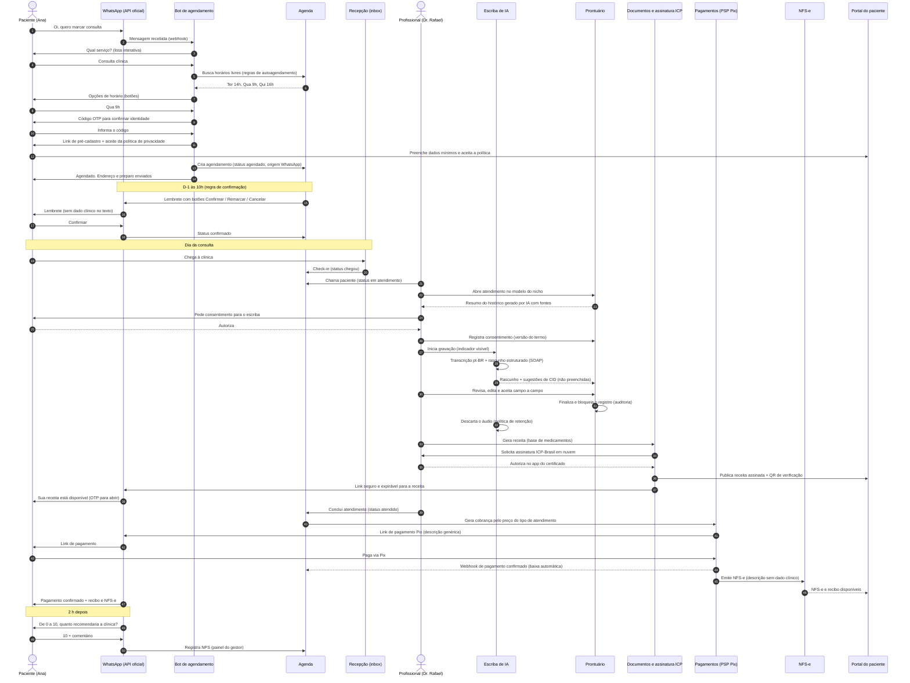
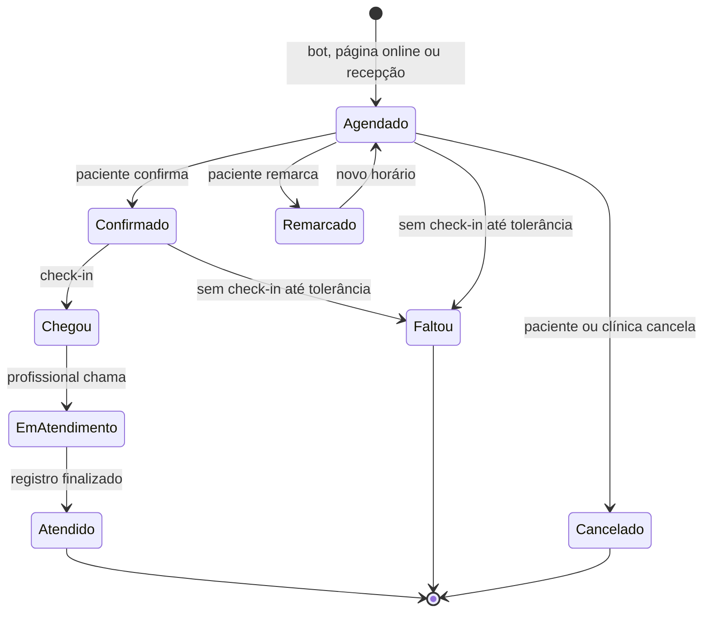
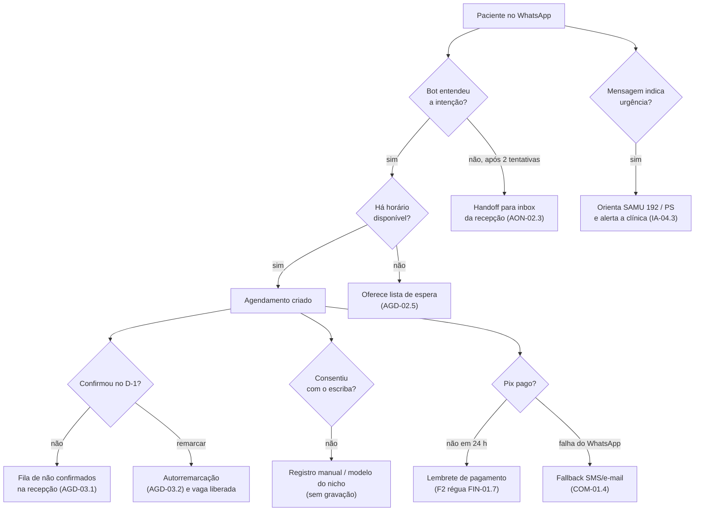
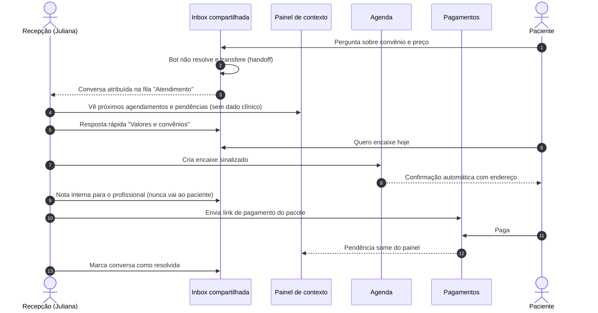
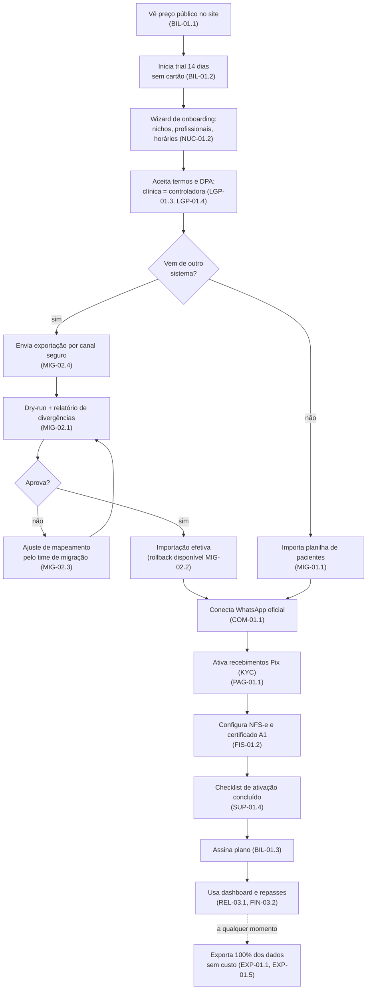
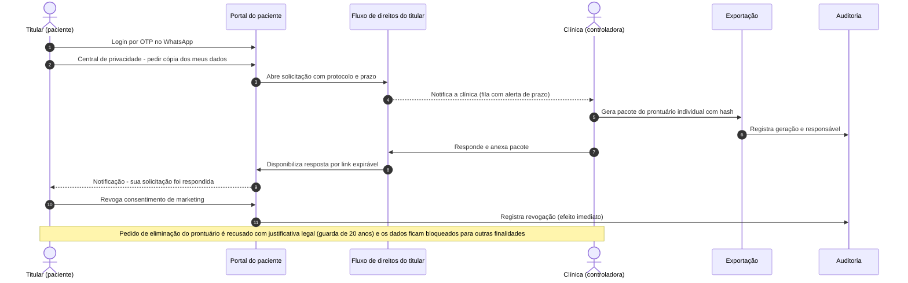
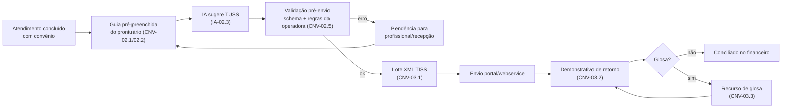
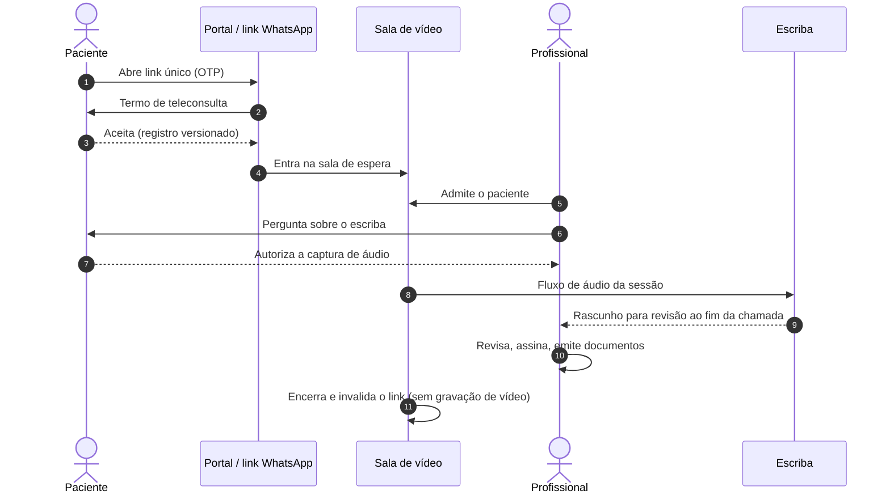

# Jornadas de usuário

> Frente: 🧩 Produto (N2) · Executor: N3 PRD + WBS · Versão 0.1 · Data: 2026-10-08
> Base: [PRD.md](./PRD.md) · [WBS-micropartes.md](./WBS-micropartes.md) · [roadmap.md](./roadmap.md)
> Cada passo traz entre colchetes as micropartes da WBS que o tornam possível. Pontos com 🔒 tocam dado sensível e têm controle LGPD explícito.

## Índice
1. [Jornada principal — do WhatsApp ao NPS (MVP)](#1-jornada-principal--do-whatsapp-ao-nps-mvp)
2. [Exceções da jornada principal](#2-exceções-da-jornada-principal)
3. [Recepção — um dia na inbox compartilhada (MVP)](#3-recepção--um-dia-na-inbox-compartilhada-mvp)
4. [Dono de clínica — da assinatura à migração (MVP)](#4-dono-de-clínica--da-assinatura-à-migração-mvp)
5. [Paciente — direitos LGPD pelo portal (MVP)](#5-paciente--direitos-lgpd-pelo-portal-mvp)
6. [Faturista — guia TISS sem glosa (Fase 2)](#6-faturista--guia-tiss-sem-glosa-fase-2)
7. [Teleconsulta com escriba (Fase 2)](#7-teleconsulta-com-escriba-fase-2)
8. [Jornadas de nicho (resumo)](#8-jornadas-de-nicho-resumo)

---

## 1. Jornada principal — do WhatsApp ao NPS (MVP)

**Persona:** Ana (paciente) e Dr. Rafael (médico autônomo), com Juliana (recepção) de apoio.
**Resultado esperado:** Ana marca sem ligar, comparece, recebe receita assinada no celular, paga por Pix e avalia — e Rafael não digita o prontuário.

### 1.1 Visão macro

```mermaid
flowchart LR
    A["1. Paciente chama<br/>no WhatsApp"] --> B["2. Bot agenda<br/>(OTP + pré-cadastro)"]
    B --> C["3. Lembrete e<br/>confirmação D-1"]
    C --> D["4. Check-in<br/>na recepção"]
    D --> E["5. Consulta com<br/>escriba de IA 🔒"]
    E --> F["6. Revisão e<br/>assinatura do prontuário 🔒"]
    F --> G["7. Receita assinada<br/>ICP-Brasil 🔒"]
    G --> H["8. Envio seguro<br/>por WhatsApp/portal 🔒"]
    H --> I["9. Cobrança Pix<br/>+ baixa automática"]
    I --> J["10. NFS-e e recibo"]
    J --> K["11. NPS pelo<br/>WhatsApp"]

    classDef sens fill:#fee2e2,stroke:#b91c1c,color:#111
    class E,F,G,H sens
```

### 1.2 Sequência detalhada

### 1.3 Passos, micropartes e controles

| # | Passo | Micropartes (WBS) | Métrica do passo | Controle LGPD 🔒 |
|---|---|---|---|---|
| 1 | Paciente inicia conversa | COM-01.1, COM-01.4 | Tempo até 1ª resposta < 5 s | Número oficial da clínica (não pessoal) |
| 2 | Bot oferece serviços e horários | AON-02.1, AON-02.2, IA-04.1, AGD-02.2 | % agendamentos sem humano ≥ 70% | Bot não dá orientação clínica (IA-04.3) |
| 3 | Identificação e pré-cadastro | AON-01.3, PAC-01.4, COM-04.2, LGP-01.3 | Tempo de pré-cadastro < 2 min | Minimização (só nome + telefone obrigatórios); aceite de política registrado |
| 4 | Lembrete e confirmação | COM-03.1, COM-03.2, AGD-03.1 | Taxa de confirmação; no-show | Texto sem dado clínico; opt-in de canal (COM-01.3) |
| 5 | Check-in e chamada | AGD-02.7 | Tempo de espera | — |
| 6 | Resumo do histórico | IA-02.1, PRO-02.7 | Avaliação do resumo ≥ 4/5 | 🔒 RAG isolado por tenant e permissão (IA-05.2) |
| 7 | Consentimento e gravação | LGP-01.2, IA-01.1 | % consultas com escriba | 🔒 Sem consentimento não há gravação |
| 8 | Transcrição e rascunho | IA-01.2, IA-01.3, IA-02.2 | Rascunho < 60 s; alucinação ≤ 2% | 🔒 Provedor sem retenção; logs sem PII (IA-05.1) |
| 9 | Revisão e assinatura do registro | IA-01.4, PRO-02.3, NUC-04.1 | Taxa de aceitação do rascunho ≥ 60% | 🔒 Humano no loop obrigatório; bloqueio pós-assinatura; descarte do áudio (IA-01.5) |
| 10 | Receita assinada | DOC-01.1, DOC-02.1, DOC-02.3 | Tempo de emissão < 60 s | 🔒 Assinatura qualificada; verificação pública sem expor conteúdo |
| 11 | Entrega ao paciente | DOC-03.1, POR-02.2 | % documentos abertos | 🔒 Link expirável + OTP; abertura auditada |
| 12 | Cobrança e Pix | FIN-01.1, PAG-01.2, PAG-02.1, PAG-01.4 | Dias para receber; % conciliado automático | Descrição genérica do serviço |
| 13 | NFS-e e recibo | FIS-01.3, FIS-01.6, FIN-01.4 | NFS-e < 5 min após pagamento | Sem CID na nota (FIS-01.6) |
| 14 | NPS | COM-03.4, CRM-01.1, CRM-01.2 | Taxa de resposta; NPS ≥ 70 | Anti-fadiga; resposta não vinculada a dado clínico |

### 1.4 Mapa de estados do agendamento

## 2. Exceções da jornada principal

## 3. Recepção — um dia na inbox compartilhada (MVP)

**Persona:** Juliana (recepção). Micropartes: COM-02.1–02.4, AON-02.3, AGD-02.*, PAG-02.1, PAC-01.3.

## 4. Dono de clínica — da assinatura à migração (MVP)

**Persona:** Carla (dona de clínica multiprofissional). Micropartes: BIL-01.1–01.3, NUC-01.2, LGP-01.4, MIG-01.*, MIG-02.*, COM-01.1, PAG-01.1, FIS-01.2, SUP-01.4, EXP-01.*.

## 5. Paciente — direitos LGPD pelo portal (MVP)

**Persona:** Seu Antônio (paciente). Micropartes: POR-01.1, POR-02.5, POR-02.6, LGP-02.1–02.3, EXP-01.3, NUC-04.1.

## 6. Faturista — guia TISS sem glosa (Fase 2)

**Persona:** Fernanda (faturista). Micropartes: CNV-01.*, CNV-02.1–02.5, CNV-03.1–03.3, IA-02.3, PAC-01.5.

## 7. Teleconsulta com escriba (Fase 2)

Micropartes: TEL-01.1–01.3, TEL-02.1, TEL-02.2, IA-01.*, POR-02.9, PAG-02.1.

## 8. Jornadas de nicho (resumo)

| Nicho | Momento-chave da jornada | Micropartes | Fase |
|---|---|---|---|
| Odontologia | Odontograma na 1ª consulta → plano de tratamento com orçamento → aprovação assinada → parcelas Pix → execução marca dente/face | PRO-03.1, PRO-03.2, FIN-01.6, DOC-02.4, PAG-01.2 | MVP (odontograma) / F2 (plano + orçamento) |
| Psicologia | Série semanal recorrente → sessão com evolução + anotações privadas → recibo para reembolso → pacote mensal | AGD-02.4, PRO-02.6, FIN-01.4, FIN-01.5 | MVP |
| Nutrição | Antropometria + gráficos → plano alimentar → paciente acompanha evolução no portal | PRO-03.4, PRO-03.6, POR-02.8 | MVP (antropometria) / F2 (plano + portal) |
| Fisioterapia / TO | Avaliação com escalas → plano de sessões com metas → saldo de sessões → guia SP/SADT com autorização | PRO-03.8, PRO-03.7, CNV-02.2, CNV-02.4 | MVP (plano) / F2 (TISS) |
| Estética | Termo de consentimento + consentimento de imagem → fotos padronizadas antes → mapa de aplicação com lote → baixa de estoque → fotos depois lado a lado | PRO-03.13, PRO-03.9, PRO-03.10, EST-01.3, EST-01.4 | MVP (termo + fotos) / F2 (mapa + estoque) |
| Fono / TEA | Plano terapêutico multiprofissional com metas → registros por sessão de cada área → relatório consolidado para família, escola e operadora | PRO-03.11, PRO-02.8, CNV-02.4 | F2 |
| Medicina | Jornada principal (seção 1) + pedidos de exame, atestado com CID só se autorizado, resultado de laboratório integrado | DOC-01.3, DOC-01.4, INT-01.2 | MVP / F2 (laboratórios) |
