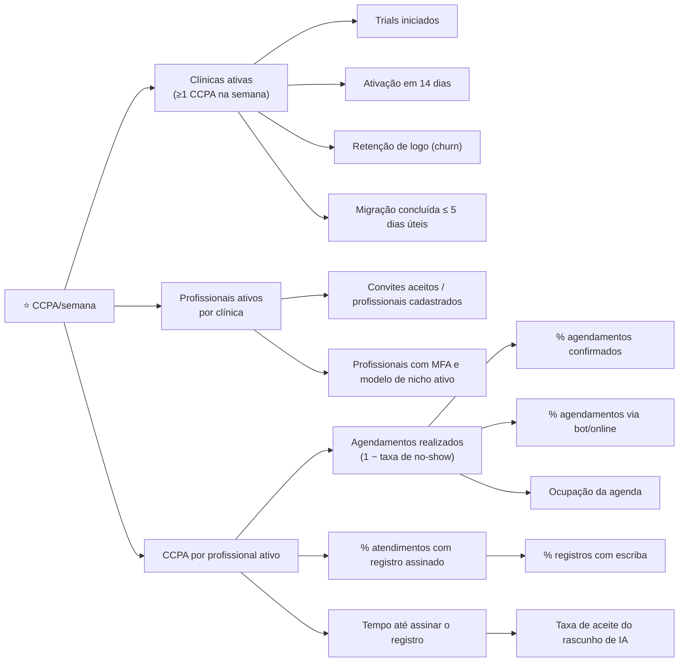

# Métricas de produto

> Frente: 🧩 Produto (N2) · Versão 0.1 · Data: 2026-10-08
> Base: [PRD.md](./PRD.md) §5 · [roadmap.md](./roadmap.md) · [plano-piloto.md](./plano-piloto.md) · microparte ADM-01.6 (métricas de negócio) e NUC-05.5 (observabilidade)
> Todas as metas aqui são **HIPÓTESES** (estimativas de planejamento), a recalibrar após 4 semanas de piloto com linha de base medida.

## 1. North Star

**CCPA/semana — Consultas Concluídas com Prontuário Assinado por semana** (definição do PRD §5.1).

- **Conta:** atendimento que passou por agenda → status `atendido` → registro clínico finalizado/assinado (PRO-02.3) na plataforma, na mesma semana ISO.
- **Não conta:** registro criado fora da agenda, registro em rascunho, tenants de teste/demo, ambiente de piloto antes do Gate LGPD (dados sintéticos).
- **Métrica de apoio:** % de CCPA com escriba de IA usado (a partir do M3).
- **Por que:** mede uso real do núcleo clínico, cresce com nº de clínicas e profundidade de uso e precede faturamento.
- **Cálculo:** a partir do evento `encounter_record_signed` (§5) com `from_schedule = true`; sem dado de paciente.

## 2. Árvore de métricas (input metrics)

| Input metric | Definição | Alavanca de produto | Marco em que passa a ser medida |
|---|---|---|---|
| Ativação em 14 dias | % de clínicas novas com ≥ 10 agendamentos e ≥ 3 registros assinados em 14 dias | Onboarding (NUC-01.2, SUP-01.4), modelos por nicho, migração | M1 |
| Profissionais ativos / clínica | Profissionais com ≥ 1 registro assinado na semana ÷ profissionais cadastrados | Convites, MFA simples, modelos | M1 |
| % atendimentos com registro assinado | Registros assinados ÷ agendamentos com status `atendido` | Atendimento em 1 clique, autosave | M1 |
| Tempo até assinar | Mediana entre `encounter_started` e `encounter_record_signed` | Escriba, componentes clínicos | M1 (base) / M3 (com escriba) |
| Taxa de no-show | Faltas ÷ agendamentos vencidos | Lembretes, confirmação, autorremarcação | M1 (base) / M2 |
| % confirmados | Confirmados ÷ agendamentos elegíveis | Confirmação interativa | M2 |
| % agendamentos via bot/online | Origem `bot` ou `online` ÷ total | AON, bot | M2 |
| % registros com escriba | Registros com `used_scribe = true` ÷ assinados | Escriba | M3 |
| Aceite do rascunho de IA | % rascunhos com distância de edição < 20% | Qualidade do escriba (IA-05.3) | M3 |
| % Pix conciliado automaticamente | Recebimentos Pix com baixa automática ÷ recebimentos Pix | PAG-01.4, PAG-03.2 | M4 |

## 3. KPIs por persona

| Persona ([PRD](./PRD.md) §3) | KPI | Meta piloto (hipótese) | Meta 12 meses pós-GA (PRD) |
|---|---|---|---|
| **Carla — dona de clínica** | Clínica ativa semanalmente; repasse fechado na plataforma; NPS da clínica | ≥ 80% das clínicas ativas toda semana; NPS ≥ 40 | Churn ≤ 2,5%/mês; NPS ≥ 50 |
| **Dr. Rafael / profissionais de nicho** | Tempo de documentação por consulta; % CCPA com escriba; aceite do rascunho | −30% tempo; ≥ 30% CCPA com escriba; aceite ≥ 50% | −50% tempo; aceite ≥ 60% |
| **Juliana — recepção** | % confirmações automáticas; tempo de 1ª resposta na inbox; conversas resolvidas pelo bot | ≥ 60% confirmações sem ação manual; 1ª resposta < 10 min | ≥ 70% agendamentos do bot sem humano |
| **Paciente (Antônio/Ana)** | No-show; % pagos via Pix/link; NPS paciente; uso do portal | No-show −20% vs. linha de base; NPS ≥ 60 | No-show −30%; NPS ≥ 70 |
| **Marcos (psico) / Diego (fisio) / Renata (fono-TEA)** | % sessões recorrentes criadas em série; saldo de pacote correto | ≥ 80% das séries via recorrência; 0 divergência de saldo reportada | — |
| **Encarregado (DPO) da clínica** | SLA de direitos do titular; incidentes | 100% dentro do prazo; 0 incidente | ≤ 15 dias; 0 incidente |
| **Fernanda — faturista** | Taxa de glosa | Fora do MVP (TISS em F2) | ≤ 3% |

## 4. Princípios de instrumentação (LGPD)

1. **Nenhum dado pessoal ou sensível em evento de analytics.** Proibido: nome, telefone, e-mail, CPF, CNS, ID de paciente, texto livre, CID, medicamento, conteúdo de prontuário, áudio, transcrição, valor de medida clínica, nome do profissional.
2. **Identificadores pseudônimos:** `tenant_hash` e `user_hash` (HMAC com chave rotacionável guardada no KMS, nunca o ID interno); sem `patient_*` de qualquer tipo.
3. **Papel, não pessoa:** usar `user_role` (admin, profissional, recepção, financeiro, gestor) e `clinic_niche` (lista fechada). Nichos sensíveis (ex.: psicologia) aparecem só em agregados de ≥ 5 clínicas nos painéis.
4. **Valores em faixas:** durações, quantidades e valores monetários em *buckets* (ex.: `duration_bucket = "5-10min"`), nunca o valor exato quando puder reidentificar.
5. **Lista fechada (allowlist):** o schema de cada evento vive em `packages/shared`; propriedade fora do schema é descartada no servidor; teste de contrato no CI.
6. **Coleta no servidor** sempre que possível; no front, sem *session replay* em telas clínicas.
7. **Ferramenta hospedada no Brasil** (ex.: PostHog self-hosted na AWS São Paulo — sugestão, a decidir com Engenharia) e retenção de eventos de 25 meses.
8. Analytics de produto é finalidade da plataforma (legítimo interesse sobre dado de uso dos clientes); registrar no ROPA (LGP-03.1).

Propriedades comuns a todos os eventos: `event_ts`, `tenant_hash`, `user_hash`, `user_role`, `clinic_niche`, `clinic_size_bucket` (1, 2–5, 6–10, 11+), `plan`, `app_surface` (web, pwa, whatsapp, portal), `release_version`, `is_pilot`.

## 5. Eventos a instrumentar no MVP

| Evento | Quando dispara | Propriedades específicas (sem dado pessoal) | Marco | Alimenta |
|---|---|---|---|---|
| `clinic_signed_up` | Conta criada | `acquisition_channel`, `migrating_from` (lista fechada de concorrentes ou `none`) | M1 | Aquisição |
| `dpa_accepted` | Clínica aceita o contrato de operador | `dpa_version` | M0 | LGPD |
| `onboarding_step_completed` | Passo do wizard concluído | `step` (dados, nicho, profissionais, horários, importação), `elapsed_bucket` | M1 | Ativação |
| `user_invited` / `user_activated` | Convite enviado / aceito | `invited_role`, `channel` | M0 | Profissionais ativos |
| `mfa_enabled` | MFA configurado | `method` | M0 | Segurança |
| `schedule_configured` | Grade salva | `weekly_hours_bucket`, `has_rooms` | M1 | Ativação |
| `template_selected` | Modelo de prontuário ativado | `template_niche`, `template_origin` (global, custom) | M1 | Adoção por nicho |
| `appointment_created` | Agendamento criado | `source` (recepcao, online, bot, recorrencia, encaixe, importacao), `lead_time_bucket`, `is_recurring` | M1 | Agenda |
| `appointment_status_changed` | Mudança de status | `from_status`, `to_status`, `actor` (recepcao, paciente, bot, sistema) | M1 | No-show, confirmação |
| `appointment_rescheduled` | Remarcação | `actor`, `channel` | M2 | Autoatendimento |
| `encounter_started` | Atendimento aberto | `from_schedule` (bool) | M1 | Tempo até assinar |
| `encounter_record_signed` | Registro finalizado/assinado | `from_schedule`, `template_niche`, `used_scribe`, `time_to_sign_bucket`, `has_attachments` | M1 | **North Star** |
| `record_addendum_created` | Adendo em registro assinado | — | M1 | Qualidade |
| `consent_recorded` | Consentimento registrado/revogado | `consent_type` (escriba, imagem, marketing…), `action` (granted, revoked), `channel` | M1 | LGPD, escriba |
| `audit_log_viewed` | Consulta de auditoria | `filter_type` | M0 | LGPD |
| `message_sent` | Mensagem enviada | `channel` (whatsapp, sms, email), `template_category` (lembrete, confirmacao, instrucao…), `delivery_status` | M2 | Comunicação |
| `bot_conversation_ended` | Conversa do bot encerrada | `outcome` (agendou, remarcou, cancelou, handoff, abandonou), `turns_bucket` | M2 | % bot sem humano |
| `inbox_first_response` | 1ª resposta humana | `response_time_bucket` | M2 | Recepção |
| `online_booking_completed` | Agendamento online concluído | `entry_point` (pagina, widget, link) | M2 | Aquisição de pacientes |
| `scribe_draft_generated` | Rascunho do escriba gerado | `template_niche`, `audio_length_bucket`, `latency_bucket` | M3 | IA |
| `scribe_draft_reviewed` | Profissional revisa o rascunho | `edit_ratio_bucket` (0–20%, 20–50%, > 50%), `action` (accepted, edited, discarded) | M3 | Aceite do rascunho |
| `ai_suggestion_feedback` | Sugestão de CID/resumo aceita ou rejeitada | `feature` (cid, resumo), `action` | M3 | IA |
| `document_issued` | Documento emitido | `doc_type` (receita, controle_especial, atestado, pedido_exame, tcle), `signature` (icp, eletronica, nenhuma), `delivery` (whatsapp, portal, impresso) | M3 | Documentos |
| `charge_created` | Cobrança criada | `method` (pix, link, cartao, dinheiro, outro), `amount_bucket` | M4 | Financeiro |
| `payment_received` | Pagamento confirmado | `method`, `auto_reconciled` (bool), `days_to_pay_bucket` | M4 | Pix conciliado |
| `nfse_issued` | NFS-e emitida | `mode` (auto, manual), `status` (ok, erro, cancelada) | M4 | Fiscal |
| `payout_closed` | Repasse fechado | `professionals_bucket` | M4 | Repasse |
| `portal_session_started` | Paciente entra no portal | `auth_method` (link_magico, otp) | M4 | Portal |
| `titular_request_opened` / `titular_request_closed` | Solicitação de direito do titular | `request_type`, `sla_status` (no_prazo, atrasado) | M4 | LGPD |
| `data_export_requested` | Exportação pedida | `scope` (total, prontuario_individual), `status` | M4 | Confiança |
| `migration_completed` | Migração concluída | `source_system`, `duration_days_bucket`, `rollback_used` | M4 | Migração |
| `nps_submitted` | NPS respondido | `respondent` (clinica, paciente), `score_bucket` (detrator, neutro, promotor) | M4 | Satisfação |
| `subscription_changed` | Mudança de plano | `from_plan`, `to_plan`, `reason_category` | M4 | Receita, churn |
| `support_ticket_opened` | Ticket aberto | `module`, `channel` | M4 | Suporte |
| `feature_flag_exposed` | Usuário exposto a flag | `flag_key`, `variant` | M0 | Experimentos |

> Revisão: a lista de eventos é aprovada pelo Guardião LGPD antes do M1; qualquer propriedade nova exige o mesmo fluxo.

## 6. Metas para o piloto (hipóteses)

| Métrica | Meta ao fim do piloto (semana 16) | Linha de corte para GA |
|---|---|---|
| Clínicas piloto ativas (≥ 1 CCPA/semana nas últimas 4 semanas) | 30 | ≥ 25 |
| CCPA/semana (soma do piloto) | ≥ 2.500 | ≥ 1.500 |
| Ativação em 14 dias (clínicas da onda 3) | ≥ 50% | ≥ 40% |
| % atendimentos com registro assinado | ≥ 85% | ≥ 75% |
| No-show vs. linha de base da clínica | −20% | −10% |
| Agendamentos do bot concluídos sem humano | ≥ 70% | ≥ 60% (gate M2) |
| % CCPA com escriba (nichos liberados) | ≥ 30% | ≥ 20% |
| Aceite do rascunho do escriba (edição < 20%) | ≥ 50% | ≥ 40% |
| % Pix conciliado automaticamente | ≥ 90% | ≥ 85% |
| Migração assistida | ≤ 5 dias úteis (mediana) | ≤ 7 dias úteis |
| NPS das clínicas | ≥ 40 | ≥ 30 |
| Retenção do piloto (clínicas que aceitam virar pagantes) | ≥ 70% | ≥ 60% |
| Incidentes com dados pessoais | 0 | 0 (inegociável) |
| Disponibilidade | ≥ 99,9% por 4 semanas | ≥ 99,9% (gate GA) |

Estimativa da meta de CCPA: 30 clínicas × ~4 profissionais ativos × ~20 atendimentos assinados/semana ≈ 2.400 (ESTIMATIVA, sem fonte de mercado; recalibrar com dados reais).

## 7. Rituais
- **Semanal:** painel North Star + inputs (ADM-01.6), revisado por Produto; desvio > 20% gera ação.
- **Por marco:** revisão das metas com Maestro e sócios.
- **Mensal:** Guardião audita amostra de eventos para confirmar ausência de dado pessoal.
