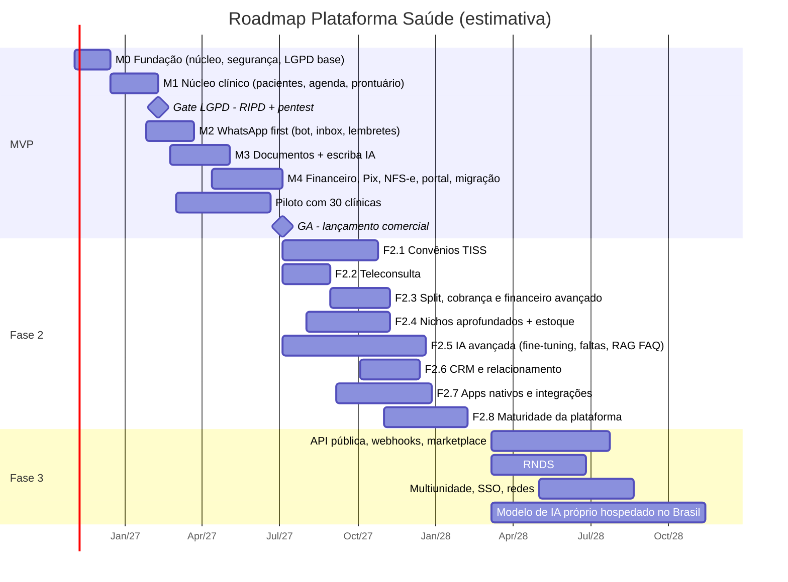
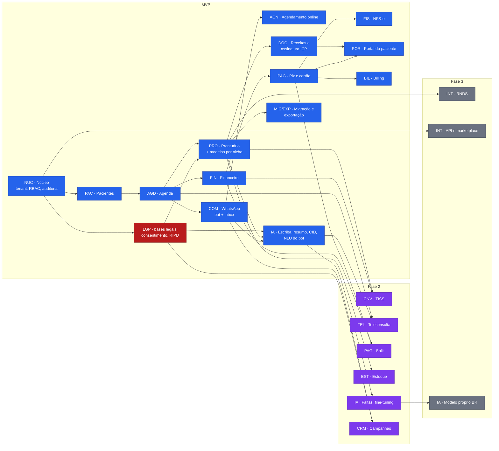

# Roadmap do produto

> Frente: 🧩 Produto (N2) · Executor: N3 PRD + WBS · Versão 0.1 · Data: 2026-10-08
> Base: [PRD.md](./PRD.md) · [WBS-micropartes.md](./WBS-micropartes.md) (IDs citados aqui) · alinhado com a estratégia de IA em fases de [`docs/05-ia-llm/README.md`](../05-ia-llm/README.md)
> **Datas são ESTIMATIVAS** de planejamento (premissa: 1 squad de produto + 2 squads de engenharia + 1 squad de IA, a partir de nov/2026). Devem ser recalibradas pela frente 🛠️ Engenharia depois da quebra técnica.

## 1. Visão geral das fases

| Fase | Período estimado | Tema | Público-alvo | Saída (critério de fase concluída) |
|---|---|---|---|---|
| **MVP (Fase 1)** | nov/2026 → jun/2027 (~8 meses) | Atender, documentar e receber | Autônomos e clínicas pequenas (≤ 10 profissionais), particular-first com controle de guia simples para clínicas mistas (premissa D1: fisio/TO + psicólogos) | GA (lançamento comercial) com 194 micropartes MVP prontas, RIPD aprovado, pentest sem achado crítico/alto aberto, 30 clínicas piloto ativas |
| **Fase 2** | jul/2027 → fev/2028 (~8 meses) | Convênios, equipes e escala de IA | Clínicas médias com convênio, clínicas multiprofissionais, odonto/estética | TISS homologado com ≥ 3 operadoras, teleconsulta, split, estoque, apps nativos, previsão de faltas; 106 micropartes F2 |
| **Fase 3** | mar/2028 → 2029 | Ecossistema e escala | Redes, franquias, parceiros | RNDS, API pública e marketplace, multiunidade, modelo de IA próprio hospedado no Brasil; 32 micropartes F3 |

## 2. MVP — ordem de entrega em marcos

O MVP é entregue em 5 marcos incrementais. Cada marco termina com uma **demo para os sócios** e uma **revisão do Guardião LGPD**. A partir do Marco 2 há clientes piloto, mas **nenhum dado real de paciente entra no sistema antes do Gate LGPD** (fim do Marco 1).

| Marco | Semanas (est.) | Objetivo | Micropartes principais (WBS) | Gate de saída |
|---|---|---|---|---|
| **M0 — Fundação** | 1–6 | Plataforma segura multi-tenant pronta para receber módulos | NUC-01.1, NUC-01.3, NUC-01.4, NUC-02.1–02.4, NUC-02.6, NUC-03.1, NUC-03.3, NUC-04.1, NUC-04.2, NUC-05.1–05.7, LGP-01.1, LGP-01.3, LGP-01.4, LGP-03.1, LGP-03.5, INT-01.4, ADM-01.1, ADM-01.3, ADM-01.7 | Testes de isolamento de tenant 100% verdes; auditoria e criptografia ativas; ROPA inicial |
| **M1 — Núcleo clínico** | 7–14 | Agendar e atender com prontuário por nicho | PAC-01.1–01.3, PAC-02.1–02.4, PAC-02.6, AGD-01.* (inclui atendimento simultâneo AGD-01.5), AGD-02.1–02.5, AGD-02.7, FIN-01.5 (pacotes), CNV-04.* (controle de guia simples, sem XML TISS), PRO-01.1–01.4, PRO-02.1–02.3, PRO-02.5–02.7, PRO-03.1, PRO-03.4, PRO-03.7, PRO-03.8, LGP-01.2, LGP-03.2 (RIPD do produto), LGP-03.3, ADM-01.5, NUC-01.2 | **Gate LGPD:** RIPD do produto aprovado, pentest externo do núcleo, plano de incidentes (LGP-03.4) testado → libera piloto com dados reais |
| **M2 — WhatsApp first** | 13–20 | Paciente agenda, confirma e conversa pelo WhatsApp | COM-01.*, COM-02.1–02.4, COM-03.1–03.3, COM-04.1, COM-04.2, COM-04.4, AON-01.1–01.3, AON-01.5, AON-01.7, AON-02.*, AGD-03.1, AGD-03.2, PAC-01.4, IA-04.1, IA-04.3 | ≥ 70% dos agendamentos do bot concluídos sem humano em piloto; no-show medido |
| **M3 — Documentos e escriba** | 17–26 | Profissional atende sem digitar e entrega documentos assinados | DOC-01.1–01.5, DOC-02.1, DOC-02.3, DOC-02.4, DOC-03.1, DOC-03.2, PRO-03.9, PRO-03.13, IA-01.1–01.5, IA-02.1, IA-02.2, IA-05.1–05.3, IA-05.6 | RIPD específico do escriba aprovado; gate de avaliação de IA (IA-05.3) aprovado para todos os nichos do MVP |
| **M4 — Receber e lançar** | 23–34 | Cobrar, emitir nota, portal do paciente, migrar, cobrar o cliente e lançar | FIN-01.1–01.4, FIN-01.8 (cobrança de pacotes), FIN-03.1, FIN-03.2, PAG-01.1, PAG-01.2, PAG-01.4, PAG-01.5, PAG-02.1, PAG-02.2, PAG-03.2, FIS-01.1–01.6, COM-03.4, CRM-01.1, CRM-01.2, CRM-02.1, REL-01.*, REL-02.1, REL-03.1, POR-01.1, POR-01.2, POR-02.1–02.3, POR-02.5, POR-02.6, POR-03.1, LGP-02.*, LGP-03.4, LGP-03.8, MIG-01.1–01.4, MIG-01.6, MIG-02.*, EXP-01.1, EXP-01.3, EXP-01.5, EXP-01.6, BIL-01.1–01.7, BIL-01.9, ADM-01.2, ADM-01.4, ADM-01.6, SUP-01.1–01.4 | **GA:** 30 clínicas piloto ativas, North Star medida semanalmente, SLO 99,9% por 4 semanas, Guardião ✅, Sócios ✅ |

> Os marcos se sobrepõem de propósito (trabalho paralelo entre squads; integração serial pelo Maestro).

## 3. Fase 2 — ordem sugerida

1. **F2.1 Convênios/TISS** (maior pedido de médicos e clínicas médias; libera a onda 2 TEA/ABA): CNV-02.2 primeiro, reaproveitando as guias do controle simples do MVP (CNV-04.*); depois CNV-01.*, CNV-02.1–02.5, CNV-03.1–03.3, CNV-03.5, PAC-01.5, IA-02.3.
2. **F2.2 Teleconsulta**: TEL-01.1–01.5, TEL-02.*, POR-02.9.
3. **F2.3 Dinheiro avançado**: PAG-01.3, PAG-01.6, PAG-02.4, PAG-03.1, PAG-03.4, FIN-01.6, FIN-01.7, FIN-02.1–02.3, FIN-03.3, FIS-01.7–01.9, REL-02.2, REL-02.3.
4. **F2.4 Nichos aprofundados**: PRO-03.2 (plano odonto), PRO-03.5, PRO-03.6, PRO-03.10–03.12, PRO-02.8, PRO-01.5, EST-01.1–01.6.
5. **F2.5 IA avançada**: IA-01.6, IA-01.7, IA-02.4, IA-03.1, IA-04.2, IA-05.4, IA-05.5, LGP-03.7, PRO-02.9, POR-02.7, MIG-01.7, SUP-01.5.
6. **F2.6 Crescimento e relacionamento**: CRM-01.3, CRM-01.4, CRM-02.2, CRM-02.3, CRM-03.1–03.3, COM-03.5, AGD-02.6, AON-01.4, AGD-03.3, INT-02.5.
7. **F2.7 Mobilidade e integrações**: POR-03.2, POR-03.3, COM-04.3, POR-02.4, POR-02.8, INT-01.1, INT-01.2, INT-01.5, INT-02.1, DOC-03.3.
8. **F2.8 Maturidade da plataforma**: NUC-03.2, NUC-03.4, NUC-04.3, NUC-05.8, PAC-01.6, PAC-02.5, AGD-02.8, PRO-02.4, DOC-02.2, EXP-01.2, MIG-01.5, REL-03.2, REL-03.3, COM-02.5, BIL-01.8, ADM-01.8, SUP-01.6, SUP-01.7, LGP-03.6, LGP-03.9.

## 4. Fase 3 — temas

- **Ecossistema:** INT-02.2 (API pública), INT-02.3 (webhooks), INT-02.4 (marketplace), INT-01.3 (RNDS), INT-01.6, FIN-04.1, AON-01.6.
- **Escala e redes:** NUC-01.5 (multiunidade), NUC-02.5 (SSO), POR-01.3 (identidade multi-clínica), COM-02.6, AGD-02.9.
- **IA de 3ª geração:** modelo próprio hospedado no Brasil (evolução do gateway de inferência do MVP), IA-01.8, IA-02.5, IA-03.2, REL-03.5, REL-03.4.
- **Financeiro e operação:** PAG-02.3, PAG-03.3, FIN-02.4, EST-01.7, EST-01.8, CNV-02.6, CNV-03.4.
- **Conteúdo e engajamento:** PRO-01.6, PRO-03.3, PRO-03.14, DOC-01.6, TEL-01.6, CRM-03.4, CRM-03.5, EXP-01.4.

## 5. Dependências críticas (caminho crítico do MVP)

| # | Dependência | Bloqueia | Tipo | Ação / dono |
|---|---|---|---|---|
| D1 | **NUC-01.1 multi-tenant + NUC-03.3 sigilo + NUC-04.1 auditoria** | Todos os módulos com dado sensível | Técnica | Engenharia — primeira entrega do M0 |
| D2 | **Gate LGPD** (RIPD do produto LGP-03.2, consentimentos LGP-01.2, pentest) | Qualquer dado real de paciente (piloto) | Regulatória | Guardião LGPD — veto absoluto |
| D3 | **Conta WhatsApp Business Platform / BSP + aprovação de templates** (COM-01.1, COM-01.2) | Bot, lembretes, inbox, pós-consulta, NPS | Externa (Meta) — prazo de verificação de empresa | Produto inicia contratação na semana 1 |
| D4 | **Contrato com provedor de IA (não-retenção, dados no Brasil ou salvaguarda) + STT pt-BR** (IA-05.1, IA-01.2, LGP-03.8) | Escriba, resumo, CID | Externa + LGPD | IA + Guardião — decidir até a semana 8 |
| D5 | **Golden sets clínicos por nicho** (IA-05.3) | Liberação do escriba (gate M3) | Conteúdo | IA + profissionais consultores por nicho, a partir do M1 |
| D6 | **Modelos de prontuário validados por nicho** (PRO-01.3) | Escriba (IA-01.3 mapeia para os campos), onboarding | Conteúdo | Produto + consultores clínicos |
| D7 | **PSC de assinatura ICP-Brasil em nuvem** (DOC-02.1) | Receitas válidas, controle especial | Externa | Engenharia — contratar até o M2 |
| D8 | **PSP/gateway com Pix, cartão e (futuro) split** (PAG-01.1) | Pagamentos, link, conciliação, billing | Externa (KYC) | Produto + Engenharia — contratar até o M2 |
| D9 | **Agregador de NFS-e + lista de municípios prioritários** (FIS-01.1) | Emissão fiscal | Externa + Pesquisa de Mercado | Pesquisa define os 20 municípios |
| D10 | **Acesso a exportações de concorrentes** (MIG-01.3, MIG-01.4) | Migração assistida, vendas | Externa (clientes piloto) | Produto recruta clínicas piloto que estão migrando |
| D11 | **Bases de referência licenciadas/atualizadas** (INT-01.4: CID, CMED/ANVISA, TUSS, TACO) | Prescrição, CID, nutrição, TISS | Externa | Engenharia — M0 |

## 6. Diagrama do roadmap (Gantt — estimativa)

## 7. Diagrama de dependências entre blocos

## 8. Riscos do cronograma

| Risco | Efeito no roadmap | Mitigação |
|---|---|---|
| Atraso na verificação da Meta (D3) | M2 escorrega | Iniciar na semana 1; usar número de teste/sandbox; fallback SMS/e-mail |
| Escriba não passa no gate de qualidade em algum nicho (D5) | M3 parcial | Lançar escriba por nicho conforme passar no gate; nichos restantes com ditado/modelo manual |
| Veto do Guardião no Gate LGPD | Piloto atrasa | Guardião participa desde o M0 (LGP-03.5); RIPD escrito em paralelo ao M1 |
| Escopo do MVP grande (194 micropartes; o M1 ganhou pacotes, guia simples e atendimento simultâneo) | GA atrasa | Corte pré-acordado: se necessário, mover para F2 sem quebrar a proposta de valor — MIG-01.4, CRM-02.1, REL-01.3, AON-01.5, PRO-03.8 (exceto EVA), DOC-01.5 |
| Pedido forte de TISS por médicos | Perda de vendas no GA | Recibo de reembolso bem feito (FIN-01.4) e controle de guia simples (CNV-04.*) no MVP; F2.1 é a primeira entrega pós-GA |

## 9. Regras de mudança do roadmap

- Mudanças de fase de microparte: proposta pela frente dona → Produto (N2) → Maestro (N1) → Sócios (N0) se afetar a data de GA.
- Qualquer microparte `S` movida para fase anterior precisa de nova avaliação do Guardião.
- Roadmap revisado ao fim de cada marco.
