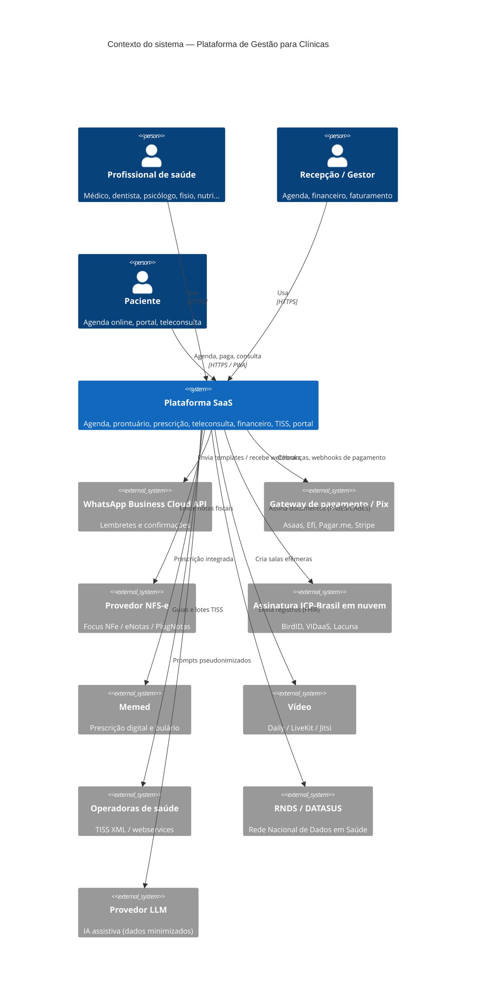
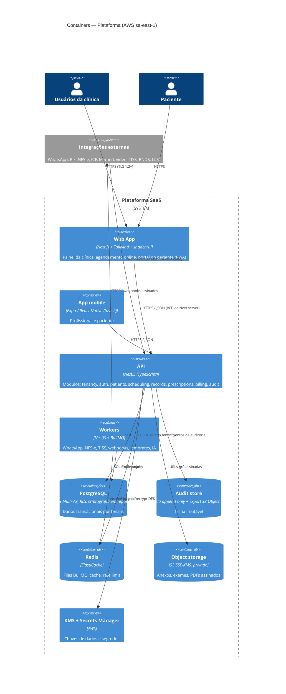

# 04 — Arquitetura

Visão geral técnica da plataforma SaaS multi-tenant de gestão para clínicas de saúde (todos os nichos). Este diretório é mantido pela frente **Engenharia**. Todo código deve seguir o checklist de `docs/03-seguranca-lgpd/`.

| Documento | Conteúdo |
|---|---|
| [README.md](README.md) | Visão geral, stack, diagramas C4 |
| [modelo-de-dados.md](modelo-de-dados.md) | Entidades, ER, criptografia em nível de campo |
| [seguranca-na-arquitetura.md](seguranca-na-arquitetura.md) | RLS, criptografia, segredos, auditoria, backups, CI de segurança |
| [integracoes.md](integracoes.md) | WhatsApp, Pix, NFS-e, ICP-Brasil, Memed, vídeo, TISS, RNDS |
| [ambientes-e-devops.md](ambientes-e-devops.md) | Ambientes, CI/CD, branches, commits, revisão |

## 1. Princípios arquiteturais

1. **LGPD by design e by default** — dado de saúde é dado pessoal sensível (art. 5º, II e art. 11). Minimização, finalidade, criptografia e trilha de auditoria são requisitos de base, não features.
2. **Isolamento de tenant em profundidade** — filtro na aplicação **e** Row-Level Security no PostgreSQL. Uma falha de código não pode vazar dados entre clínicas.
3. **Monólito modular primeiro** — uma API com módulos de fronteira clara (tenancy, auth, patients, scheduling, records, prescriptions, billing, audit). Extrair serviços só quando houver necessidade comprovada (escala, isolamento de falha, equipe).
4. **Assíncrono para o que é externo** — WhatsApp, NFS-e, TISS, webhooks de Pix, IA: sempre via fila com retry, idempotência e dead-letter.
5. **Dados no Brasil** — hospedagem primária em região brasileira; transferência internacional só com base legal e registrada (art. 33).
6. **Integrações atrás de interfaces (ports & adapters)** — trocar provedor de Pix, NFS-e ou vídeo não pode exigir reescrever domínio.
7. **Tipagem ponta a ponta** — TypeScript em todo o monorepo; contratos compartilhados em `packages/shared`.

## 2. Stack recomendada

| Camada | Escolha | Justificativa | Alternativa considerada |
|---|---|---|---|
| Monorepo | **pnpm workspaces + Turborepo** | Instalação rápida e determinística, cache de build/test, um só lockfile | Nx (mais pesado), Yarn |
| Linguagem | **TypeScript** (Node.js 22 LTS) | Mesma linguagem no web, API, mobile e tipos compartilhados; mercado de devs amplo no Brasil | Go/Kotlin na API (melhor desempenho, mas duplica tipos) |
| Web | **Next.js (App Router) + Tailwind CSS + shadcn/ui** | SSR para portal do paciente e agendamento online (SEO), componentes acessíveis e customizáveis por tenant (white-label) | Remix, Vite SPA |
| API | **NestJS** | Módulos, DI, guards e interceptors encaixam com multi-tenancy, RBAC e auditoria transversal; OpenAPI nativo | Fastify puro (menos estrutura), tRPC (acopla web↔API e dificulta API pública/parceiros) |
| ORM / SQL | **Drizzle ORM** | SQL explícito, suporte de primeira a `SET LOCAL` por transação (necessário para RLS), migrations em SQL revisáveis, sem engine binária | Prisma (DX ótima, porém RLS exige extensões/workarounds e transações interativas mais caras) |
| Banco | **PostgreSQL 16+** com **RLS** | Transacional, JSONB para prontuário configurável, RLS nativo, `pgcrypto`, maduro em gerenciados (RDS/Aurora) | MySQL (sem RLS) |
| Cache / filas | **Redis + BullMQ** | Filas com retry/backoff, agendamento (lembretes), rate limit | SQS (bom em prod, mas pior DX local); podemos adotar SQS depois atrás da mesma interface |
| Armazenamento de arquivos | **S3 compatível** (AWS S3 sa-east-1) com SSE-KMS, bucket privado, URLs pré-assinadas curtas | Exames, anexos, PDFs de receitas e documentos | Cloudflare R2, MinIO (local) |
| Criptografia | **AWS KMS** (envelope encryption) | Chaves por ambiente e por tenant (DEK), rotação, auditoria de uso via CloudTrail | HashiCorp Vault Transit |
| Segredos | **AWS Secrets Manager** | Rotação, IAM, nada em `.env` de produção | Vault, Doppler |
| Autenticação | Módulo `auth` próprio (sessão + refresh rotativo, MFA TOTP/WebAuthn) **ou** Keycloak self-hosted no Brasil | Controle total de dados de identidade dentro do país; MFA obrigatório para perfis clínicos | Auth0/Clerk (dados fora do Brasil — exige avaliação de transferência internacional) |
| Hospedagem | **AWS sa-east-1 (São Paulo)** — ECS Fargate ou EKS, RDS PostgreSQL Multi-AZ, ElastiCache Redis | Residência de dados no Brasil, serviços gerenciados, conformidade (ISO 27001/SOC 2 do provedor) | GCP southamerica-east1, Azure Brazil South, Magalu Cloud |
| IaC | **Terraform** (ou OpenTofu) | Ambientes reprodutíveis, revisão de infra via PR | Pulumi, CDK |
| Observabilidade | OpenTelemetry → Grafana (Loki/Tempo/Prometheus) ou Datadog, **Sentry** com scrubbing de PII | Logs estruturados **sem dado de saúde**, traces por `tenant_id` pseudonimizado | CloudWatch puro |
| Mobile | **PWA primeiro** (web responsivo, instalável) → **React Native/Expo** quando houver necessidade de push nativo/biometria | Reduz custo inicial; Expo reaproveita tipos e lógica de `packages/shared` | Flutter (outra linguagem) |
| Testes | Vitest (unit), Supertest (API), Playwright (E2E), testcontainers (Postgres real p/ testar RLS) | RLS precisa ser testado contra Postgres real | Jest |
| IA/LLM | Gateway interno (`ai` module futuro) com redação/pseudonimização antes do envio; provedor com contrato de não-treinamento e, preferencialmente, processamento no Brasil | Ver `docs/05-ia-llm/` | — |

## 3. Diagrama C4 — Nível 1 (Contexto)



## 4. Diagrama C4 — Nível 2 (Containers)



## 5. Estrutura do monorepo

```
apps/
  web/          Next.js — painel, agendamento online, portal do paciente
  api/          NestJS — módulos de domínio + workers
packages/
  shared/       Tipos e contratos (DTOs, enums, IDs) compartilhados
docs/04-arquitetura/
```

Pacotes futuros previstos (criar só quando houver uso): `packages/ui` (design system), `packages/db` (schema Drizzle + migrations), `packages/config` (eslint/tsconfig), `apps/mobile` (Expo), `infra/` (Terraform).

## 6. Fluxo de uma requisição (multi-tenant)

1. Usuário autentica → recebe sessão com `user_id`, `tenant_id`, papéis.
2. `TenantGuard` (NestJS) resolve o tenant (sessão/subdomínio) e rejeita divergências.
3. Interceptor abre transação e executa `SET LOCAL app.tenant_id = '<uuid>'` e `SET LOCAL app.user_id = '<uuid>'`.
4. Repositórios consultam com filtro explícito por `tenant_id` **e** o Postgres aplica RLS.
5. `AuditInterceptor` registra leitura/escrita de dados sensíveis (prontuário, prescrição, documentos).
6. Campos sensíveis são decifrados apenas na camada de serviço, apenas para quem tem permissão.

## 7. Decisões em aberto (ADR pendentes)

- Auth próprio vs. Keycloak self-hosted — decidir antes do módulo `auth` sair do esqueleto.
- Um banco compartilhado com RLS (padrão) vs. banco dedicado para tenants enterprise (opção premium).
- Provedor de vídeo e de Pix padrão para o MVP (ver [integracoes.md](integracoes.md)).
- ADRs devem ser registradas em `docs/04-arquitetura/adr/NNNN-titulo.md`.
