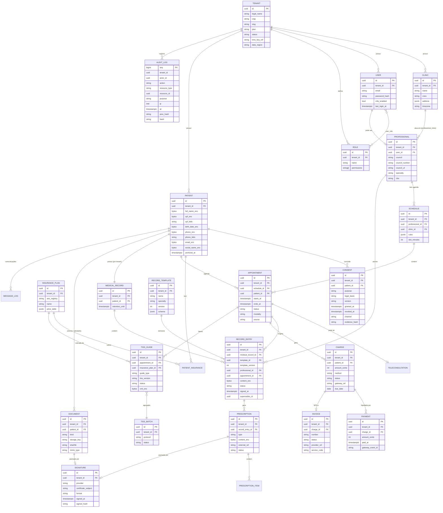
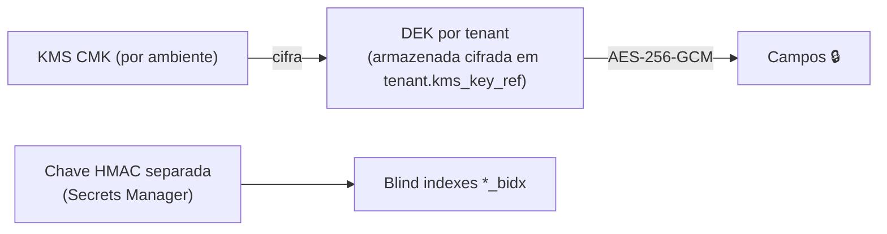

# Modelo de dados

> Modelo lógico do MVP. Nomes de tabelas/colunas em inglês (`snake_case` no banco, `camelCase` no TypeScript). Detalhes de colunas evoluem via migrations revisadas; este documento é a referência conceitual.

## 1. Convenções obrigatórias

- **PK:** `id uuid` (UUIDv7 — ordenável, não enumerável). Nunca expor IDs sequenciais.
- **Tenant:** toda tabela de domínio tem `tenant_id uuid not null` + índice composto iniciado por `tenant_id` + **política RLS** (ver [seguranca-na-arquitetura.md](seguranca-na-arquitetura.md)). Exceções globais: `tenant`, catálogos públicos (`insurance_plan_catalog`, códigos TUSS/CID).
- **Timestamps:** `created_at`, `updated_at` (`timestamptz`, UTC), `created_by`, `updated_by`.
- **Exclusão:** dados clínicos **nunca** são apagados fisicamente durante o prazo legal de guarda (prontuário: mínimo 20 anos — Lei 13.787/2018). Usa-se `archived_at`/`retention_until`. Dados não clínicos seguem a política de retenção do Guardião LGPD (anonimização ao fim da finalidade).
- **Versionamento clínico:** registros assinados de prontuário e prescrição são **imutáveis**; correções geram nova versão (`supersedes_id`) com trilha.
- **Criptografia em nível de campo:** colunas marcadas 🔒 são armazenadas como `bytea` cifrado (AES-256-GCM, envelope com DEK por tenant protegida por KMS). Para busca, usa-se **blind index** (`*_bidx` = HMAC-SHA256 com chave separada) — nunca o valor em claro.

## 2. Diagrama ER (núcleo)

Entidades auxiliares (fora do diagrama para legibilidade): `user_role`, `professional_clinic`, `patient_insurance` (número da carteirinha 🔒), `prescription_item`, `teleconsultation` (sala, tokens efêmeros, consentimento específico), `message_log` (WhatsApp/e-mail — sem conteúdo clínico), `webhook_event` (idempotência), `data_subject_request` (pedidos do titular — art. 18), `ai_interaction` (metadados de uso de IA, sem conteúdo identificável).

## 3. Descrição das entidades

| Entidade | Finalidade | Observações |
|---|---|---|
| `tenant` | Conta contratante (clínica, rede ou profissional autônomo) | Raiz do isolamento. Guarda referência à chave KMS/DEK do tenant |
| `clinic` | Unidade física/virtual do tenant | CNES opcional; fuso horário próprio |
| `user` | Login de pessoa da equipe | MFA obrigatório para papéis com acesso clínico. Paciente do portal é `patient_account` separado |
| `role` / `user_role` | RBAC por tenant | Permissões granulares (`records:read`, `billing:write`...) + ABAC: profissional vê prontuário de quem atendeu, salvo compartilhamento |
| `professional` | Profissional de saúde | Conselho (CRM, CRO, CRP, CREFITO, CRN, COREN...), UF, CBO — necessário para TISS e prescrição |
| `patient` | Titular dos dados | Maior concentração de PII 🔒; nome social suportado |
| `consent` | Registro de consentimentos e bases legais | Uma linha por finalidade/versão; revogação nunca apaga histórico |
| `schedule` / `appointment` | Agenda e consultas | `modality`: presencial/teleconsulta; `source`: recepção/online/WhatsApp |
| `medical_record` | Prontuário do paciente no tenant | Um por paciente por tenant; `retention_until` ≥ 20 anos após último registro |
| `record_template` | Construtor de modelos (anamnese, evolução, odontograma, escalas...) | `schema` JSON versionado; entradas guardam a versão usada |
| `record_entry` | Evolução/registro clínico | Conteúdo 🔒; imutável após `signed_at`; correção por nova versão |
| `prescription` | Receita, atestado, solicitação de exames | Pode ser gerada via Memed (`external_ref`) ou nativa; assinatura ICP-Brasil |
| `document` / `signature` | Arquivos no S3 e evidência de assinatura | Hash SHA-256 do arquivo; objeto no S3 cifrado com SSE-KMS |
| `charge` / `payment` | Cobranças (Pix, boleto, cartão) e baixas | Valores em centavos (`int`); idempotência por `gateway_event_id` |
| `invoice` | NFS-e | Discriminação do serviço **sem** diagnóstico/CID |
| `insurance_plan` / `tiss_guide` / `tiss_batch` | Convênios e faturamento TISS | Registro ANS; versão TISS por guia |
| `audit_log` | Trilha imutável | Append-only com encadeamento de hash; ver segurança |

## 4. Criptografia em nível de campo (🔒)

| Tabela | Campos cifrados | Busca |
|---|---|---|
| `patient` | `full_name`, `social_name`, `cpf`, `rg`, `birth_date`, `phone`, `email`, `address`, `mother_name` | `cpf_bidx`, `phone_bidx`, `email_bidx` (HMAC). Busca por nome: índice de prefixo tokenizado HMAC (n-gramas normalizados) — avaliar custo × risco |
| `patient_insurance` | `card_number` | `card_number_bidx` |
| `record_entry` | `content` (JSON inteiro do registro clínico) | Sem busca textual no banco; busca clínica futura só via índice cifrado/isolado aprovado pelo Guardião |
| `prescription` | `content` | — |
| `tiss_guide` | `xml` (contém dados clínicos e de beneficiário) | — |
| `teleconsultation` | `notes` (se houver) | Vídeo **não é gravado** por padrão |
| `user` | `phone`, segredo TOTP | — |
| `document` | Arquivo cifrado no S3 (SSE-KMS); metadados não sensíveis no banco | — |

**Não cifrados em campo** (protegidos por criptografia em repouso do volume + RLS): IDs, datas e status de agendamento, valores financeiros, nomes de modelos de prontuário. Regra geral: *na dúvida, se identifica o titular ou revela informação de saúde, cifra.*

**Esquema de chaves:**

- DEK decifrada em memória, com cache de curta duração (minutos), nunca logada.
- Rotação: nova DEK por tenant → re-cifra em background (job BullMQ) com coluna `key_version`.
- **Crypto-shredding:** ao encerrar contrato e após prazos legais, destruir a DEK do tenant torna ilegíveis backups antigos.

## 5. Multi-tenancy no schema

- Modelo: **banco compartilhado, schema compartilhado, coluna `tenant_id` + RLS**. Simples de operar e migrar; isolamento garantido pelo Postgres.
- FKs compostas `(tenant_id, id)` nas relações críticas (ex.: `record_entry → medical_record`) para impedir referência cruzada entre tenants mesmo com bug.
- Opção enterprise futura: banco dedicado por tenant, mesma base de código (a conexão é escolhida pelo `TenantResolver`).
