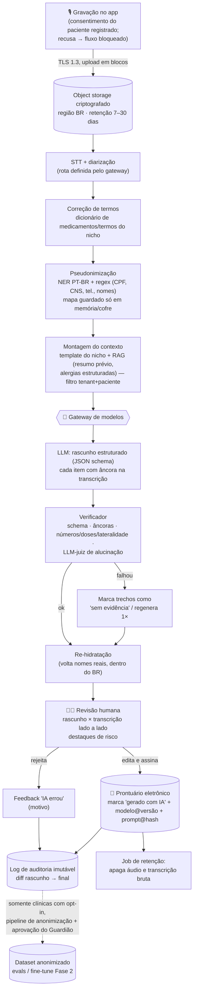

# Arquitetura de IA — pipeline, gateway de modelos, cache e custos

> Parte de [`README.md`](README.md). Preços de fornecedores são **FATO** (fontes ao final, consultadas em out/2026). Volumes de tokens, câmbio e custos por consulta são **ESTIMATIVA** com premissas explícitas. Integra-se à arquitetura geral da frente 🛠️ Engenharia (`docs/04-arquitetura`).

## 1. Pipeline do escriba clínico (áudio → prontuário)

**Latência-alvo (ESTIMATIVA):** consulta de 15 min → rascunho pronto em < 60 s após o fim da gravação (STT em streaming durante a consulta reduz para ~15–25 s).

## 2. Gateway de modelos

Um serviço interno (`ai-gateway`) por onde passa **toda** chamada de IA. Nenhum módulo chama fornecedor diretamente.

```mermaid
flowchart LR
    subgraph App["Módulos do SaaS"]
        S1[Escriba]
        S2[Resumo]
        S3[CID/TUSS]
        S4[Extração exames]
        S5[Chatbot WhatsApp]
        S6[Relatórios TEA / Plano alimentar]
    end

    subgraph GW["ai-gateway (região BR)"]
        P1["Política de roteamento<br/>tarefa × sensibilidade × tenant × custo"]
        P2["Guarda-corpos de entrada<br/>pseudonimização · detector de injeção · limites"]
        P3["Cache<br/>prompt cache · embeddings · respostas não-PHI"]
        P4["Guarda-corpos de saída<br/>schema · validação de códigos · filtros"]
        P5["Observabilidade<br/>custo · latência · versões · traces sem PHI"]
        P6["Fallback & kill switch"]
    end

    subgraph BR["🇧🇷 Processamento no Brasil"]
        M1["Gemini via Vertex AI<br/>endpoint regional southamerica-east1"]
        M2["Maritaca Sabiá-4 / Sabiazinho-4"]
        M3["Fase 2–3: modelos próprios<br/>(Qwen/Gemma/Mistral + LoRA)<br/>vLLM em GPU sa-east-1"]
        M4["STT auto-hospedado<br/>(Whisper-like) — Fase 2"]
        M5["ML clássico no-show<br/>(LightGBM, CPU)"]
    end

    subgraph EXT["🌎 Fora do Brasil — transferência internacional<br/>(cláusulas-padrão ANPD + DPA + não-treino + retenção mínima/ZDR)"]
        X1["Anthropic Claude<br/>Sonnet 5.5 · Haiku 4.5"]
        X2["OpenAI GPT-5.x / transcribe"]
        X3["Deepgram / AssemblyAI (STT)"]
    end

    App --> P1
    P1 --> P2 --> P3 --> BR
    P3 --> EXT
    BR --> P4
    EXT --> P4
    P4 --> P5
    P6 -.-> P1
```

### Regras de roteamento (Fase 1, configuráveis por tenant)

| Tarefa | Rota padrão | Alternativa / fallback | Observação |
|---|---|---|---|
| Escriba (psicologia) | **Somente BR** (Vertex regional / Maritaca) | outra rota BR | Nunca sai do país |
| Escriba (demais nichos) | BR (Vertex regional) | Claude Sonnet 5.5 com pseudonimização, se o tenant aceitou transferência internacional no contrato | Decidir rota padrão pelo eval de qualidade |
| Verificador de alucinação | modelo pequeno (Gemini Flash-Lite / Haiku 4.5 / Sabiazinho) | — | Barato, roda em toda nota |
| Resumo do paciente | BR | — | Contém histórico completo → preferir BR |
| CID/TUSS | Busca híbrida local + LLM pequeno para re-ranking | LLM maior se confiança baixa | Texto já aprovado; candidatos vêm da tabela |
| Extração de exames | LLM multimodal BR | Claude/GPT com documento pseudonimizado (tarja de cabeçalho) | Candidato nº 1 a modelo próprio na Fase 2 |
| Chatbot WhatsApp | LLM pequeno e rápido + ferramentas | humano | Mensagens podem conter sintomas → preferir BR |
| Relatórios TEA / plano alimentar | BR | Claude Sonnet 5.5 pseudonimizado | Números sempre do banco/motor |
| No-show | ML clássico interno | — | Sem LLM |

**Princípios técnicos do gateway**
- Versões de modelo **fixadas** (nada de alias "latest"); troca de versão só via PR com eval.
- Saída estruturada (JSON schema) e validação antes de devolver ao módulo.
- Orçamento por tenant e por funcionalidade (limite diário; alerta em 80%).
- *Timeouts*, *retries* com backoff, *circuit breaker* por fornecedor, fallback para outra rota **de mesma classe de residência** (rota BR nunca cai automaticamente para rota estrangeira).
- Traces (OpenTelemetry) com metadados — tokens, custo, latência, modelo, versão do prompt — **sem conteúdo clínico**; payloads completos, se guardados para depuração, ficam criptografados, com retenção ≤ 30 dias e acesso auditado.
- Prompts versionados no repositório (`prompts/<tarefa>/<nicho>/vN.md`), sem dados reais.

## 3. Cache

| Camada | O que cacheia | PHI? | Ganho |
|---|---|---|---|
| **Prompt caching do fornecedor** | Prefixo fixo: instruções do sistema, template do nicho, exemplos few-shot (sintéticos) | Não (prefixo sem dado do paciente) | Leitura de cache custa ~10% do preço de entrada nos fornecedores que oferecem (ex.: Anthropic US$ 0,20/MTok no Sonnet 5.5 vs US$ 2,00) e reduz latência |
| **Embeddings** | Vetores de tabelas (CID, TUSS, TACO), protocolos e documentos da clínica | Docs da clínica = sim → armazenados no Postgres/pgvector do tenant, região BR | Evita reprocessar |
| **Respostas determinísticas** | FAQ administrativa do chatbot por clínica (endereço, convênios, preparo); busca CID por hash de texto normalizado | Não para FAQ; CID por hash **dentro do tenant** | Corta chamadas repetidas |
| **Proibido** | Cache semântico de respostas clínicas entre pacientes ou entre clínicas | — | Risco de vazamento e de resposta errada para outro caso |

Ordem do prompt para maximizar cache: `[instruções fixas] → [template do nicho] → [exemplos] → (marcador de cache) → [contexto RAG do paciente] → [transcrição]`.

## 4. Custo por consulta (escriba, 15 min)

**Premissas (ESTIMATIVA):** 15 min de áudio; ~140 palavras/min → ~2.100 palavras ≈ 4.000 tokens de transcrição; prefixo fixo 3.000 tokens (cacheado) + RAG 1.000 tokens → **~8.000 tokens de entrada**; saída ~1.200 tokens; verificador com ~10.000 tokens de entrada e 300 de saída; câmbio **US$ 1 = R$ 5,50**. Preços de lista sem impostos (IOF/ISS/PIS-COFINS sobre serviços importados podem somar 15–25% nas rotas estrangeiras).

### 4.1 Transcrição (STT)

| Fornecedor | Preço (FATO) | 15 min |
|---|---|---|
| OpenAI gpt-4o-mini-transcribe | US$ 0,003/min | US$ 0,045 ≈ R$ 0,25 |
| Deepgram Nova-3 (pré-gravado) | ~US$ 0,0043/min | US$ 0,065 ≈ R$ 0,36 |
| OpenAI gpt-4o-transcribe | US$ 0,006/min | US$ 0,09 ≈ R$ 0,50 |
| AssemblyAI Universal-2 | US$ 0,0025/min | US$ 0,038 ≈ R$ 0,21 |
| STT auto-hospedado no BR (Fase 2) | GPU compartilhada | ~R$ 0,03–0,10 (ESTIMATIVA, depende de volume) |

> Todos os STT de API acima processam fora do Brasil (transferência internacional). Escolher por **WER em PT-BR clínico** no nosso eval, não só por preço.

### 4.2 Geração (LLM) — rascunho + verificador

| Rota | Preço (FATO, por milhão de tokens entrada/saída) | Rascunho | Verificador (modelo pequeno) | Total LLM |
|---|---|---|---|---|
| Claude Sonnet 5.5 + Haiku 4.5 | US$ 2 / 10 · US$ 1 / 5 | ~US$ 0,028 | ~US$ 0,012 | **~US$ 0,04 ≈ R$ 0,22** (menos com cache) |
| Gemini 2.5 Flash (Vertex regional BR)* | US$ 0,30 / 2,50 | ~US$ 0,005 | ~US$ 0,004 | **~US$ 0,01 ≈ R$ 0,05** |
| GPT-5 mini | US$ 0,25 / 2,00 | ~US$ 0,004 | ~US$ 0,003 | **~US$ 0,007 ≈ R$ 0,04** |
| Maritaca Sabiá-4 + Sabiazinho-4 | R$ 5 / 20 · R$ 1 / 4 | ~R$ 0,064 | ~R$ 0,011 | **~R$ 0,075** |
| Claude Opus 5.5 (casos difíceis apenas) | US$ 4 / 20 | ~US$ 0,056 | — | ~US$ 0,06 ≈ R$ 0,31 |

\* Preço de referência da API Gemini; o preço no Vertex AI em endpoint regional pode diferir — confirmar na tabela do Google Cloud.

### 4.3 Total por consulta

| Cenário | STT | LLM | **Total por consulta** | 600 consultas/mês (clínica média) |
|---|---|---|---|---|
| Qualidade máxima (Deepgram + Claude Sonnet 5.5) | R$ 0,36 | R$ 0,22 | **≈ R$ 0,58** | ≈ R$ 350 |
| Equilibrado (gpt-4o-mini-transcribe + Gemini Flash BR) | R$ 0,25 | R$ 0,05 | **≈ R$ 0,30** | ≈ R$ 180 |
| Nacional (Fase 1: STT de API + Sabiá) | R$ 0,25–0,36 | R$ 0,08 | **≈ R$ 0,33–0,44** | ≈ R$ 200–265 |
| Fase 3 (STT + LLM próprios no BR) | ~R$ 0,05 | ~R$ 0,05–0,15 | **≈ R$ 0,10–0,20** + custo fixo de GPU | depende do volume |

Outras funcionalidades (ESTIMATIVA): resumo do paciente R$ 0,02–0,10; CID/TUSS R$ 0,005–0,03; extração de exame R$ 0,02–0,08 por laudo; conversa de agendamento no WhatsApp R$ 0,01–0,05 em LLM (+ tarifa da Meta por conversa/mensagem, conforme categoria); no-show ≈ R$ 0.

### 4.4 Quando vale hospedar modelo próprio (Fase 3)

- Custo fixo (ESTIMATIVA): 2 GPUs (L40S/H100) 24×7 com redundância a US$ 2–4/h cada ≈ **R$ 16–35 mil/mês**, + ~0,5 engenheiro de MLOps.
- Se o LLM próprio substitui uma rota que custa R$ 0,22/consulta (Claude), o ponto de equilíbrio fica em ~**75–160 mil consultas/mês**; substituindo rota de R$ 0,05 (Gemini Flash), ~**320–700 mil**. Conclusão: **migrar para modelo próprio por custo só em escala alta; antes disso, só por exigência de residência/cliente**.
- Alternativa intermediária: GPU sob demanda/serverless na região BR para cargas em lote (relatórios, extração), mantendo tempo real em API.

## 5. Componentes e onde rodam

| Componente | Tecnologia sugerida | Região |
|---|---|---|
| ai-gateway | Serviço próprio (TypeScript/Python) ou base em LiteLLM/Portkey auto-hospedado, com políticas nossas | BR |
| Vetores | Postgres + pgvector (mesmo cluster, schema por tenant / RLS) | BR |
| Fila de jobs (STT, geração, retenção) | Fila gerenciada (SQS/Pub/Sub) ou Redis/BullMQ | BR |
| Pseudonimização | Presidio + reconhecedores PT-BR + regex | BR |
| Evals e experimentos | Runner em CI + MLflow/Langfuse auto-hospedado | BR |
| Serving Fase 2–3 | vLLM / TGI em GPU com autoscaling | BR |
| Rotulagem | Label Studio / Argilla auto-hospedado | BR |

## 6. Próximos passos técnicos (micropartes sugeridas para o líder IA/LLM)

1. `ia/gateway-esqueleto` — gateway com 2 rotas (BR + estrangeira), versões fixadas, telemetria de custo.
2. `ia/eval-escriba` — 50 consultas simuladas por nicho prioritário (medicina, fisio, nutri) + métricas WER/alucinação/omissão.
3. `ia/benchmark-stt-ptbr` — comparar 4 STT no eval (WER e erro de termos críticos).
4. `ia/escriba-prompt` — prompts v1 por nicho com saída JSON e âncoras.
5. `ia/pseudonimizacao-ptbr` — NER + regex + medição de recall de PHI.
6. `ia/no-show-baseline` — LightGBM com dados sintéticos até haver histórico real.
7. `lgpd/ripd-ia` — RIPD da IA e mapa de subprocessadores (com o 🛡️ Guardião).

---

## Fontes

- Preços Claude (Opus 5.5 US$ 4/20; Sonnet 5.5 US$ 2/10, cache read US$ 0,20; Haiku 4.5 US$ 1/5): [Anthropic — pricing](https://platform.claude.com/docs/en/about-claude/pricing).
- Claude no Amazon Bedrock — `sa-east-1` só com endpoint Global; regionais com +10%: [Claude in Amazon Bedrock](https://platform.claude.com/docs/build-with-claude/claude-in-amazon-bedrock).
- Vertex AI — endpoint regional `southamerica-east1` e processamento de ML na região; não usar endpoint global com requisito de residência: [Vertex AI locations](https://docs.cloud.google.com/vertex-ai/generative-ai/docs/learn/locations), [Data residency](https://docs.cloud.google.com/vertex-ai/generative-ai/docs/learn/data-residency).
- Maritaca (Sabiá-4 R$ 5/20; Sabiazinho-4 R$ 1/4): [maritaca.ai/en/api](https://www.maritaca.ai/en/api).
- GPT-5 mini e Gemini 2.5 Flash: [pricepertoken — GPT-5 mini](https://pricepertoken.com/pricing-page/model/openai-gpt-5-mini), [pricepertoken — Gemini 2.5 Flash](https://pricepertoken.com/pricing-page/model/google-gemini-2.5-flash).
- STT (gpt-4o-transcribe US$ 0,006/min, mini US$ 0,003/min; Deepgram Nova-3 ~US$ 0,0043/min batch, ~US$ 0,0077/min streaming; AssemblyAI US$ 0,0025/min): [convertaudiototext — STT API pricing 2026](https://convertaudiototext.com/blog/speech-to-text-api-pricing-2026), [convertaudiototext — Deepgram Nova-3](https://convertaudiototext.com/blog/deepgram-nova-3-explained).
- GPU (H100 mediana ~US$ 3/h; OCI H100 US$ 10,75/h): [Spheron — H100 price 2026](https://www.spheron.network/blog/h100-price-per-hour-2026/), [Spheron — GPU cloud LatAm 2026](https://www.spheron.network/blog/gpu-cloud-brazil-mexico-latin-america-2026/).
