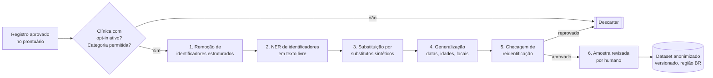

# Dados e treino — origem, anonimização, rotulagem e governança

> Parte de [`README.md`](README.md). **Todo dataset descrito aqui só pode ser criado/usado após aprovação do 🛡️ Guardião LGPD** (veto absoluto — `docs/00-governanca/hierarquia.md`). Este documento é técnico e deve ser validado pelo DPO/jurídico.

## 1. A ideia central: o que "treinar" significa para nós

| Mecanismo | Precisa de dado de cliente? | Quando |
|---|---|---|
| Prompts + templates por nicho | Não (escritos por especialistas) | Fase 1 |
| RAG com tabelas e protocolos públicos | Não | Fase 1 |
| RAG com prontuário do próprio paciente | Sim, **no atendimento** (finalidade original, sem treino) | Fase 1 |
| Few-shot com exemplos aprovados | Exemplos **sintéticos** ou anonimizados | Fase 1 |
| Evals (conjuntos de teste) | Sintéticos + anonimizados | Fase 1 em diante |
| Fine-tuning (LoRA/QLoRA) | Anonimizados + sintéticos, com base legal | Fase 2 |

A maior parte do ganho vem de **evals + correções dos profissionais**, não de treinar pesos.

## 2. Fontes de dados

### 2.1 Públicas (PT-BR) — base de conhecimento e eval

| Fonte | Uso | Observação |
|---|---|---|
| CID-10 (DATASUS) | RAG + validação de códigos | Versionar por vigência |
| TUSS (ANS) e SIGTAP (SUS) | RAG + validação de procedimentos | Atualizações periódicas da ANS |
| Bulário eletrônico ANVISA | Dicionário de medicamentos para correção de STT | Só como dicionário/referência, não para recomendar |
| PCDTs e protocolos do Ministério da Saúde | RAG de referência (resumo, não conduta automática) | Citar fonte e data |
| TACO (Unicamp) / TBCA (USP) | Motor nutricional | Checar licença de uso comercial |
| Corpora clínicos acadêmicos em PT-BR (ex.: SemClinBr, PUCPR) | Eval de extração/NER | **Checar licença** — muitos são só para pesquisa; não usar em produto sem permissão |
| Áudio público em PT-BR (ex.: Mozilla Common Voice) | Ajuste/benchmark de STT geral | Não é clínico; complementar com sintético |

### 2.2 Sintéticos — o principal combustível das Fases 1 e 2

- **Consultas simuladas gravadas:** roteiros escritos por profissionais de cada nicho, encenados por atores/colaboradores (com termo de cessão de voz). Dão áudio realista para medir WER e testar o escriba sem dado de paciente. Meta inicial: 50–100 consultas por nicho (ESTIMATIVA).
- **Texto sintético gerado por LLM** (evoluções, laudos, mensagens de WhatsApp, pedidos de convênio), **revisado por profissional**. Atenção: (1) sintético sozinho produz modelo "artificial" — misturar com real anonimizado; (2) checar os termos do fornecedor sobre usar saídas para treinar outros modelos.
- **Casos adversariais** (red-team): pacientes pedindo diagnóstico ao bot, injeção de prompt, áudio com ruído, sotaques regionais, falas sobrepostas.

### 2.3 Dados de clientes — só com base legal, contrato e anonimização

| Requisito | Detalhe |
|---|---|
| **Papel das partes** | Clínica = controladora; plataforma = operadora. Usar dado do cliente para **melhorar o produto/treinar** é finalidade nova → precisa estar no contrato e ter base legal própria |
| **Contrato (DPA)** | Cláusula de **opt-in** da clínica para uso de dados **anonimizados** na melhoria dos modelos; cliente pode sair a qualquer momento (sem efeito retroativo sobre modelo já treinado com dado anonimizado — deixar claro) |
| **Base legal** | Para dado anonimizado (de fato irreversível), a LGPD não se aplica (art. 12). Para dado ainda pseudonimizado → é dado sensível: exige base do art. 11 (na prática, consentimento específico e destacado, ou estudo por órgão de pesquisa com anonimização). **Decisão do DPO** |
| **Transparência ao paciente** | Política de privacidade da clínica (modelo fornecido por nós) informando uso de IA e, se houver, uso anonimizado para melhoria |
| **Exclusões** | Psicologia, saúde mental, HIV/ISTs, violência, gestação/aborto, menores de idade e genética: **fora do dataset de treino por padrão** (podem entrar apenas em eval, anonimizados e com aprovação específica) |
| **O que coletar** | Preferir **o diff** (rascunho IA → texto final aprovado) e rótulos de aceite/rejeição (ex.: "CID sugerido trocado por X") a guardar transcrições inteiras |

## 3. Pipeline de anonimização

1. **Identificadores estruturados:** nome, CPF, CNS, RG, telefone, e-mail, endereço, CEP, número de prontuário, carteirinha do convênio, nomes de profissionais e da clínica → removidos na origem.
2. **NER em texto livre (PT-BR):** regex para padrões brasileiros (CPF com dígito verificador, CNS, telefone, CEP, placas, datas) + modelo NER (ex.: Microsoft Presidio com reconhecedores customizados para PT-BR, spaCy `pt`, ou modelo BERT clínico em português ajustado para PHI). Detectar também nomes de familiares, escolas, empresas, cidades pequenas, profissões raras.
3. **Substituição consistente** por substitutos realistas ("Maria" → "Ana" em todo o documento), não por `[NOME]`, para não degradar o treino. Mapas de substituição **não** são guardados.
4. **Generalização:** datas → deslocamento aleatório por paciente (mantendo intervalos); idade > 89 → "90+"; município → região/UF quando pequeno.
5. **Checagem de reidentificação:** k-anonimato nos quase-identificadores (idade, sexo, município, diagnóstico raro); doenças raras + cidade pequena = descartar; teste de "ataque de ligação" amostral.
6. **Revisão humana amostral:** ≥ 2% dos registros (mínimo 200 por lote) revisados por pessoa treinada; meta de recall de PHI ≥ 99% medida em conjunto rotulado; lote reprovado volta inteiro.

**Onde roda:** dentro do nosso ambiente, na região Brasil. A anonimização **não** é feita mandando o dado bruto para uma API estrangeira.

> Em tempo de **inferência** (Fase 1) aplicamos uma versão leve (pseudonimização de identificadores diretos antes de enviar à API externa e re-hidratação na volta). Isso reduz risco, **mas não torna o dado anônimo** — ver README §4.

## 4. Rotulagem

| Tarefa | Rótulo | Quem rotula | Garantia de qualidade |
|---|---|---|---|
| Escriba | Evolução ideal a partir da transcrição; marcação de alucinações/omissões | Profissional do nicho (revisores pagos) | Dupla rotulagem em 10%; concordância (kappa) ≥ 0,7 |
| CID/TUSS | Código(s) corretos + justificativa | Médico/codificador; odontólogo para TUSS odonto | Adjudicação por sênior em divergências |
| Extração de exames | Campos (analito, valor, unidade, referência) | Técnico treinado + checagem automática | Validação de faixa e unidade |
| Chatbot | Intenção, urgência (sim/não), resposta ideal | Equipe de atendimento + profissional para urgência | Lista de "urgências" aprovada clinicamente |
| No-show | Comparecimento real (vem do sistema) | Automático | — |

- Ferramenta: Label Studio ou Argilla **auto-hospedado no Brasil** (não usar plataformas de rotulagem estrangeiras com dado de saúde).
- Revisores assinam termo de confidencialidade; acesso só a dados anonimizados; trilha de auditoria.
- Guia de rotulagem por nicho versionado no repositório (sem exemplos reais).

## 5. Governança e versionamento

| Item | Prática |
|---|---|
| **Inventário** | Cada dataset tem *datasheet*: origem, base legal, clínicas incluídas (IDs), período, categorias excluídas, método de anonimização, aprovação do Guardião (link do PR), validade |
| **Versionamento** | DVC ou lakeFS sobre armazenamento de objetos criptografado na região BR; hash imutável por versão; **nunca** no git |
| **Linhagem** | Cada modelo treinado registra: dataset@versão, código@commit, hiperparâmetros, métricas de eval (MLflow ou equivalente) — *model card* |
| **Acesso** | RBAC; acesso a dataset só para equipe de ML; logs de acesso; sem download para máquinas pessoais |
| **Revogação** | Clínica sai do opt-in → dados removidos das **próximas** versões; política de re-treino periódica (ex.: semestral) |
| **Retenção** | Datasets intermediários (pré-anonimização) apagados em ≤ 30 dias; dataset final revisto anualmente |
| **RIPD** | Relatório de Impacto à Proteção de Dados específico para "treino de modelos", feito pelo Guardião antes da Fase 2 |
| **Comitê de IA** | Sócio + responsável técnico clínico + DPO + líder IA aprovam novos datasets e novos modelos em produção |

## 6. O que NUNCA fazer

1. ❌ Colocar dado real de paciente em repositório git, issue, prompt de exemplo, log de aplicação, planilha compartilhada ou ferramenta de chat.
2. ❌ Mandar dado de saúde identificável para API de LLM **sem contrato** (DPA, cláusulas-padrão ANPD, não uso para treino) — inclusive "só para testar".
3. ❌ Usar planos de consumidor (ChatGPT/Claude/Gemini pessoais, apps gratuitos) com dado de cliente.
4. ❌ Treinar com dado de clínica que não deu opt-in, ou de categorias excluídas (saúde mental, menores, HIV etc.) sem aprovação específica.
5. ❌ Chamar de "anonimizado" um dado apenas pseudonimizado (troca de nome com tabela de correspondência guardada).
6. ❌ Misturar dados de clínicas diferentes em RAG de atendimento (vazamento entre tenants).
7. ❌ Fazer fine-tune e publicar/compartilhar o modelo ou pesos (modelos podem memorizar e regurgitar trechos de treino).
8. ❌ Treinar com saídas da IA não revisadas por humano (o modelo aprende os próprios erros).
9. ❌ Guardar áudio de consulta indefinidamente.
10. ❌ Colocar um modelo novo em produção sem eval comparativo com o anterior e aprovação do comitê.
11. ❌ Usar datasets acadêmicos/licenciados "só para pesquisa" em produto comercial.
12. ❌ Usar a previsão de falta ou qualquer score para negar atendimento automaticamente.
