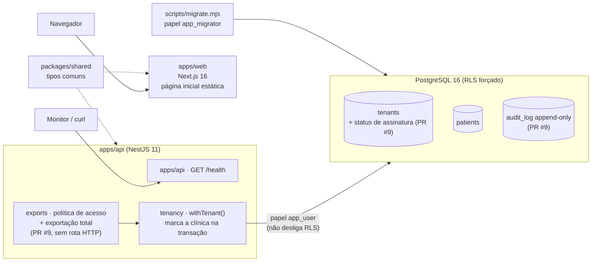

# Relatório geral do projeto Plataforma Saúde

> **Para quem:** os dois sócios (N0). Dá para entender o projeto inteiro só com este documento, sem abrir o resto.
> **Autor:** Maestro (N1) · **Data de referência:** 29/10/2026 (a **§0** resume as rodadas 28 a 30; o resto do documento descreve o estado de 27/10, rodada 27; versões anteriores: 25/10, 15/10, 12/10 e 09/10/2026) · **Base:** só fatos do repositório, com o arquivo de origem citado em cada ponto.
> **Escopo:** rodadas 1 a 27. A `main` continua no código de 12/10 (migrações 0001 a 0006), porque o GitHub Actions está parado por cobrança desde então e a regra é não mergear código sem CI verde. Todo o resto está **pronto em PR**, testado só localmente: #43 a #47, #75 e #76 (telas), #54 (economia de minutos), #56 (IA), #57, #60, #61, #62, #63, #65 e **#73** (API, que substitui #66 a #69), #58 (Terraform), #59 (Docker), #36 (PoC da D4, rascunho), #74 (multer) e os Dependabot #49, #51, #52, #70, #71 e #72. A §6 (rodada 5) fica como registro histórico.
> **Números de teste:** são os últimos verificados localmente pelo Maestro. Nenhum passou pelo CI.
>
> **Legenda de estado:** ✅ pronto · 🛠️ em andamento ou aguardando merge · 📋 planejado (só no papel)

---

## 0. Atualização de 29/10/2026 (rodadas 28 a 30)

> **Leia isto primeiro.** As seções 1 a 11 descrevem 27/10, quando o GitHub Actions estava parado e a `main` ainda tinha o código de 12/10. **Isso mudou:** onde elas dizem "CI parado", "pronto em PR" ou "main em 0006", vale o que está aqui.

**O CI voltou e o backend entrou.** Em 27/10 o repositório ficou **público** e o GitHub Actions voltou a rodar de graça. A fila validada no ensaio do merge completo entrou na `main`, PR por PR, cada um com CI verde (CI, Segurança com Redis real, Testes de produção, CodeQL, imagem e infra): #77, #43, #57, #61, #62, #63, #65, #56, #59, **#73** (importador, responsáveis, portal, WhatsApp e tarefas automáticas), #60, #58, #76, #49 e as atualizações do Dependabot. O CI real achou 4 defeitos que o teste local não pegava (imagem, Trivy/OpenSSL, k6 e infra), todos corrigidos. Fonte: [rodada 29](2026-10-27-rodada-29-merges.md).

**Proteção do repositório (28 e 29/10, com o OK do sócio).**
- A `main` só aceita PR com a branch atualizada e 10 checks obrigatórios verdes, sem force push nem exclusão (#87).
- CodeQL publica na aba Security (#90): 103 regras, **0 alertas**.
- Alertas do Dependabot ligados (#108): o único achado (`qs`, só em teste) foi corrigido; **0 abertos**.

**Entregas de código depois dos merges** (todas com parecer do Guardião e CI verde):

| PR | O quê | Guardião |
|---|---|---|
| #88 | Job diário que gera o índice cego do CPF dos pacientes antigos, sem script manual | aprovado após C1/C2 |
| #89 | Índice cego do CPF também nos responsáveis (0054) | aprovado após C1 |
| #109 | Tipo `apoiador` (tomada de decisão apoiada): não representa o paciente; informação clínica exige a decisão do profissional **e** a autorização do paciente (0055) | vetado, depois aprovado |
| #110 | Escopo da informação clínica ao responsável (`essencial` por padrão) e pedido de sigilo do adolescente (0056) | aprovado com ressalvas |
| #111 | Pendência de revisão de pai/mãe ou tutor de paciente adulto (0057) | aprovado |
| #113 | Pedido de sigilo ligado ao atendimento do prontuário, só pelo id (0058) | aprovado com ressalvas (feitas) |

Com isso, **não sobra pendência de código nos pareceres do Guardião**. O que falta depende de pessoas, de infraestrutura ou de data. Fonte: [rodada 30](2026-10-29-rodada-30.md).

**Bug do postgres.js 3.4.9 (#112).** Já tinha sido relatado por terceiros e foi corrigido na v4.0.0 (29/10). Seguimos com o nosso patch; a troca para a v4 fica para depois de ~12/11, porque ela quebra compatibilidade.

**O que falta para o piloto, hoje:**
1. **D4** (login real): é o bloqueio técnico nº 1, junto com MFA (issues #106 e #107 do @Lopesloro).
2. Rodar as provas K-c3/K-c5 no staging da AWS (nada foi aplicado ainda) e o R10 do importador.
3. Front: o @Lopesloro decidir o `fake.ts` no #86 (pilha #44–#47 + #75 sobre a `main`, CI verde) e atualizar sobre a `main` os PRs #91 e #104, já aprovados pelo Maestro.
4. Interceptor geral de auditoria (issue #105, com o @Lopesloro).
5. Jurídico: **D8** (advogado), agora com a pergunta 1.15 sobre o sigilo do adolescente; D7 e D13.

---

## 1. Resumo executivo

**O que é o produto.** Um SaaS (software vendido por assinatura, usado pela internet) de gestão para clínicas e consultórios de **todos os nichos da saúde**, para concorrer com iClinic, Feegow e Ninsaúde. O escopo completo inclui agenda, prontuário por especialidade, receita digital, financeiro, Pix, nota fiscal, WhatsApp, portal do paciente, convênios (TISS) e IA, com a LGPD considerada desde o desenho. Fonte: [CONTEXTO.md](../../CONTEXTO.md) §1.

**Por que pode dar certo.** É um mercado de **troca de sistema**: 92% dos estabelecimentos já usam sistema eletrônico [FATO, TIC Saúde, citado em [relatório executivo de mercado](../01-mercado/relatorio-executivo-mercado.md) §1]. As queixas mais comuns contra os concorrentes são prontuário bloqueado por inadimplência, cancelamento difícil, cobrança escondida e suporte lento. Nossa proposta é atacar exatamente essas dores, com garantias que o código faz cumprir.

**Onde estamos (27/10/2026).** **O núcleo do MVP (primeira versão vendável) está escrito, testado localmente e aprovado pelo Guardião, mas nada de código entrou na `main` desde 12/10**, porque o GitHub Actions continua parado por falta de pagamento. Desde a última versão deste relatório (rodada 15):
- o **financeiro** (#65) e o **prontuário** (#63) passaram de "aprovado com ressalvas" para **APROVADO** (rodada 20);
- nasceram e foram aprovados o **importador** de dados dos concorrentes, os **responsáveis** do paciente (pais, representante legal, quem paga), o **backend do portal do paciente** e os **lembretes por WhatsApp**. Os quatro foram juntados num único PR, o **#73**, que o Guardião **APROVOU** em 23/10 (rodadas 17 a 19);
- entrou o **agendador real das tarefas automáticas** (descarte de dados vencidos, revogação na maioridade, lembretes), que só pode ser mergeado depois de passar com um Redis real (rodada 20);
- o **Terraform do staging** (#58) ganhou alarmes, IAM das chaves e uma trava de TLS no CI (rodadas 20 a 22);
- os vetos das telas do front (#44, #46, #47) foram **levantados** e o **portal do paciente no navegador foi ligado ao backend real** (#75) (rodadas 24 e 25);
- foi feito um **ensaio local do merge completo** (todos os PRs juntos, na ordem) e as telas de pacientes e agenda foram alinhadas ao backend novo (**#76**) (rodada 26);
- a **segurança das chaves** ficou mais forte: cada clínica tem uma chave que **só abre com a identificação da própria clínica**, um alarme avisa qualquer mudança nas regras das chaves, e a API sobe em produção com o cofre de chaves real da AWS — só falta o login (D4). O Terraform do staging (#58) foi **APROVADO** pelo Guardião (rodada 27).

Ao todo, o Guardião vetou 4 entregas novas nessas rodadas (#66, #67, #68, #69). Todas foram corrigidas e reaprovadas antes de existir dado real. Fontes: [rodada 16](2026-10-15-rodada-16.md), [rodadas 17–19](2026-10-22-rodadas-17-a-19.md), [rodada 20](2026-10-23-rodada-20.md), [rodadas 21–22](2026-10-23-rodadas-21-22.md), [rodadas 24–25](2026-10-25-rodadas-24-25.md), [rodada 26](2026-10-25-rodada-26.md), [rodada 27](2026-10-27-rodada-27.md).

| Pronto | Falta |
|---|---|
| Pesquisa de mercado (11 segmentos) e recomendação de nicho | Confirmar o nicho com 5 a 10 entrevistas reais (D1) |
| PRD, WBS (332 micropartes), roadmap, backlog do MVP (176 histórias, 898 pontos), garantias G1–G9 | Merge de tudo quando o CI voltar (§9.1) |
| LGPD: RIPD da plataforma, da IA e do WhatsApp, minuta do DPA, proposta de retenção, plano de incidente, matriz de retenção por conselho e **mais de 25 pareceres do Guardião** | Advogado validar os itens ⚖️ (D8); nomear o encarregado (DPO); DPA assinado |
| API pronta em PR: pacientes, agenda, vínculo de cuidado, guias, pacotes, prontuário, financeiro, importador, responsáveis, portal do paciente, WhatsApp e agendador de tarefas (**53 migrações**, `test:rls` **613/613** local) | Login, permissões por perfil (RBAC) e MFA: tudo depende da **D4** |
| Telas do front: design system, Ajudante, Hoje, Agenda, Pacientes (#42 na `main`); demais telas e portal ligado ao backend em PR (#43 a #47, #60, #75, #76) | Login real (D4) para usar no navegador; @Lopesloro aceitar ou descartar o #75 |
| Infra em PR: Terraform do staging com alarmes, IAM das chaves e alarme de administração do KMS (#58, **aprovado**), imagem Docker (#59) | Orçamento (D13) e o primeiro *apply* (criação real) na AWS |
| 9 checks automáticos no CI, mais os que chegam com os PRs (§5) | **O GitHub Actions parou por falta de pagamento**: hoje nenhum CI roda ([fila.md](../00-governanca/fila.md)) |

**As 3 decisões mais urgentes**

1. **D4: autenticação.** É o **gargalo** do projeto: sem login não existe RBAC nem MFA, as telas só funcionam com sessão de teste, a entrada no portal do paciente continua simulada e nenhuma clínica entra. A PoC do PR #36 já mediu Zitadel × Better Auth, e o memo da rodada 10 recomenda Better Auth. Fonte: [memo D04](../00-governanca/memos/D04-autenticacao.md).
2. **D8: contratar o advogado de saúde + LGPD**, junto com a nomeação do **DPO**. Bloqueia o piloto com dados reais, o DPA, os termos e a publicação da Carta de Compromissos. Fonte: [memo D08](../00-governanca/memos/D08-validacao-juridica.md).
3. **D13: orçamento de infraestrutura e pentest.** Destrava o staging na AWS (Terraform parado) e o pentest obrigatório antes do piloto. Fonte: [memo D13](../00-governanca/memos/D13-orcamento-infra-pentest.md).

Além das decisões, há uma **ação simples e urgente**: **regularizar o pagamento do GitHub** da conta Rocafa. Sem isso o CI não roda e, pela regra do projeto, nenhum PR de código entra. Há ainda um motivo de segurança: a versão do Next.js (o motor do site) hoje na `main` tem **2 vulnerabilidades críticas**, e a correção (Dependabot #72) é o primeiro merge da fila assim que o CI voltar ([rodada 20](2026-10-23-rodada-20.md)).

---

## 2. Linha do tempo

As datas estão no horário de Brasília. Os merges aparecem no GitHub como 09/10 em UTC.

| Data | Rodada | O que foi feito | PRs / commits |
|---|---|---|---|
| 06/10/2026 | 0 — Fundação | Repositório criado; governança e hierarquia de agentes (Maestro, Guardião LGPD com veto, 4 frentes) | `34a9b6f` |
| 08/10/2026 | 1 — Pesquisa e planejamento | Mercado geral e 8 arquivos de nichos; PRD e WBS; LGPD (mapa, papéis, checklist, RIPD); estratégia de IA; arquitetura e esqueleto do monorepo; registro das decisões D1–D8 | `550e7aa` … `fd863a1`, `3b848c0` |
| 08/10/2026 | 2 — Visão e processo | Visão e posicionamento; playbook (RACI, rituais); modelos de issue; relatório executivo de mercado com matriz de nichos; backlog do MVP; definição de pronto; métricas; plano de piloto | **PR #5** (merge em 08/10) |
| 08/10/2026 | — | Dependabot abre 4 PRs de atualização de dependências | PRs #1–#4 (abertos) |
| 08/10/2026 | 3 — Revisão LGPD + bootstrap | Guardião vetou o PR #5 (1 bloqueante, corrigido); produto incluiu guia, pacotes e agenda simultânea no MVP; engenharia criou API NestJS + site Next.js + teste de isolamento entre clínicas no CI; CodeQL | **PR #6**, **PR #7** (merge em 08/10); `f452407`, `db440d8`, `5bb1d6d` |
| 08–09/10/2026 | 4 — Garantias ao cliente | Garantias G1–G9 contra as queixas do mercado; Guardião vetou a 1ª versão (2 bloqueantes, corrigidos); garantia de saída (G1–G3) em código com 24 testes unitários e 18 contra banco real | **PR #8**, **PR #9** (abertos, CI 5/5) |
| 09/10/2026 | 5 — Testes de segurança e produção | 72 ataques automatizados + ZAP; resiliência (banco fora, carga, backup/restauração); 1 falha crítica de isolamento e 1 bug da biblioteca de banco encontrados e corrigidos (§6) | PRs #10 e #11 (#8 a #12 mergeados em 09/10) |
| 09/10/2026 | 6 — Dependabot | Actions atualizadas (checkout, setup-node, pnpm) com SHA conferido; TypeScript 6.0.3; TS 7 recusado porque quebra o lint | **#1, #2, #3, #13** mergeados; #4 fechado ([relatório](2026-10-09-rodada-6-dependabot.md)) |
| 10–11/10/2026 | 7 — Necessidades de produção | Checklist P0/P1/P2, portões A/B/C, custo estimado de AWS, decisões novas D10–D14; LGPD: RIPD da plataforma, minuta de DPA, retenção (D7), plano de incidente, checklist CFM 2.454 | **#27**, **#28** ([relatório](2026-10-10-rodada-7-necessidades-producao.md)) |
| 11–12/10/2026 | 8 — Fundação de segurança, IA e front | 4 abas em paralelo (ENG, DevOps, LGPD, QA) e depois o front. Entraram: guarda de schema, pendências de produção (build, 25006 → 503, rate limit em Redis), NestJS 12, auditoria encadeada, criptografia por clínica, golden sets e memos D1–D14, ações de auditoria (0006), @Lopesloro no `CODEOWNERS`. PoC da D4 feita (rascunho). Telas do front abertas em pilha (#42–#47) | **#29, #30, #32, #34, #35, #37, #39, #40, #48** mergeados; #36 rascunho ([estado](2026-10-12-estado-rodada-8.md)) |
| 12/10/2026 | 9 — Fila e higiene | `fila.md` compartilhada entre os dois Maestros; merges de #41, #31 e #33 (Dependabot #14–#26 fechados); parecer do Guardião sobre o front: **#44, #46 e #47 vetados**; #42 mergeado; #38 (pareceres LGPD) mergeado. **O GitHub Actions parou por billing** e o #43 ficou pronto mas parado | **#41, #31, #33, #42, #38** ([o que falta](2026-10-12-o-que-falta.md), [fila](../00-governanca/fila.md)) |
| 13/10/2026 | 10 — Sem CI: decisões | Memo de **recomendação da D4 (Better Auth)**, **kit de entrevistas** (D1/D2), **pacote para o advogado** (D8); termo de consentimento das entrevistas revisado e registrado no ROPA | `main` ([rodada 10](2026-10-13-rodada-10-sem-ci.md)) |
| 13/10/2026 | 11 — API, infra e IA | Primeiras **rotas de negócio** (pacientes e agenda), **Terraform do staging** pronto para PR, **golden sets** com 50 casos por nicho | PRs **#57, #58, #56** ([rodada 11](2026-10-13-rodada-11.md)) |
| 13/10/2026 | 12 — Revisões e ligação do front | Guardião **vetou #57 e #58** (nome na URL, exportação impossível de apagar, senha em log) → corrigidos e **reaprovados**; **telas ligadas à API real**; **imagem Docker** + E2E no CI; PR de economia de minutos | PRs **#60, #59, #54** ([rodada 12](2026-10-13-rodada-12.md)) |
| 14/10/2026 | 13 — Ressalvas e guias | **Vínculo de cuidado** no servidor, alerta de anomalia, pseudônimo via KMS; **API de guias e pacotes** (saldo nunca negativo sob concorrência); ressalvas de infraestrutura (break-glass, backup, logs) | PRs **#61**, guias e pacotes, #58 atualizado ([rodada 13](2026-10-14-rodada-13.md)) |
| 14/10/2026 | 14 — Prontuário | **Prontuário** por nicho (cifrado, versionado, bloqueado após finalizar, notas privadas da psicologia); Guardião **vetou 2 vezes o vínculo de cuidado** (encaixe consigo mesmo; remarcar consulta antiga) e **1 vez o prontuário** (troca de sigilo abria registros antigos): tudo corrigido e reaprovado | PRs **#63**, #61 e #62 atualizados ([rodada 14](2026-10-14-rodada-14.md)) |
| 15/10/2026 | 15 — Ressalvas e financeiro | Retenção legal que bloqueia eliminação, custódia do psicólogo substituto, **usuário da sessão travado no banco**; **financeiro** (cobranças, caixa, recibos sem buraco, insumo do Receita Saúde, texto neutro) | PRs **#65**, #61 e #63 atualizados ([rodada 15](2026-10-15-rodada-15.md)) |
| 15/10/2026 | 16 — Limpeza das ressalvas | Toda transação com usuário travado (0019); o banco passa a saber quem é admin ou psicólogo (0020); ressalvas do financeiro (0021); registro de mudanças de estrutura do banco (pgaudit) e alarmes no Terraform | #61, #63, #65, #58 atualizados ([rodada 16](2026-10-15-rodada-16.md)) |
| 15–22/10/2026 | 17 a 19 — Importador, responsáveis, portal e WhatsApp | **Importador** dos concorrentes (#66), **responsáveis** do paciente com pagador congelado (#67), **backend do portal do paciente** com sessão própria (#68) e **lembretes por WhatsApp** (#69). Guardião vetou os quatro pelo menos uma vez; todos corrigidos e reaprovados. Integração dos quatro no **#73** (0036–0040), **APROVADO** em 23/10 | PRs **#66–#69** → **#73** ([rodadas 17–19](2026-10-22-rodadas-17-a-19.md)) |
| 23/10/2026 | 20 — Agendador e aprovações | **#65 e #63 APROVADOS**; **agendador real das tarefas automáticas** (BullMQ, 7 tarefas, 0043); alarmes de tarefas no Terraform; achado de 2 vulnerabilidades críticas no Next.js (#72 vira o 1º merge) | #73, #58 ([rodada 20](2026-10-23-rodada-20.md)) |
| 23/10/2026 | 21 a 23 — Fechamento do importador | Chave própria por lote de importação e índice cego do CPF (0046): **importador aprovado pelo código**; operador nominal na correção do fundador (0047); responsáveis importados com as regras de idade (0048); varredura de testes instáveis; chave de lote sem órfã (0049); titular que passa a menor perde o acesso ao portal (0050); trava de TLS e IAM das chaves no Terraform | #73, #58 ([rodadas 21–22 e 23](2026-10-23-rodadas-21-22.md)) |
| 24/10/2026 | — Dependabot local | Todos os PRs do Dependabot testados localmente; ordem de merge definida; PR #74 (multer/body-parser) | [relatório](2026-10-24-dependabot-local.md) |
| 24–25/10/2026 | 24 e 25 — Front e portal real | **Vetos do front levantados** (#44, #46, #47); contrato único `ApiPortal`; redução de idade do adolescente só com documento conferido (0051–0053); **PR #75**: portal do navegador ligado ao backend real | #73, **#74**, **#75** ([rodadas 24–25](2026-10-25-rodadas-24-25.md)) |

Fontes: `git log --oneline --first-parent origin/main`, `gh pr list --state all`, [rodada 2](2026-10-08-rodada-2.md), [rodada 3](2026-10-08-rodada-3.md), [rodada 4](2026-10-09-rodada-4-garantias.md), [rodada 6](2026-10-09-rodada-6-dependabot.md), [rodada 7](2026-10-10-rodada-7-necessidades-producao.md), [rodada 8](2026-10-12-estado-rodada-8.md), [o que falta](2026-10-12-o-que-falta.md) e os relatórios das rodadas 10 a 25 em `docs/relatorios/`.

---

## 3. O que existe hoje, por área

### 3.1 Governança e agentes

| Item | Onde | Estado | Como verificar |
|---|---|---|---|
| Hierarquia (N0 sócios → N1 Maestro, Guardião, Revisor → N2 líderes → N3 executores) | [hierarquia.md](../00-governanca/hierarquia.md) | ✅ | Ler o organograma (diagrama Mermaid) |
| Fluxogramas (ciclo de demanda, fluxo de dados de paciente, git) | [fluxograma.md](../00-governanca/fluxograma.md) | ✅ | Abrir no GitHub (renderiza os diagramas) |
| Playbook: RACI, rituais, severidade de incidente | [processo-de-trabalho.md](../00-governanca/processo-de-trabalho.md) | ✅ | — |
| 10 agentes configurados | [.claude/agents/](../../.claude/agents/) | ✅ | Abrir o Claude Code na pasta; os agentes carregam sozinhos |
| Guia de skills e automação | [skills-agentes-e-automacao.md](../00-governanca/skills-agentes-e-automacao.md) | ✅ | — |
| Página visual da orquestra | [orquestra.html](../00-governanca/orquestra.html) | ✅ | Abrir no navegador |
| Registro de decisões (D1–D14) | [decisoes.md](../00-governanca/decisoes.md) | 🛠️ todas pendentes | — |
| Memos de 1 página por decisão (D1–D14), com opções, custo e recomendação | [memos/](../00-governanca/memos/README.md) | ✅ (PR #29) | Nenhum memo decide nada |
| Fila de trabalho compartilhada entre os dois Maestros (@Rocafa e @Lopesloro) | [fila.md](../00-governanca/fila.md) | ✅ | Regra: quem abriu o PR faz o merge |
| Regras para agentes (≤ 3 subagentes, commit a cada entrega) | [AGENTS.md](../../AGENTS.md) | ✅ | — |
| `CODEOWNERS` (quem revisa cada pasta) | [.github/CODEOWNERS](../../.github/CODEOWNERS) | ✅ @Lopesloro incluído (PR #48) | — |

### 3.2 Mercado

| Item | Onde | Estado | Como verificar |
|---|---|---|---|
| Mercado geral e concorrentes | [mercado-geral-e-concorrentes.md](../01-mercado/mercado-geral-e-concorrentes.md) | ✅ | Cada número tem URL e data |
| 8 arquivos de nichos (11 segmentos) | [nichos/](../01-mercado/nichos/) | ✅ | — |
| Relatório executivo: TAM/SAM/SOM, matriz de nichos, 10 hipóteses, roteiro de entrevista | [relatorio-executivo-mercado.md](../01-mercado/relatorio-executivo-mercado.md) | ✅ | Marcações [FATO] / [ESTIMATIVA] em cada número |
| Entrevistas com clínicas reais | — | 📋 | Pré-requisito da D1 e da D2 |

Números-chave (fonte: relatório executivo §1): TAM de R$ 0,6 a 2,0 bi/ano e SAM das terapias de R$ 0,18 a 0,82 bi/ano, ambos [ESTIMATIVA]; SOM de R$ 2 a 20 mi de ARR em 3 anos, com R$ 6 mi no cenário base [ESTIMATIVA]. Os números do Reclame Aqui (iClinic nota 6,4; 17,96% das queixas da Doctoralia são "não consegue cancelar") estão marcados como [FATO-snippet] e precisam ser revalidados antes de ir para um investidor.

### 3.3 Produto

| Item | Onde | Estado | Como verificar |
|---|---|---|---|
| PRD (visão, personas, escopo por fase, riscos, preço) | [PRD.md](../02-produto/PRD.md) | ✅ | — |
| WBS: 24 módulos, 332 micropartes (194 MVP, 106 F2, 32 F3; 169 tocam dado sensível) | [WBS-micropartes.md](../02-produto/WBS-micropartes.md) | ✅ | Dependências validadas por script na rodada 3 |
| Roadmap: MVP nov/2026–jun/2027 (estimativa), marcos M0 a M4 | [roadmap.md](../02-produto/roadmap.md) | ✅ | Gantt no §6 |
| Backlog do MVP: 24 épicos, 176 histórias, 898 pontos (M0+M1: 79 histórias, 377 pontos) | [backlog-mvp.md](../02-produto/backlog-mvp.md) | ✅ | Cenários Gherkin no M0 e no M1 |
| Visão e posicionamento | [visao-e-posicionamento.md](../02-produto/visao-e-posicionamento.md) | ✅ | — |
| Jornadas, definição de pronto, métricas (eventos sem dado pessoal), plano de piloto (30 clínicas, 4 ondas) | [jornadas.md](../02-produto/jornadas.md), [definicao-de-pronto.md](../02-produto/definicao-de-pronto.md), [metricas-produto.md](../02-produto/metricas-produto.md), [plano-piloto.md](../02-produto/plano-piloto.md) | ✅ | — |
| Garantias G1–G9 + Carta de Compromissos (rascunho, ressalvas M1–M6 aplicadas no PR #28) | [garantias-ao-cliente.md](../02-produto/garantias-ao-cliente.md) | 🛠️ na `main`; aguarda D9 e advogado | — |
| Necessidades de produção: checklist P0/P1/P2, portões A (staging), B (piloto) e C (lançamento) | [rodada 7](2026-10-10-rodada-7-necessidades-producao.md) | ✅ (documento) | — |
| Telas do front com **dados fictícios** (sem API): design system em cinza, Ajudante (busca e ações por texto, 100% local), Hoje, Agenda, Pacientes | `apps/web/` (PR #42) e [estado do front](2026-10-12-front-estado.md) | ✅ #42 na `main` · 🛠️ #43 pronto, parado sem CI | Capturas em `docs/02-produto/telas/` (no #42) |
| Telas de atendimento/prontuário/documentos (#44), financeiro/guias/mensagens (#45), configurações/acesso (#46), portal do paciente/PWA (#47) | PRs #44 a #47 (@Lopesloro) | 🛠️ **Vetos levantados em 24/10**: #46 aprovado; #44, #45 e #47 aprovados com ressalvas. Merge só com CI verde | [re-revisão do front](../03-seguranca-lgpd/revisoes/2026-10-24-front-vetos.md) |
| Telas de pacientes e agenda ligadas à API real | PR #60 | 🛠️ pronto, aguarda CI | — |
| **Portal do paciente ligado ao backend real**: escolha de "de quem" é o acesso (o próprio paciente ou o filho, por exemplo), resgate do convite com código enviado ao telefone do cadastro, botões de confirmar e cancelar decididos pelo servidor, recibos, nada clínico para o responsável. Fora do ambiente de desenvolvimento ele fica travado no modo de teste até existir login real (D4) | PR #75 (empilhado sobre o #47, sem mexer na branch do @Lopesloro) | 🛠️ aprovado com ressalvas (R1–R4 corrigidas); **aguarda @Lopesloro aceitar ou descartar** | [parecer do #75](../03-seguranca-lgpd/revisoes/2026-10-25-pr75.md); front: 262 testes e E2E do portal 24/24 (números do executor) |

### 3.4 LGPD e segurança

| Item | Onde | Estado | Como verificar |
|---|---|---|---|
| Mapa regulatório (CFM 2.454/2026, ANPD, conselhos) | [03-seguranca-lgpd/README.md](../03-seguranca-lgpd/README.md) | ✅ (não é parecer jurídico) | Itens ⚖️ vão ao advogado |
| Papéis: clínica controladora, nós operadores; cláusulas do DPA | [papeis-controlador-operador.md](../03-seguranca-lgpd/papeis-controlador-operador.md) | ✅ | — |
| Bases legais, requisitos técnicos, LGPD e IA | [pasta 03](../03-seguranca-lgpd/) | ✅ | — |
| Checklist de PR e modelo de RIPD | [checklist-pr.md](../03-seguranca-lgpd/checklist-pr.md), [RIPD-modelo.md](../03-seguranca-lgpd/RIPD-modelo.md) | ✅ | — |
| Revisão do PR #5 (vetado → corrigido) | [revisoes/2026-10-08-pr5.md](../03-seguranca-lgpd/revisoes/2026-10-08-pr5.md) | ✅ | — |
| Revisão das garantias (vetado → corrigido; ressalvas M1–M6 aplicadas no PR #28) | [revisoes/2026-10-09-garantias.md](../03-seguranca-lgpd/revisoes/2026-10-09-garantias.md) | ✅ | — |
| RIPD da plataforma, minuta do DPA, retenção e descarte (proposta da D7), plano de resposta a incidente (3 dias úteis), checklist CFM 2.454 | [RIPD-plataforma.md](../03-seguranca-lgpd/RIPD-plataforma.md), [dpa-minuta.md](../03-seguranca-lgpd/dpa-minuta.md), [retencao-e-descarte.md](../03-seguranca-lgpd/retencao-e-descarte.md), [plano-resposta-incidentes.md](../03-seguranca-lgpd/plano-resposta-incidentes.md), [checklist-cfm-2454.md](../03-seguranca-lgpd/checklist-cfm-2454.md) | ✅ rascunho (PR #28) | Itens ⚖️ vão ao advogado |
| RIPD da IA (escriba) e do WhatsApp; matriz de retenção por conselho; pareceres dos PRs #29, #30, #35, #37 | [RIPD-ia-escriba.md](../03-seguranca-lgpd/RIPD-ia-escriba.md), [RIPD-whatsapp.md](../03-seguranca-lgpd/RIPD-whatsapp.md), [matriz-retencao.md](../03-seguranca-lgpd/matriz-retencao.md), [revisoes/](../03-seguranca-lgpd/revisoes/) | ✅ (PR #38) | — |
| Parecer das telas do front (#42–#47): 3 bloqueantes. **B1** recepção e admin não clínico leem evoluções; **B2** atestado com CID emitido por qualquer perfil e em nome de qualquer profissional; **B3** o portal do paciente usa o contrato e os dados da clínica | [revisoes/2026-10-12-front-r8.md](../03-seguranca-lgpd/revisoes/2026-10-12-front-r8.md) | ✅ **vetos levantados** na re-revisão de 24/10 | [revisoes/2026-10-24-front-vetos.md](../03-seguranca-lgpd/revisoes/2026-10-24-front-vetos.md) |
| Pareceres da API e da infra (rodadas 11 a 25): #56, #57, #58, #61, #62, #63, #65, importador (#66), responsáveis (#67), portal do paciente (#68), WhatsApp (#69), integração (#73), agendador de tarefas, portal no front (#75) | [revisoes/](../03-seguranca-lgpd/revisoes/) (arquivos de 13/10 a 25/10) | ✅ todos aprovados ou aprovados com ressalvas; **nenhum veto em aberto** | Cada parecer lista as ressalvas e o prazo de cada uma |
| Financeiro no ROPA (registro das operações de tratamento) | [pasta 03](../03-seguranca-lgpd/) | ✅ (rodada 16) | — |
| RIPD do piloto, DPA assinado, DPO nomeado, termos de uso e política de privacidade | — | 📋 | Dependem da D8 e da nomeação do DPO |

### 3.5 Engenharia e código

| Item | Onde | Estado | Como verificar |
|---|---|---|---|
| Arquitetura (stack, C4, modelo de dados, integrações, DevOps) | [04-arquitetura/](../04-arquitetura/) | ✅ (documento) | — |
| Monorepo pnpm + Turborepo | [package.json](../../package.json), [turbo.json](../../turbo.json) | ✅ | `pnpm install --frozen-lockfile` |
| API NestJS: `GET /health` + contexto de clínica (`withTenant`) | [apps/api/](../../apps/api/) | ✅ | `pnpm turbo run lint typecheck test` |
| Banco na `main`: tabelas `tenants` e `patients` com RLS forçado; 6 migrações (0001 a 0006). Outras 47 (0007 a 0053) prontas em PR, na tabela abaixo | [db/migrations/](../../apps/api/db/migrations/) | ✅ `main` · 🛠️ PRs | `pnpm db:up`, depois `pnpm --filter @plataforma/api db:migrate` e `test:rls` |
| Site Next.js: telas com dados fictícios (Hoje, Agenda, Pacientes, Mais) e Ajudante; ainda **não fala com a API** | [apps/web/](../../apps/web/) (PR #42) | ✅ fundação do front · 🛠️ #43–#47 abertos | `pnpm turbo run test`; E2E (Playwright) só roda local, ainda não no CI |
| Tipos compartilhados (com build próprio desde o PR #30) | [packages/shared/](../../packages/shared/) | ✅ | — |
| Módulos de negócio da API (rotas reais) | `apps/api/src/modules/*` nos PRs | 🛠️ **prontos em PR** (tabela abaixo); na `main` a API ainda só tem `/health` e `/health/ready` | `test:rls` **600/600**, `test:security` 81 ok e 7 pulados (os que exigem Redis real), turbo 12/12: verificação do Maestro no #73, banco recriado do zero ([rodadas 24–25](2026-10-25-rodadas-24-25.md)) |
| Garantia de saída: status de assinatura, política de acesso, exportação, `audit_log` append-only | [explicação](../04-arquitetura/garantia-de-saida.md) | ✅ (PR #9) | Testes `exit-guarantee.rls.test.ts` |
| **Criptografia por clínica:** AES-256-GCM com chave própria de cada clínica (envelope). Destruir a chave deixa os dados daquela clínica ilegíveis, até nos backups; destruição em duas fases | [criptografia-de-campo.md](../04-arquitetura/criptografia-de-campo.md), migração 0004 | ✅ (PR #35) · ainda não protege nenhum campo de negócio, porque eles não existem | `crypto.rls.test.ts` |
| **Auditoria encadeada:** cada registro guarda o hash (impressão digital) do anterior, por clínica; um verificador detecta alteração, exclusão e reordenação. Ações de chave, IA e break-glass no enum (0006) | [auditoria-encadeada.md](../04-arquitetura/auditoria-encadeada.md), migrações 0005 e 0006 | ✅ (PRs #37, #40, #41) · falta âncora externa imutável (depende do Terraform) | `audit-chain.rls.test.ts` |
| **Guarda de schema:** teste que lê o catálogo do banco e reprova qualquer tabela sem RLS forçado, sem policy, com privilégio a mais (inclusive por coluna) ou fora do teste de isolamento | `apps/api/test/guarda-schema.rls.test.ts` | ✅ (PR #34) | Pegou as 8 mutações de teste |
| **Rate limit em Redis** compartilhado entre instâncias, com fallback em memória; build definitivo; erro 25006 → 503 | `apps/api/src/security/` | ✅ (PR #30) · falta R5 (teste do `trustProxyHops`, depende do ALB) | — |
| Interface de LLM com adaptador falso (sem provedor real) | `apps/api/src/modules/ai/` | ✅ (PR #29) · veto prévio do Guardião a adaptador real antes das condições | — |
| Login, RBAC, MFA | — | 📋 | Depende da D4; PoC no PR #36 (rascunho). As rotas já usam um "login plugável" (#57), pronto para receber o adaptador escolhido |
| Ambiente de staging na AWS (Terraform): rede, banco, Redis com TLS, chaves por clínica no KMS, WAF, CloudTrail, backup, alarmes de mudança de estrutura do banco e das tarefas automáticas, IAM das chaves de lote | PR #58 | 🛠️ aprovado no código pelo Guardião; validar no CI. **Nada foi criado na AWS** (depende da D13) | `fmt`, `validate`, `tflint` locais; checkov só no CI |
| Imagem Docker da API (distroless, sem root, com varredura de vulnerabilidades) + E2E no CI | PR #59 | 🛠️ pronto, aguarda CI | — |

**Módulos prontos em PR** (todos testados localmente contra Postgres real; nenhum na `main`):

| Módulo | PR | O que faz, em uma linha | Guardião |
|---|---|---|---|
| Pacientes e agenda | #57 | Cadastro com CPF, telefone e nascimento só cifrados; busca sem nome na URL; atendimento simultâneo | Aprovado c/ ressalvas |
| Vínculo de cuidado | #61 | Só o profissional que atende o paciente vê conteúdo clínico, sem atalhos (encaixe consigo mesmo, remarcar consulta antiga) | Aprovado c/ ressalvas |
| Guias de convênio e pacotes | #62 | Guias sem TISS com dados cifrados; saldo de sessões nunca fica negativo, mesmo com uso simultâneo | Aprovado c/ ressalvas |
| Prontuário | #63 | Por nicho (fisio/TO e psicologia), cifrado, versionado, travado após finalizar, notas privadas, retenção legal e custódia do psicólogo substituto | **Aprovado** (20) |
| Financeiro | #65 | Cobranças, caixa, estorno, recibos sem buraco na numeração, insumo do Receita Saúde, texto neutro (sem CID) | **Aprovado** (20) |
| Importador de concorrentes | #73 (era #66) | Traz pacientes de outros sistemas; cada lote tem chave própria; desfazer não apaga paciente antigo. **Só liga em produção** com as condições do §9.2 | **Aprovado pelo código** (22) |
| Responsáveis do paciente | #73 (era #67) | Pais, representante legal e pagador; o pagador fica congelado no recibo já emitido | Aprovado |
| Backend do portal do paciente | #73 (era #68) | Sessão própria do paciente; responsável só para menor ou curatela, sem nada clínico; sigilo do adolescente até no banco | Aprovado |
| Lembretes por WhatsApp | #73 (era #69) | Opt-in amarrado ao número, modelos em lista fechada, "SAIR" revoga tudo; canal desligado por padrão e sem provedor real | Aprovado |
| Agendador de tarefas automáticas | #73 | 7 tarefas por clínica (descarte do WhatsApp, revogação na maioridade, ciclo das notas privadas, retenção fiscal etc.), com trilha e alarme de atraso | Aprovado c/ ressalvas: **merge exige os testes com Redis real verdes** |
| Contrato `ApiPortal` | #73 (`packages/shared`) | Lista única das rotas do portal, usada igual pelo backend e pelo front, com teste de contrato | Adaptador do portal liberado (24) |

**Migrações do banco** (cada migração é um script que cria ou altera tabelas; elas rodam em ordem). Na `main`: **0001 a 0006**. Prontas em PR: **0007 a 0053** (todas acumuladas no #73, que está empilhado sobre os anteriores). Descrição em uma linha, a partir do nome do arquivo e dos relatórios das rodadas:

| Nº | O que protege |
|---|---|
| 0001 | Tabelas de clínicas e pacientes com RLS forçado: cada clínica só vê as próprias linhas |
| 0002 | Garantia de saída: clínica inadimplente ou cancelada continua lendo e exportando; auditoria que só aceita inclusões |
| 0003 | Clínica travada por transação: ninguém troca de clínica no meio de uma operação |
| 0004 | Chave de dados por clínica: apagar a chave deixa os dados dela ilegíveis, até nos backups |
| 0005 | Auditoria encadeada: alterar ou apagar um registro deixa rastro |
| 0006 | Novas ações na auditoria (chaves, IA, break-glass) |
| 0007 | Pacientes e agenda, com CPF, telefone e nascimento só cifrados (#57) |
| 0008 | Tipo de ator na auditoria: o suporte aparece pseudonimizado na exportação (#57) |
| 0009 | Pacientes sem DELETE: a API não consegue apagar paciente (#57) |
| 0010 | Limite por usuário e alerta de acesso fora do normal (#61) |
| 0011 | Guias e pacotes: saldo nunca negativo; número, senha e carteirinha só cifrados (#62) |
| 0012 | Prontuário cifrado, versionado e travado após finalizar (#63) |
| 0013 | Profissional não ganha vínculo de cuidado marcando consulta consigo mesmo (#61) |
| 0014 | Remarcar consulta antiga não reabre o prontuário (#61) |
| 0015 | Sigilo da psicologia gravado em cada atendimento + notas privadas: mudar a configuração não abre sessões antigas (#63) |
| 0016 | Usuário da sessão gravado no banco: o banco recusa autor diferente (#61) |
| 0017 | Retenção legal bloqueia eliminação; custódia do psicólogo substituto; caixa de avisos (#63) |
| 0018 | Financeiro: cobranças, caixa, recibos sem buraco (#65) |
| 0019 | Toda transação tem usuário travado; sem usuário vale um "sentinela de sistema" que não serve de autor (#61) |
| 0020 | O banco sabe quem é admin ou psicólogo; ninguém se promove sozinho; o último admin não sai (#63) |
| 0021 | Cobrança de pessoa física só do profissional certo; retenção fiscal de 5 anos com piso no banco (#65) |
| 0022 | A clínica já nasce com o fundador registrado como admin; avisos de mudança de perfil (#63) |
| 0023 | Profissional fixado já na venda do pacote (#65) |
| 0024 | Importador de dados dos concorrentes (#66) |
| 0025 | Cobrança de pessoa física de um pacote só cobre sessões do próprio profissional; profissional e paciente do agendamento não podem ser trocados (#65) |
| 0026 | Correções do primeiro veto do importador (#66) |
| 0027 | Portal do paciente: o servidor descobre o paciente pela sessão (#68) |
| 0028 | Responsáveis do paciente: menores, representante legal, pagador (#67) |
| 0029 | Sessão de pacote não muda depois de registrada, salvo um único estorno (#65) |
| 0030 | O importador não dá nenhum sinal sobre pacientes de outras clínicas (fim do alerta de CPF em outra clínica) (#66) |
| 0031 | **Pagador congelado** no recebimento: recibo passado não muda se o cadastro do responsável mudar (#67) |
| 0032 | Lembretes por WhatsApp com opt-in (#69) |
| 0033 | Portal: responsável com regra de idade; trilha de auditoria invisível ao portal (#68) |
| 0034 | Responsáveis: anular pagador com recebimentos exige perfil financeiro; responsáveis na retenção de 20 anos; CPF mascarado no recibo (#67) |
| 0035 | Nenhuma migração pode criar exclusão em cascata em pacientes ou agendamentos; desfazer importação não apaga paciente antigo (#66) |
| 0036 | WhatsApp para menor só pelo responsável vigente (#73) |
| 0037–0040 | Ajustes pedidos pelo Guardião na integração (#73): recibos e cobranças sensíveis do adolescente ocultos ao responsável que não paga; sigilo só recalculado quando a data de nascimento muda de fato; avisos a admin e profissional e alerta ao DPO quando o sigilo desliga; avisos visíveis só ao destinatário |
| 0041 | Estorno de sessão de pacote só com perfil ativo, conferido no banco; hora do estorno vem do servidor (#65) |
| 0042 | Guia imutável, salvo estorno; correção do fundador em dois passos, só pelo migrador, com 24 h e trilha (#65, #63) |
| 0043 | Agendador de tarefas: lista de clínicas que devolve só ids e recusa rodar dentro de uma clínica (#73) |
| 0044 | Pedido de correção do fundador em tabela que só o migrador acessa (#63) |
| 0045 | Responsáveis: guarda de 20 anos completa; via oficial do recibo (IR) só para admin e financeiro; trava contra corrida entre recebimento e anulação (#67) |
| 0046 | Importador: **crypto-shredding por lote** e **índice cego** do CPF por clínica (#66) |
| 0047 | **Operador nominal** na correção do fundador: precisa ser outra pessoa, identificada pelo login do banco (#63) |
| 0048 | Responsáveis importados seguem as regras de idade, curatela e sigilo; desfazer só apaga o que o lote criou (#66) |
| 0049 | Chave de lote registrada antes de ser criada; chave órfã detectada com alarme (#66) |
| 0050 | Titular que passa a constar como menor perde o acesso ao portal (#68) |
| 0051 | Portal: nascimento completo e pedido de correção da data (#73) |
| 0052 | Reduzir a idade de um adolescente exige documento conferido (#73) |
| 0053 | Só admin ou profissional conferem esse documento; mensagens de erro unificadas (#73) |

### 3.6 IA

| Item | Onde | Estado | Como verificar |
|---|---|---|---|
| Estratégia em fases (API + RAG → ajuste fino com dados anonimizados → modelo próprio no Brasil) | [05-ia-llm/README.md](../05-ia-llm/README.md) | ✅ (documento) | — |
| Casos de uso, dados e treino, avaliação, arquitetura do gateway | [05-ia-llm/](../05-ia-llm/) | ✅ (documento) | — |
| Custo estimado do escriba: R$ 0,30 a 0,70 por consulta [ESTIMATIVA] | [05-ia-llm/README.md](../05-ia-llm/README.md) §1 | — | O [CONTEXTO.md](../../CONTEXTO.md) cita R$ 0,30–0,58; vale o número do README da IA |
| Golden sets sintéticos (8 casos de fisio/TO e 8 de psicologia) e protocolo do gate do M3 | [golden-sets/](../05-ia-llm/golden-sets/), [protocolo-avaliacao-escriba.md](../05-ia-llm/protocolo-avaliacao-escriba.md) | ✅ (PR #29) · 🛠️ **50 casos sintéticos por nicho** prontos no PR #56 (aprovado c/ ressalvas), aguardando CI e a revisão de 1 profissional de fisio/TO e 1 de psicologia | — |
| Código de IA: interface de LLM, política de roteamento e adaptador falso (sem rede) | `apps/api/src/modules/ai/` | ✅ fundação · 📋 escriba e adaptador real | Escriba entra no M3; depende da D3 e das condições do Guardião (consentimento em 3 estados, classificação de risco CFM) |

### 3.7 CI e automação

| Item | Onde | Estado |
|---|---|---|
| **GitHub Actions parado por billing** ("recent account payments have failed or your spending limit needs to be increased"): nenhum check roda hoje | [fila.md](../00-governanca/fila.md) | 🔴 bloqueio: ajustar o pagamento da conta Rocafa |
| CI com 4 jobs (gitleaks, qualidade, RLS + guarda de schema, auditoria de dependências) | [ci.yml](../../.github/workflows/ci.yml) | ✅ (quando o Actions volta) |
| Segurança (testes ofensivos + ZAP) e Testes de produção (resiliência/backup + carga k6) | [seguranca.yml](../../.github/workflows/seguranca.yml), [producao.yml](../../.github/workflows/producao.yml) | ✅ (PRs #10 e #11) |
| CodeQL por PR e semanal (segunda, 03h17) | [codeql.yml](../../.github/workflows/codeql.yml) | ✅ (v4 desde o PR #31) |
| Dependabot semanal (npm e Actions) | [dependabot.yml](../../.github/dependabot.yml) | ✅ #1–#26 resolvidos (rodadas 6 e 9) · 🛠️ abertos e **testados localmente em 24/10**: #72 (next 16.4.2, corrige 2 críticas), #70+#71 (CodeQL), #52, #51 e #49 (ioredis 6); mais o #74, aberto pelo Maestro (multer e body-parser) ([relatório](2026-10-24-dependabot-local.md)) |
| E2E do front (Playwright), imagem Docker com varredura, Terraform e os testes novos da API | PRs #59, #58 e #73 | 🛠️ chegam com os PRs (ver §5) |
| Actions fixadas por SHA (proteção da cadeia de suprimentos) | workflows | ✅ |
| Modelos de issue (feature, pesquisa, decisão, incidente LGPD) e de PR | [.github/ISSUE_TEMPLATE/](../../.github/ISSUE_TEMPLATE/), [pull_request_template.md](../../.github/pull_request_template.md) | ✅ |
| Proteção da `main` (impedir merge com CI vermelho) | configuração do GitHub, descrita em [ambientes-e-devops](../04-arquitetura/ambientes-e-devops.md) | ✅ desde 28/10/2026: PR obrigatório e 10 checks; aprovação obrigatória ainda não |

---

## 4. Como o código funciona hoje (para leigos)

Pense no sistema como três peças.

1. **O site (`apps/web`)** é o que a clínica vai ver no navegador. Hoje tem as primeiras telas (Hoje, Agenda, Pacientes e o Ajudante), mas com dados fictícios. Ainda não conversa com a API.
2. **A API (`apps/api`)** é o "cérebro" que recebe pedidos do site e conversa com o banco. Hoje responde a um único endereço público, `GET /health` ("estou vivo"), que de propósito não revela versão nem dado nenhum.
3. **O banco de dados (PostgreSQL 16)** guarda os dados. Hoje tem a tabela de clínicas (`tenants`) e a de pacientes (`patients`), só com nomes fictícios.

**Isolamento por clínica (a proteção mais importante).** Todas as clínicas ficam no mesmo banco. Para uma nunca ver os dados da outra, usamos duas travas:
- **na aplicação:** toda operação roda dentro de `withTenant`, que diz ao banco "esta transação é da clínica X". Essa marcação some ao fim da transação e não "vaza" para o próximo pedido;
- **no banco (RLS):** o próprio PostgreSQL esconde as linhas que não são da clínica marcada. Se o código esquecer de marcar a clínica, o banco não mostra **nada** (falha fechada).

A API usa um usuário de banco limitado (`app_user`), que não consegue desligar essa trava. As tabelas são criadas por outro usuário (`app_migrator`). Um teste automático com 8 casos tenta furar o isolamento contra um banco real a cada PR. Fonte: [0001_tenants_patients.sql](../../apps/api/db/migrations/0001_tenants_patients.sql) e [tenant-transaction.ts](../../apps/api/src/db/tenant-transaction.ts).

**Garantia de saída (PR #9, na `main` desde 09/10).** É a resposta, em código, à queixa nº 1 do mercado. Fonte: [garantia-de-saida.md](../04-arquitetura/garantia-de-saida.md) (no PR #9).
- Cada clínica tem um **status de assinatura**: em teste, ativa, inadimplente, só leitura ou cancelada.
- **Inadimplente:** não cria registros novos, mas **lê e exporta tudo, sem limite de tempo**.
- **Cancelada:** lê e exporta por **90 dias**. Esse número é configurável, mas não pode ser menor que 90: a API se recusa a subir com valor menor.
- **Status desconhecido:** nega tudo (falha fechada).
- A **exportação total** gera um JSON documentado + uma planilha CSV de pacientes, só com dados da própria clínica.
- Se alguém mudar essa regra, **os testes quebram o CI**. O agente provou isso introduzindo um erro de propósito: 3 testes de banco e 7 unitários falharam (relatório da rodada 4, §3).

**Auditoria (PR #9).** Toda exportação grava uma linha na tabela `audit_log` **na mesma transação**: sem registro de auditoria, a exportação não acontece. A tabela é **append-only** (só aceita inclusões). O usuário da API não tem permissão de alterar nem apagar, e um gatilho do banco rejeita alteração e exclusão vindas de qualquer usuário. A auditoria nunca guarda conteúdo clínico, só quem fez, quando, o quê e as contagens.

> **Atualização de 12/10/2026 (rodadas 6 a 9).** O texto acima foi escrito em 09/10 e continua valendo; a garantia de saída já está na `main`. Desde então entraram: **criptografia por clínica** (cada clínica tem sua chave; apagar a chave torna os dados dela ilegíveis), **auditoria encadeada** (cada registro "assina" o anterior, então alterar ou apagar um deixa rastro), **guarda de schema** (o CI reprova tabela nova sem a trava por clínica) e **rate limit em Redis** (o limite de requisições vale para todas as instâncias juntas, não para cada uma). O site ganhou telas, mas com **dados fictícios** e sem falar com a API. Fontes: [criptografia-de-campo.md](../04-arquitetura/criptografia-de-campo.md), [auditoria-encadeada.md](../04-arquitetura/auditoria-encadeada.md), [estado da rodada 8](2026-10-12-estado-rodada-8.md).

> **Atualização de 25/10/2026 (rodadas 10 a 25).** Tudo acima continua valendo para a `main`. Quando os PRs entrarem, a API passa a ter rotas reais (pacientes, agenda, prontuário, guias, pacotes, financeiro, importador, responsáveis, portal e WhatsApp), com três travas novas que valem **dentro do banco**, e não só no código:
> - **quem é o usuário:** toda transação carrega o usuário logado, travado; trocar no meio dá erro, e sem usuário vale um "sentinela de sistema" que não serve de autor de nada (0016/0019);
> - **qual é o perfil:** o banco sabe quem é admin, psicólogo, recepção ou financeiro, e confere o perfil antes das ações sensíveis (0020 em diante);
> - **quem cuida do paciente:** conteúdo clínico só aparece para quem tem vínculo de cuidado com aquele paciente (#61).
>
> A criptografia por clínica passa a proteger campos reais (CPF, telefone, nascimento, prontuário, dados da guia), e há um **agendador de tarefas** (BullMQ sobre Redis) que roda, uma clínica de cada vez, o descarte de dados vencidos, a revogação de acessos na maioridade e os lembretes. Fontes: relatórios das rodadas 11 a 25.

**O que ainda não existe:** login, permissões por perfil ligadas a um login real, MFA, hospedagem na AWS (o Terraform está pronto, mas nada foi criado), conta da Meta para o WhatsApp real e a âncora externa da auditoria publicada por um job. Na `main` também faltam as rotas de negócio e o agendador, que estão em PR.

### Diagrama da arquitetura atual (só o que existe)



---

## 5. O CI explicado

O **CI** é um robô do GitHub que, a cada PR e a cada mudança na `main`, roda verificações automáticas. Hoje são **9 checks**: os 5 da tabela abaixo mais os 4 da rodada 5 (testes ofensivos, ZAP, resiliência/backup e carga k6, ver §6). Desde o PR #34, o check de RLS também roda a **guarda de schema**.

> ⚠️ **Bloqueio atual (desde 12/10/2026, ainda valendo em 25/10): o GitHub Actions da conta parou por falta de pagamento** (mensagem do GitHub: "recent account payments have failed or your spending limit needs to be increased"). **Nenhum check roda** até o billing da conta Rocafa ser ajustado: todos os jobs falham em 1 a 2 segundos. A regra continua: **não fazer merge de código sem CI verde**. Por isso todos os PRs de código estão parados. Fonte: [fila.md](../00-governanca/fila.md).

| Check (nome no GitHub) | O que faz | O que protege | Se falhar |
|---|---|---|---|
| **Secret scanning (gitleaks)** | Procura senhas, chaves e tokens em todo o histórico do git | Vazamento de segredo (um token exposto dá acesso a sistemas) | PR fica vermelho; o segredo precisa ser trocado (revogado) e removido. Lint e RLS nem começam, porque dependem dele |
| **Lint, typecheck e testes** | Confere estilo e erros comuns, tipos do TypeScript e testes unitários de API, site e `shared` | Bugs bobos e regressões, incluindo a tabela de regras da garantia de saída | PR vermelho; quem abriu corrige |
| **Isolamento entre tenants (RLS)** | Sobe um PostgreSQL real, cria os papéis, aplica as migrações e roda os testes de isolamento e da garantia de saída com o usuário limitado | Uma clínica ver dados de outra; quebra da garantia de saída; auditoria editável | **É o check mais crítico.** Falha = risco de vazamento entre clínicas. Não se faz merge |
| **Auditoria de dependências** | `pnpm audit`: bibliotecas de terceiros com falha conhecida grave | Vulnerabilidade herdada de pacote externo | Bloqueia em nível alto/crítico; atualizar ou trocar o pacote |
| **Análise estática de segurança (CodeQL)** | Lê o código procurando padrões perigosos (injeção, XSS etc.); também roda toda segunda-feira | Falhas de segurança no nosso próprio código | Falha se houver achado de nível "error"; o relatório fica como artefato (SARIF), porque o repositório privado não tem a aba Security |

### 5.1 Checks e travas novos, que chegam com os PRs

Estes ainda **não rodaram no CI** (só localmente, quando possível). Passam a valer quando cada PR entrar.

| Check ou trava | Onde | O que protege | Se falhar |
|---|---|---|---|
| **Exportação completa (G2)** | `test:rls` (#57 em diante) | Um teste lê o catálogo do banco e reprova qualquer tabela de clínica que fique fora da exportação total. Garante que a promessa "você leva todos os seus dados" continua verdadeira a cada tabela nova | Merge bloqueado até a tabela entrar na exportação |
| **Sem exclusão em cascata** | toda migração (#66/#73) | Nenhuma migração pode criar uma regra que apague pacientes ou agendamentos em cascata (um apagamento que se espalha sozinho) | A migração é recusada |
| **`DATABASE_ADMIN_URL` no teste de isolamento** | `ci.yml` e `.env.example` (#73) | O `test:rls` agora exige uma conexão de superusuário do banco de teste (descartável). Ela é usada só para testar o que nem o migrador pode fazer: o operador nominal da correção do fundador e as guardas da chave de lote do importador | Sem a variável o teste para com erro; com ela, o teste reprova se alguma dessas guardas falhar |
| **Testes com Redis real** (`JOBS_REDIS_TESTE=1`) | `test:security` (#73) | Exercitam o caminho de produção do agendador de tarefas: trava para duas instâncias não rodarem a mesma tarefa e registro do último sucesso. Localmente ficaram **pulados** (o `test:security` teve 7 pulados no total, todos por falta de Redis real) | **Condição de merge do #73:** precisam rodar verdes pelo menos uma vez, com a saída anexada ao PR. Teste pulado é "verde falso" |
| **E2E do front (Playwright)** | `e2e.yml` (#59) | Testa as telas num navegador de verdade, de ponta a ponta | PR vermelho |
| **Imagem Docker** | `imagem.yml` (#59) | Varredura de vulnerabilidades (Trivy), lista de componentes (SBOM) e teste de fumaça (`/health` responde) | Imagem não é publicada |
| **Terraform** (`fmt`, `validate`, tflint, checkov) | `infra.yml` (#58) | Infraestrutura escrita de forma válida e sem configurações inseguras conhecidas. O checkov só roda no CI | PR vermelho |
| **Guarda de TLS** | `infra.yml`, job `tls` (#58) | Reprova qualquer arquivo fora do staging e dos docs que desligue a conferência do certificado nas conexões criptografadas (TLS). Sem essa conferência, um intermediário poderia se passar pelo servidor. Limite: pega a forma escrita literalmente; desligar por uma variável indireta passa e fica para a revisão humana | PR vermelho |
| **Alarmes das tarefas automáticas** | `infra.yml`, travas do projeto (#58) | Confere que existem os 10 alarmes de falha das tarefas (avisando a operação e, quando a falha é de retenção ou revogação, o DPO), o canary que lê o `/health/ready` a cada 5 minutos e as precondições que impedem subir a API sem Redis ou com as tarefas desligadas | PR vermelho; no `terraform plan`, o plano falha |
| **IAM das chaves KMS** (trava "R3-b") | `infra.yml` (#58) | Confere cada regra de permissão das chaves de lote do importador: só servem para o lote e a clínica certos, ninguém cancela a destruição de uma chave sem disparar alerta, e a eliminação de chave de clínica fica com um papel próprio (gestor de chaves) | PR vermelho. A validação final só acontece num *apply* real no staging |
| **Segredos fora do Terraform** | `infra.yml` (#58) | Reprova senha ou token escritos no código ou guardados no estado do Terraform, e cópia automática do backup para outro cofre (`copy_action`) | PR vermelho |

**Proteção da `main` (desde 28/10/2026):** com o repositório público, o GitHub passou a **impedir** merge com qualquer um dos 10 checks obrigatórios vermelho ou com a branch desatualizada. E2E, imagem e os jobs pesados de infra rodam só quando o PR toca nos arquivos deles. Para esses vale a disciplina: não se faz merge com check vermelho.

---

## 6. Rodada 5: testes de segurança e produção

**Pedido dos sócios:** "testes de segurança e de produção para que o sistema consiga suportar qualquer tipo de problema".
**Resposta honesta:** nenhum sistema suporta *qualquer* problema. O que fizemos foi listar os modos de falha (ataques, banco fora do ar, sobrecarga, perda de dados, deploy) e criar, **para cada um, um teste automático que roda no CI** e prova o comportamento esperado. Os testes encontraram **problemas reais**, todos corrigidos antes de existir qualquer dado de paciente.

**Agentes:** 3 de no máximo 3 (testes de segurança, testes de produção e este relatório). **PRs:** #10 (segurança) e #11 (produção), empilhados sobre o #9.

### 6.1 Testes de segurança (PR #10): "um atacante tenta; o teste prova que falha"

| O que o atacante tenta | Resultado |
|---|---|
| Trocar de clínica no meio de uma operação para ler ou gravar dados de outra (`set_config`, `SET LOCAL`, savepoint, `RESET`) | **🔴 FUNCIONAVA (crítico).** Corrigido: migração 0003 trava a clínica por transação |
| Criar uma tabela temporária `patients` para "sombrear" a real numa conexão reaproveitada | **🟠 FUNCIONAVA (alto).** Corrigido: `REVOKE TEMPORARY` (**precisa ser repetido ao criar o banco de produção na AWS**) |
| Assumir outro papel (`SET ROLE`), desligar ou apagar a proteção por clínica (RLS), criar tabelas ou funções | ✅ Bloqueado |
| Alterar ou apagar a trilha de auditoria; gravar auditoria em nome de outra clínica | ✅ Bloqueado (inclusive para o dono do banco) |
| Ler as senhas do banco (`pg_authid`, `pg_shadow`) | ✅ Bloqueado |
| Injeção de SQL (payloads clássicos, Unicode, bytes nulos) pela API interna | ✅ Tratado como dado comum |
| Injeção em planilha no CSV exportado (`=`, `+`, `-`, `@`, inclusive variações escondidas) | **🟡 Parcial.** Corrigido para cobrir as variações |
| HTTP: cabeçalhos inseguros, CORS de site desconhecido, corpo gigante, rajada de requisições, erro que vaza detalhes internos | **🟡 Faltavam proteções.** Adicionados helmet, CORS por lista, limite de 100 kb (413), rate limit (429) e erros genéricos |
| Scanner **OWASP ZAP** atacando a API em execução | ✅ Nenhum alerta de risco alto |

**Números:** antes das correções, **11 de 47 ataques ao banco funcionavam**. Hoje passam **72/72 testes ofensivos** no CI, contra PostgreSQL 16 real.

### 6.2 Testes de produção e resiliência (PR #11): "o que acontece quando algo quebra"

| Falha simulada | Comportamento provado pelo teste |
|---|---|
| Banco de dados cai | A API **continua viva**; `/health` responde 200 e `/health/ready` responde 503 em menos de 2,5 s, sem detalhes internos |
| Banco volta | A API volta a usar o banco **sozinha**, sem reiniciar (antes da correção: até 20 s) |
| Rede "pendurada" (conecta, mas nada responde) | A requisição falha por prazo (antes: ficava travada ~16 s) |
| Consulta lenta, transação esquecida aberta, todas as conexões ocupadas | Cancelada por timeout ou 503 em ~300 ms; nada trava |
| Erro no meio de uma operação | Rollback completo: nada parcial é gravado, nem a auditoria |
| Deploy (SIGTERM) com requisição em andamento | A requisição termina, as conexões fecham e o processo sai limpo |
| **Backup e restauração** (`pg_dump`/`pg_restore` reais no CI) | 23 checagens no banco restaurado: contagens, migrações, proteção por clínica e auditoria imutável continuam valendo |
| **Carga (k6)** | Rampa até 20 usuários simultâneos: p95 abaixo de 300 ms e menos de 1% de erros |

**Problemas reais encontrados e corrigidos:**
1. **🔴 Bug na biblioteca de banco (postgres.js 3.4.9, versão mais recente).** Se a conexão de uma transação cai, o processo podia travar ou cair, e consultas da transação morta podiam ir para a **transação de outra requisição**. A proteção por clínica barrou tudo nos testes, mas corrigimos com um patch mínimo (`patches/postgres@3.4.9.patch`). **Ação:** reportar ao projeto do postgres.js (rascunho pronto em [bug-postgresjs-3.4.9.md](../04-arquitetura/bug-postgresjs-3.4.9.md)) e remover o patch quando houver versão corrigida.
2. **🟠 Requisição travava ~16 s** com a rede parada → prazo por transação (15 s, configurável).
3. **🟠 Reconexão lenta (até 20 s)** → limitada a 1 s.
4. **🟠 O teste de carga encontrou um problema de produção.** O rate limit da segurança respondia 429 para `/health`, e o balanceador da AWS, que consulta essas rotas sem parar a partir de poucos IPs, **tiraria do ar instâncias saudáveis**. Corrigido: as sondas de saúde ficam fora do limite (caminho exato), e o readiness agrupa chamadas simultâneas num único ping ao banco. Testes novos garantem as duas coisas.

### 6.3 Estado no GitHub
| PR | Checks |
|---|---|
| #10 Segurança | ✅ 7/7: testes ofensivos, ZAP, RLS, CodeQL, gitleaks, auditoria, lint/testes |
| #11 Produção | ✅ 9/9: os 7 acima + resiliência/backup + carga (k6) com SIGTERM real |

### 6.4 O que **ainda não** está coberto (honestidade)
- **Infraestrutura de produção (não existe ainda):** falha de uma zona inteira da AWS (Multi-AZ), troca automática para o banco reserva, restauração de snapshot/PITR do RDS, recuperação de desastre em outra região. Estão documentados em `docs/04-arquitetura/testes-de-producao.md` e só podem ser testados quando a AWS for montada.
- **Execução arbitrária de SQL** (várias instruções) ainda permite abrir outra transação e escolher uma clínica. A trava protege contra injeção numa única instrução; a defesa principal continua sendo a consulta parametrizada (já usada).
- **Réplicas de leitura:** a trava de clínica grava a cada transação e não funciona em réplica somente leitura. Precisa ser resolvido quando houver réplicas.
- ~~**Rate limit em memória, por instância:** com várias instâncias, migrar para Redis.~~ ✅ Resolvido em 10/10/2026 (PR `eng/pendencias-producao`): Redis compartilhado com fallback em memória.
- ~~**Banco em modo somente leitura** (erro 25006) ainda vira 500 em vez de 503.~~ ✅ Resolvido em 10/10/2026: 25006 vira 503 com Retry-After.
- ~~**Build da API:** `node dist/main.js` não sobe sozinho, porque `packages/shared` é TypeScript puro.~~ ✅ Resolvido em 10/10/2026: o `shared` tem build próprio e o carregador foi removido.
- **Teste de penetração externo** (pessoa contratada) segue obrigatório antes do piloto (pré-requisito P2 do plano de piloto). Testes automáticos não o substituem.

### 6.5 Ordem de merge
**#8 → #9 → #10 → #11.** Depois do #9, mudar a base do #10 para `main`; depois do #10, a do #11.

---

## 7. Decisões pendentes dos sócios (D1–D14 + DPO)

Fonte: [decisoes.md](../00-governanca/decisoes.md) e um memo de 1 página por decisão em [memos/](../00-governanca/memos/README.md). Ordem sugerida em [o que falta](2026-10-12-o-que-falta.md) §5: **D4 → D8 + DPO → D1/D2 → D13 → D3 → D7 → demais**.

| # | Decisão | Recomendação dos agentes | Impacto de adiar |
|---|---|---|---|
| **D1** | Nicho de entrada | Fisio/TO (clínicas de 2 a 10 profissionais) + psicólogos autônomos; TEA/ABA na onda 2. Confirmar com 5 a 10 entrevistas usando o roteiro do relatório de mercado | **Alto.** O M1 já foi desenhado para esse nicho; mudar depois gera retrabalho e atrasa o piloto |
| **D2** | Preço | Validar a hipótese H1, de R$ 99 a 129 por profissional por mês, com WhatsApp e IA incluídos e sem fidelidade, nas mesmas entrevistas | Médio. Não trava código agora, mas trava a página de preço e a garantia G5 |
| **D3** | Provedor de LLM para dado sensível | Gemini (Vertex, São Paulo) ou Maritaca/Sabiá no Brasil; Claude/GPT só com dado pseudonimizado; psicologia nunca sai do país | Médio. Trava o escriba (M3) e a frase "IA no Brasil" no marketing |
| **D4** | Autenticação | Descartar login escrito do zero. A PoC (PR #36, rascunho) mediu Zitadel × Better Auth em 14 critérios, e o memo de recomendação da rodada 10 indica **Better Auth** ([memo D04](../00-governanca/memos/D04-autenticacao.md)) | **Alto e imediato: é o gargalo.** Sem login não há RBAC nem MFA; a entrada no portal do paciente continua simulada; o #63 pede "login nominal por operador" antes do lançamento |
| **D5** | Provedor Pix | Asaas, Efí, Pagar.me ou Stripe ([integracoes.md](../04-arquitetura/integracoes.md)) | Baixo agora: o financeiro (#65) já registra Pix manual; o provedor entra para cobrança automática |
| **D6** | Provedor de vídeo | LiveKit (recomendado) | Baixo; teleconsulta é da Fase 2 |
| **D7** | Retenção da trilha de auditoria | Proposta do PR #28: 20 anos para a auditoria de prontuário, 5 anos para a administrativa, 12 meses para logs de acesso ([retencao-e-descarte.md](../03-seguranca-lgpd/retencao-e-descarte.md)) | Médio. A auditoria encadeada já existe; o prazo precisa estar definido antes do piloto (também define a retenção dos logs no Terraform, a R9 do #58) |
| **D8** | Validação jurídica | Advogado de saúde + LGPD revisar os itens ⚖️: CFM 2.454/2026, DPA, Carta de Compromissos, sigilo na exportação e enquadramento ANVISA da sugestão de CID. Itens novos das rodadas 14 a 19: prontuário único da psicologia (pergunta 1.11), prazo da prova de opt-in do WhatsApp (proposta: enquanto ativo + 5 anos), descarte de cadastro errado em 30 dias, titular de 12 a 17 anos no portal e as cláusulas-padrão para enviar dados à Meta (R17) | **Alto.** Sem o advogado não há DPA, não há piloto com dado real, não há WhatsApp real e não se publica a Carta |
| **D9** | Garantias ao cliente | Aprovar a Carta (G1–G9) e antecipar o roadmap público e a status page para o MVP | Médio. A Carta é o argumento de venda contra os concorrentes; adiar enfraquece o discurso do piloto |
| **D10** | Receita controlada (SNCR da Anvisa) | Integrar direto ao SNCR ou usar parceiro já integrado ([memo D10](../00-governanca/memos/D10-receita-controlada-sncr.md)) | Baixo no nicho de entrada; trava a venda para nichos com médico |
| **D11** | Inscrição no CRM como plataforma de prescrição | Inscrever a empresa com responsável técnico ou delegar a prescrição a parceiro inscrito ⚖️ ([memo D11](../00-governanca/memos/D11-inscricao-crm-prescricao.md)) | Baixo no nicho de entrada |
| **D12** | Certificação SBIS S-RES | Seguir o manual desde o M0 e certificar depois do lançamento ([memo D12](../00-governanca/memos/D12-certificacao-sbis.md)) | Médio. Influencia o desenho da auditoria e da assinatura já no M0 |
| **D13** | Orçamento de infraestrutura e pentest | ~US$ 750–1.050/mês de AWS (staging + produção) e pentest de US$ 5–30 mil [ESTIMATIVA]; inclui uma chave por clínica no KMS ([memo D13](../00-governanca/memos/D13-orcamento-infra-pentest.md)) | **Alto.** Trava o primeiro *apply* do staging (o Terraform do #58 está pronto, mas o staging ficou **estimado em US$ 280–380/mês** [ESTIMATIVA], acima da faixa do memo por causa do Multi-AZ e da réplica do Redis), o IAM das chaves validado na AWS e o pentest obrigatório antes do piloto |
| **D14** | Receita Saúde no MVP | Gerar o arquivo de lote e conciliar, sem prometer emissão automática (não há API pública) ([memo D14](../00-governanca/memos/D14-receita-saude-mvp.md)) | Médio. O financeiro (#65) já gera o insumo marcado como "não oficial"; falta a decisão e o manual oficial |
| **DPO (J4)** | Nomear o encarregado de dados, com canal público | — | **Alto.** Trava o plano de incidente, o RIPD e o piloto com dado real. O código já manda alertas ao DPO (sigilo do adolescente desligado, falha nas tarefas de retenção e revogação), e o Terraform precisa do e-mail dele (`alerta_dpo_email`) |

Os relatórios das rodadas 20 a 25 listam como mais urgentes para os sócios: **GitHub Actions, D4, D8 e D7** ([rodadas 24–25](2026-10-25-rodadas-24-25.md)). Também aguardam os sócios: **regularizar o pagamento do GitHub Actions** (sem CI nada de código entra); a ratificação da decisão "não treinar LLM do zero"; confirmar com um **contador** o prazo de 5 anos da retenção fiscal (#65); indicar o **e-mail dos alertas de segurança** (break-glass e alarmes das tarefas); e a **revisão clínica** dos golden sets (1 profissional de fisio/TO e 1 de psicologia).

---

## 8. Riscos principais (top 16)

| # | Risco | Tipo | Mitigação | Dono |
|---|---|---|---|---|
| 1 | Vazamento de dados entre clínicas | Técnico / LGPD | RLS forçado + `withTenant` + teste de isolamento obrigatório no CI + guarda de schema (reprova tabela nova sem a trava) + criptografia por clínica | Engenharia + Guardião |
| 2 | Piloto com dado real antes de RIPD, DPA e pentest | LGPD | Gate LGPD do M1 no roadmap; Guardião com veto | Guardião + Sócios |
| 3 | Falta de validação jurídica (D8) | LGPD / negócio | Contratar o advogado agora; os itens ⚖️ já estão listados | Sócios |
| 4 | Publicidade com garantia absoluta (CDC art. 37) | Negócio / jurídico | Regra "garantia sem mecanismo não vai para o marketing"; Carta só publicada depois da D8 | Sócios + Produto |
| 5 | Nicho errado ou preço errado | Negócio | 5 a 10 entrevistas antes de fechar D1 e D2; hipóteses H1–H10 no relatório de mercado | Sócios + Pesquisa de mercado |
| 6 | Escopo do MVP grande (194 micropartes, 898 pontos) e atraso do lançamento | Negócio / técnico | Corte pré-acordado no roadmap §8 (lista de itens que podem ir para a F2) | Produto + Maestro |
| 7 | Exportação total usada por quem invadiu a conta (exfiltração) | Segurança | Controles da EXP-01.5 e do parecer M1: MFA recente, link pessoal de 24 h, alerta "não fui eu", janela de segurança | Engenharia + Guardião |
| 8 | Dado sensível processado fora do Brasil (IA, WhatsApp/Meta) | LGPD | D3 com provedor no Brasil; psicologia nunca sai do país; "IA no Brasil" só no marketing depois da D3 | IA + Guardião |
| 9 | Merge na `main` com CI vermelho (sem proteção de branch) **ou sem CI nenhum** (Actions parado por billing desde 12/10, ainda parado em 25/10) | Técnico | Disciplina + revisor de código; regularizar o billing já; avaliar o plano pago do GitHub quando houver código de produção | Sócios + DevOps |
| 10 | IA errando em conteúdo clínico (CFM 2.454/2026) | Regulatório / técnico | Revisão humana obrigatória ("rascunho para revisar e assinar"); golden sets só sintéticos; avaliação antes do gate do M3 | IA + Guardião |
| 11 | Telas ensinarem o modelo de acesso errado e a API real herdar (B1–B3: recepção lendo evolução, atestado por qualquer perfil, portal com dados da clínica, risco de IDOR, ou seja, um paciente acessar dado de outro trocando um número na requisição) | LGPD / segurança | **Mitigado:** vetos levantados em 24/10; o portal usa um contrato próprio (`ApiPortal`) e o servidor descobre o paciente pela sessão; falta rodar os E2E por perfil no CI | Front + Guardião |
| 12 | D4 parada segurando tudo: telas e backend prontos, trabalho acumulando em pilha | Negócio / técnico | Decidir a D4 com o memo (recomenda Better Auth) e a PoC #36 | Sócios + Maestro |
| 13 | **Merge gigante quando o CI voltar:** 25 rodadas de código em PRs empilhados, testados só localmente (Windows e Postgres embutido); algo pode falhar só no CI (Linux, Node 22, Redis real) | Técnico | Ordem de merge definida (§9.1); um PR por vez, esperando o CI verde; testes instáveis já varridos na rodada 23 (`test:rls` passou 5 vezes seguidas) | Maestro + DevOps |
| 14 | **Tarefas automáticas sem Redis real testado:** se o agendador falhar em produção, dados vencidos não são descartados e acessos não são revogados na maioridade | LGPD / técnico | Condição de merge do #73 (testes com Redis real verdes); alarmes para operação e DPO no Terraform; a API sem Redis sobe **sem tarefas** e avisa | Engenharia + DevOps + Guardião |
| 15 | **Vulnerabilidades críticas conhecidas na `main`** (Next.js 16.4.0: 2 críticas e 1 alta; mais altas em body-parser e multer) | Segurança | #72 é o 1º merge; #74 corrige multer e body-parser; o sistema ainda não está no ar (nada foi criado na AWS) | Maestro + DevOps |
| 16 | **Importador ligado cedo demais:** dados importados de outro sistema sem a destruição por lote funcionando na AWS | LGPD | Importador só liga em produção com IAM/KMS aplicado, alarme `CHAVE_LOTE_PRESA`, R10 e 1º ciclo do agendador sem alarme (§9.2) | DevOps + Guardião |

Fontes: [roadmap.md](../02-produto/roadmap.md) §8, [PRD.md](../02-produto/PRD.md) §8, revisões do Guardião em [revisoes/](../03-seguranca-lgpd/revisoes/), [05-ia-llm/avaliacao-e-seguranca.md](../05-ia-llm/avaliacao-e-seguranca.md), [o que falta](2026-10-12-o-que-falta.md).

---

## 9. Ordem de merge, o que falta para o piloto e próximos passos

> As sequências sugeridas nas versões anteriores (rodadas 9 a 11) foram feitas, exceto os merges, que esperam o CI. Fontes desta seção: [rodada 20](2026-10-23-rodada-20.md), [Dependabot local](2026-10-24-dependabot-local.md), [rodadas 21–22](2026-10-23-rodadas-21-22.md), [rodadas 24–25](2026-10-25-rodadas-24-25.md) e a [fila](../00-governanca/fila.md).

**Antes de tudo (sócios):** regularizar o billing do GitHub Actions; decidir a D4.

### 9.1 Ordem de merge quando o CI voltar

Um PR por vez, só com o CI verde. Regra da fila: quem abriu o PR faz o merge.

1. **#72** (Dependabot: next 16.4.2 e mais 13 pacotes). É o mais urgente, porque fecha as 2 vulnerabilidades críticas do Next.js. Conferir no CI os testes de RLS e o E2E com o Playwright novo.
2. **#74** (multer 2.5.0 e body-parser 2.4.0, aberto pelo Maestro). Vem logo depois do #72 porque, sem ele, o check de auditoria de dependências continua vermelho e travaria todos os merges seguintes (decisão do Maestro, 25/10/2026).
3. **#54** (economia de minutos do Actions).
4. **#43** (telas de agenda e pacientes).
5. **#57** → **#61** → **#62** → **#63** → **#65** (API: pacientes e agenda, vínculo de cuidado, guias e pacotes, prontuário, financeiro).
6. **#73** (integração, que **substitui #66, #67, #68 e #69**). Condição: os testes com Redis real verdes no CI, com a saída anexada.
7. **#60** (telas na API real) → **#76** (pacientes e agenda no backend novo; entra junto com o #73) → **#56** (golden sets da IA) → **#59** (imagem Docker) → **#58** (Terraform).
8. Demais Dependabot, nesta ordem: **#70 + #71** juntos (CodeQL 4.39.0) → **#52** e **#51** (setup-node e upload-artifact) → **#49** (ioredis 6) por último. Antes do #49: pedir `@dependabot rebase` depois do #72, validar o BullMQ com Redis real e confirmar que o Redis da AWS (ElastiCache) está na versão 6 ou maior.


**Pilha do front do @Lopesloro** (#44 → #45 → #46 → #47, todas aprovadas pelo Guardião, e o **#75** por cima, se ele aceitar): fica empilhada sobre o #43, e quem decide a posição e faz o merge é o @Lopesloro. Condição do Guardião: CI verde, incluindo os E2E novos de B1, B2 e R11.

### 9.2 O que falta para o piloto

| Item | Por que trava | Quem |
|---|---|---|
| **CI de volta e os merges do §9.1** | Sem isso nada do que foi feito desde 12/10 chega à `main` | Sócios (billing) + Maestro |
| **Agendador com Redis real** | Os testes do agendador com Redis real precisam passar (condição do #73), e o primeiro ciclo no staging precisa rodar sem alarme. Sem o agendador, dados vencidos não são descartados nem acessos revogados na maioridade | Engenharia + DevOps |
| **IAM e chaves KMS aplicados e validados** | As permissões das chaves (inclusive as de lote do importador) só se provam num *apply* real no staging, com uma chamada de cada tipo e uma chamada negada. Depende da D13 | DevOps + Sócios (D13) |
| **R10 do importador** | Apagar a chave antiga `IMPORT_CPF_FP_KEY` do cofre e registrar o descarte, antes da 1ª importação real. Junto: alarme `CHAVE_LOTE_PRESA` e CloudTrail ativos | DevOps (item livre na fila) |
| **Provas do Guardião no staging** | Duas provas só possíveis com a AWS de verdade: (1) a chave de uma clínica não abre sem a identificação dela ou com a de outra (K-c3); (2) o alarme de mudança nas chaves dispara de fato (K-c5). Chaves criadas antes da regra nova não vão para o piloto | DevOps + Guardião |
| **D4 (login real)** | Sem login não há RBAC, MFA, entrada real no portal nem uso das telas no navegador; o #63 pede login nominal por operador antes do lançamento | Sócios, depois Engenharia |
| **Conta da Meta (WhatsApp Business)** | Os lembretes estão prontos, mas só com adaptador falso. Antes do 1º envio real: conta na Meta ou num parceiro oficial (BSP), nome de exibição neutro e a prova jurídica das cláusulas-padrão (R17, D8) | Sócios + Advogado |
| **D8 + DPO** | Sem advogado e sem encarregado não há DPA, RIPD do piloto nem dado real | Sócios |
| **Pentest externo** | Obrigatório antes do piloto; testes automáticos não o substituem | Sócios (D13) |
| **D7** | O prazo de retenção da auditoria e dos logs precisa estar definido | Sócios |

### 9.3 Próximas rodadas (até 3 agentes cada)

- **Assim que o CI voltar:** o Maestro conduz os merges do §9.1, um por vez; `devops-ci` acompanha os jobs novos (Redis real, E2E, imagem, Terraform).
- **Enquanto o CI não volta:** kit do primeiro dia do staging (roteiro + scripts das provas K-c3/K-c5); novo ensaio do merge completo com os PRs da rodada 27; R10 do importador e o reporte do bug do postgres.js 3.4.9 (itens livres na fila).
- **Depois da D4:** `engenharia` com login, RBAC e MFA conforme a D4; `qa-testes` com o E2E real do login à agenda, por perfil.

---

## 10. Glossário

| Termo | Explicação em 1 frase |
|---|---|
| **ANPD** | Autoridade Nacional de Proteção de Dados, que fiscaliza a LGPD e hoje é agência reguladora |
| **API** | A parte do sistema que recebe pedidos do site/app e conversa com o banco |
| **Append-only** | Tabela em que só se incluem linhas; não dá para editar nem apagar |
| **Branch** | Uma "cópia de trabalho" do código onde se faz uma mudança sem mexer na versão oficial |
| **CI** | Integração contínua: robô que roda verificações automáticas a cada mudança |
| **CodeQL / gitleaks** | Ferramentas que procuram, respectivamente, falhas de segurança no código e segredos vazados |
| **Commit** | Um "salvamento" registrado no histórico do git, com autor e descrição |
| **Controlador / operador** | Controlador decide o uso do dado (a clínica); operador trata em nome dele (nós) |
| **DoR / DoD** | Definição de pronto para começar / para considerar uma entrega concluída |
| **DPA** | Contrato de operador: diz o que podemos fazer com os dados da clínica |
| **Escriba de IA** | Recurso que ouve a consulta e escreve um rascunho de evolução para o profissional revisar |
| **Gate LGPD** | Ponto de controle: sem RIPD, pentest e plano de incidentes aprovados, não entra dado real |
| **Golden set** | Conjunto de exemplos de referência para medir a qualidade da IA (no nosso caso, só sintéticos) |
| **ICP-Brasil** | Infraestrutura oficial de certificados digitais, exigida para receita e prontuário assinados |
| **LGPD** | Lei Geral de Proteção de Dados (Lei 13.709/2018); dado de saúde é "sensível" |
| **LLM / RAG** | Modelo de linguagem (como Claude ou Gemini) / técnica de responder consultando documentos próprios |
| **Merge** | Juntar uma branch à versão oficial (`main`) |
| **MFA** | Login com segundo fator (código no celular, por exemplo) |
| **Migração** | Script que cria ou altera tabelas do banco de forma versionada |
| **Monorepo** | Um único repositório com site, API e bibliotecas juntos |
| **MVP** | Primeira versão vendável, com o mínimo que resolve a dor do cliente |
| **PR (pull request)** | Pedido para fazer o merge de uma branch, com revisão e CI |
| **RBAC** | Permissões por perfil (recepção, profissional, gestor…) |
| **RIPD** | Relatório de Impacto à Proteção de Dados, a análise de risco exigida pela LGPD |
| **RLS** | Row-Level Security: regra do banco que mostra a cada clínica só as linhas dela |
| **ROPA / LIA** | Registro das operações de tratamento / teste de legítimo interesse |
| **SARIF** | Formato de arquivo com o resultado de análises de segurança |
| **Tenant** | Cada clínica cliente; "multi-tenant" = várias clínicas no mesmo sistema, isoladas |
| **TISS / TUSS** | Padrão da ANS para troca de dados com convênios / tabela de procedimentos |
| **TAM / SAM / SOM / ARR** | Mercado total / mercado atendível / fatia alcançável / receita recorrente anual |
| **WBS** | Quebra do produto em micropartes (no nosso caso, 332) |
| **Épico / história / pontos** | Bloco grande de funcionalidade / pedaço entregável / medida relativa de esforço |
| **Agendador de tarefas (BullMQ / Redis)** | Peça que roda sozinha, em horários marcados, tarefas como apagar dado vencido ou revogar acesso; usa o Redis (um banco rápido em memória) para combinar entre as instâncias quem roda o quê |
| **Break-glass** | Acesso de emergência a dados protegidos, com MFA e prazo curto, que dispara alerta toda vez que é usado |
| **Canary** | Robô que visita uma página do sistema de tempos em tempos e dispara alarme se a resposta não for a esperada |
| **Crypto-shredding** | Apagar dados destruindo a chave que os decifra: sem a chave, as cópias (inclusive backups) ficam ilegíveis |
| **Crypto-shredding por lote** | No importador, cada importação ganha uma chave própria; desfazer ou descartar aquele lote destrói a chave, e nem um backup antigo consegue decifrar o que veio nele |
| **Custódia do psicólogo substituto** | Quando um psicólogo sai, outro assume a guarda dos registros de sessão dele, em vez de os registros ficarem só em contagem regressiva |
| **E2E (ponta a ponta)** | Teste que usa o sistema como uma pessoa usaria, num navegador de verdade |
| **IAM / KMS** | IAM: as regras de quem pode fazer o quê na AWS. KMS: o cofre de chaves de criptografia da AWS |
| **Índice cego** | Uma "impressão digital" do CPF, calculada com uma chave secreta de cada clínica, que permite achar duplicados sem guardar nem revelar o CPF aberto |
| **Operador nominal** | Exigência de que uma ação delicada (como corrigir o fundador de uma clínica) seja feita por uma pessoa identificada pelo próprio login, e não por um usuário genérico; e que quem confirma seja outra pessoa |
| **Opt-in** | Autorização expressa do paciente para receber mensagens; aqui, amarrada ao número de telefone |
| **Pagador congelado** | Quando um pagamento é recebido, o nome de quem pagou fica gravado no recibo; se o cadastro do responsável mudar depois, os recibos e o Receita Saúde já emitidos não mudam |
| **Responsável (do paciente)** | Pai, mãe, representante legal ou curador que age em nome de um paciente menor ou curatelado; perde o acesso quando o paciente faz 18 anos |
| **Retenção legal** | Trava que impede apagar um prontuário enquanto houver motivo legal para guardá-lo |
| **Sentinela de sistema** | Usuário fictício que o banco usa quando uma tarefa roda sem pessoa logada; ele não serve de autor de nenhuma ação clínica ou financeira |
| **Sigilo do adolescente** | A partir dos 12 anos, as consultas sensíveis do paciente ficam ocultas para o responsável, e os recibos e cobranças sensíveis ficam ocultos para o responsável que não paga, inclusive no banco; reduzir a idade cadastrada exige documento conferido por admin ou profissional |
| **Terraform / apply** | Terraform: a infraestrutura da AWS descrita em código. *Apply*: o comando que cria de verdade o que está descrito |
| **Teste instável** | Teste que às vezes passa e às vezes falha sem mudança no código; a rodada 23 fez uma varredura para eliminá-los |
| **TLS** | A criptografia das conexões (o "cadeado" do navegador); só protege se o certificado do outro lado for conferido |
| **Vínculo de cuidado** | Regra que só deixa ver conteúdo clínico o profissional que de fato atende aquele paciente |

---

## 11. Como navegar no repositório e pedir trabalho aos agentes

### Mapa de pastas

```
CONTEXTO.md              Resumo de 5 minutos (comece por aqui)
AGENTS.md / CLAUDE.md    Regras para os agentes de IA
.claude/agents/          Os 10 agentes (maestro, guardiao-lgpd, revisor-codigo, produto, engenharia, ...)
.github/                 CI (workflows), Dependabot, CODEOWNERS, modelos de issue e de PR
apps/api/                API NestJS (migrações em db/migrations, testes de RLS em test/)
apps/web/                Site Next.js
packages/shared/         Tipos compartilhados
infra/local/             Script que cria os papéis do banco (app_migrator, app_user)
docker-compose.yml       PostgreSQL 16 + Redis locais
docs/00-governanca/      Hierarquia, fluxos, processo, decisões, orquestra
docs/01-mercado/         Pesquisa de mercado e nichos
docs/02-produto/         PRD, WBS, roadmap, backlog, piloto, garantias
docs/03-seguranca-lgpd/  LGPD, checklist, RIPD e revisões do Guardião
docs/04-arquitetura/     Stack, dados, integrações, DevOps
docs/05-ia-llm/          Estratégia de IA
docs/relatorios/         Um relatório por rodada + este relatório geral
```

### Como pedir trabalho

1. Abra o Claude Code na pasta do projeto (`claude`). Os agentes carregam sozinhos.
2. Peça ao **Maestro** em linguagem normal, dizendo o resultado esperado. Exemplo: *"Maestro, implemente o login com MFA conforme a D4 = Keycloak."* Ele quebra o pedido em micropartes, pergunta se toca dado de saúde, chama o Guardião quando necessário e usa no máximo 3 agentes ao mesmo tempo.
3. Para decisões, use o modelo de issue **Decisão** em `.github/ISSUE_TEMPLATE/`, ou responda direto no chat ("D1 decidido: fisio/TO"). O Maestro registra em [decisoes.md](../00-governanca/decisoes.md).
4. Cada entrega chega como **PR** com CI. A decisão de merge é de vocês. Veto do Guardião só pode ser derrubado pelos sócios.
5. Ao fim de cada rodada, há um relatório em `docs/relatorios/`.
