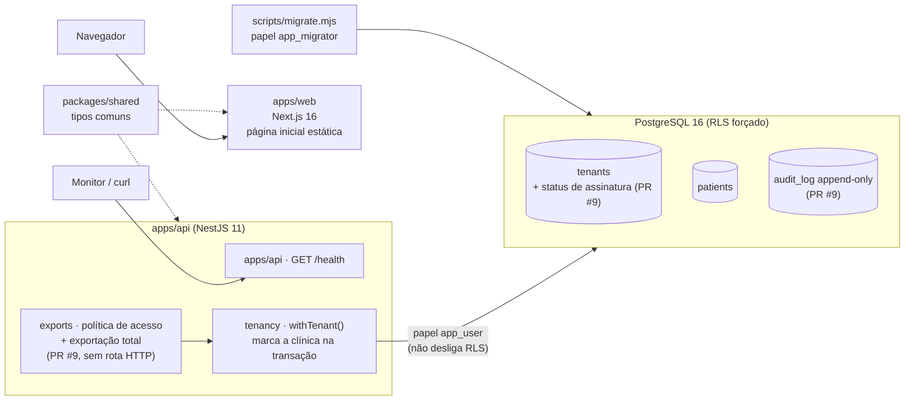

# Relatório geral do projeto Plataforma Saúde

> **Para quem:** os dois sócios (N0). Dá para entender o projeto inteiro só com este documento, sem abrir o resto.
> **Autor:** Maestro (N1) · **Data de referência:** 09/10/2026 · **Base:** só fatos do repositório, com o arquivo de origem citado em cada ponto.
> **Escopo:** `main` (rodadas 1 a 3) + PRs abertos **#8** e **#9** (rodada 4). A rodada 5 (testes de segurança e de produção) ainda está em andamento e tem uma seção própria para ser preenchida depois.
>
> **Legenda de estado:** ✅ pronto · 🛠️ em andamento ou aguardando merge · 📋 planejado (só no papel)

---

## 1. Resumo executivo

**O que é o produto.** Um SaaS (software vendido por assinatura, usado pela internet) de gestão para clínicas e consultórios de **todos os nichos da saúde**, para concorrer com iClinic, Feegow e Ninsaúde. O escopo completo inclui agenda, prontuário por especialidade, receita digital, financeiro, Pix, nota fiscal, WhatsApp, portal do paciente, convênios (TISS) e IA, com a LGPD considerada desde o desenho. Fonte: [CONTEXTO.md](../../CONTEXTO.md) §1.

**Por que pode dar certo.** É um mercado de **troca de sistema**: 92% dos estabelecimentos já usam sistema eletrônico [FATO, TIC Saúde, citado em [relatório executivo de mercado](../01-mercado/relatorio-executivo-mercado.md) §1]. As queixas mais comuns contra os concorrentes são prontuário bloqueado por inadimplência, cancelamento difícil, cobrança escondida e suporte lento. Nossa proposta é atacar exatamente essas dores, com garantias que o código faz cumprir.

**Onde estamos (09/10/2026).** Fase de **planejamento concluído + fundação técnica**. Ainda não há produto utilizável por clínica.

| Pronto | Falta |
|---|---|
| Pesquisa de mercado (11 segmentos) e recomendação de nicho | Confirmar o nicho com 5 a 10 entrevistas reais (D1) |
| PRD, WBS (332 micropartes), roadmap, backlog do MVP (176 histórias, 898 pontos) | Começar o M0 de verdade (login, permissões, criptografia, auditoria completa) |
| Mapa LGPD, checklist de PR, modelo de RIPD, 2 revisões do Guardião | Advogado validar os itens ⚖️ (D8); RIPD do produto; contrato de operador (DPA) assinado |
| Código-base: API + site + banco com **isolamento por clínica testado** | Qualquer tela ou rota de negócio (agenda, prontuário etc.) |
| Garantia de saída em código (PR #9, aguardando merge) | Rota HTTP de exportação com login e MFA |
| CI com 5 verificações automáticas, todas verdes | Proteção da `main` (exige plano pago); usuário do sócio no `CODEOWNERS` |

**As 3 decisões mais urgentes**

1. **D4: autenticação (login próprio ou Keycloak no Brasil).** É o próximo bloqueio técnico: sem login não existe RBAC nem MFA, e sem eles a rota de exportação da garantia de saída (PR #9) e qualquer tela de negócio ficam paradas. Fonte: [garantia-de-saida.md](../04-arquitetura/garantia-de-saida.md) (no PR #9), seção "Pendências".
2. **D8: contratar o advogado de saúde + LGPD.** Bloqueia o piloto com dados reais (Gate LGPD do M1), o contrato de operador (DPA) e a publicação da Carta de Compromissos. Fonte: [roadmap.md](../02-produto/roadmap.md) §2 e [garantias-ao-cliente.md](../02-produto/garantias-ao-cliente.md) (no PR #8).
3. **D1: confirmar o nicho de entrada (fisio/TO + psicólogos autônomos).** O M1 já foi desenhado em torno dessa premissa (controle de guia, pacotes, agenda simultânea). Se o nicho mudar depois que o M1 começar, há retrabalho. Fonte: [relatório executivo de mercado](../01-mercado/relatorio-executivo-mercado.md) §1.

Além das decisões, há uma **ação simples e urgente**: revisar e fazer o merge dos PRs **#8 e #9** (rodada 4), ambos com CI verde (5/5).

---

## 2. Linha do tempo

As datas estão no horário de Brasília. Os merges aparecem no GitHub como 09/10 em UTC.

| Data | Rodada | O que foi feito | PRs / commits |
|---|---|---|---|
| 06/10/2026 | 0 — Fundação | Repositório criado; governança e hierarquia de agentes (Maestro, Guardião LGPD com veto, 4 frentes) | `34a9b6f` |
| 08/10/2026 | 1 — Pesquisa e planejamento | Mercado geral e 8 arquivos de nichos; PRD e WBS; LGPD (mapa, papéis, checklist, RIPD); estratégia de IA; arquitetura e esqueleto do monorepo; registro das decisões D1–D8 | `550e7aa` … `fd863a1`, `3b848c0` |
| 08/10/2026 | 2 — Visão e processo | Visão e posicionamento; playbook (RACI, rituais); modelos de issue; relatório executivo de mercado com matriz de nichos; backlog do MVP; definição de pronto; métricas; plano de piloto | **PR #5** (merge em 08/10) |
| 08/10/2026 | — | Dependabot abre 4 PRs de atualização de dependências | PRs #1–#4 (abertos) |
| 08/10/2026 | 3 — Revisão LGPD + bootstrap | Guardião vetou o PR #5 (1 bloqueante, corrigido); produto incluiu guia, pacotes e agenda simultânea no MVP; engenharia criou API NestJS + site Next.js + teste de isolamento entre clínicas no CI; CodeQL | **PR #6**, **PR #7** (merge em 08/10); `f452407`, `db440d8`, `5bb1d6d` |
| 08–09/10/2026 | 4 — Garantias ao cliente | Garantias G1–G9 contra as queixas do mercado; Guardião vetou a 1ª versão (2 bloqueantes, corrigidos); garantia de saída (G1–G3) em código com 24 testes unitários e 18 contra banco real | **PR #8**, **PR #9** (abertos, CI 5/5) |
| em andamento | 5 — Testes de segurança e produção | Ver §6 | branches `eng/testes-seguranca` e `eng/testes-producao` (não publicadas) |

Fontes: `git log --oneline`, `gh pr list --state all`, [rodada 2](2026-10-08-rodada-2.md), [rodada 3](2026-10-08-rodada-3.md) e o relatório da rodada 4 (`docs/relatorios/2026-10-09-rodada-4-garantias.md`, no PR #8).

---

## 3. O que existe hoje, por área

### 3.1 Governança e agentes

| Item | Onde | Estado | Como verificar |
|---|---|---|---|
| Hierarquia (N0 sócios → N1 Maestro, Guardião, Revisor → N2 líderes → N3 executores) | [hierarquia.md](../00-governanca/hierarquia.md) | ✅ | Ler o organograma (diagrama Mermaid) |
| Fluxogramas (ciclo de demanda, fluxo de dados de paciente, git) | [fluxograma.md](../00-governanca/fluxograma.md) | ✅ | Abrir no GitHub (renderiza os diagramas) |
| Playbook: RACI, rituais, severidade de incidente | [processo-de-trabalho.md](../00-governanca/processo-de-trabalho.md) | ✅ | — |
| 10 agentes configurados | [.claude/agents/](../../.claude/agents/) | ✅ | Abrir o Claude Code na pasta; os agentes carregam sozinhos |
| Guia de skills e automação | [skills-agentes-e-automacao.md](../00-governanca/skills-agentes-e-automacao.md) | ✅ | — |
| Página visual da orquestra | [orquestra.html](../00-governanca/orquestra.html) | ✅ | Abrir no navegador |
| Registro de decisões (D1–D8 na `main`, D9 no PR #8) | [decisoes.md](../00-governanca/decisoes.md) | 🛠️ quase todas pendentes | — |
| Regras para agentes (≤ 3 subagentes, commit a cada entrega) | [AGENTS.md](../../AGENTS.md) | ✅ | — |
| `CODEOWNERS` (quem revisa cada pasta) | [.github/CODEOWNERS](../../.github/CODEOWNERS) | 🛠️ falta o usuário do sócio | — |

### 3.2 Mercado

| Item | Onde | Estado | Como verificar |
|---|---|---|---|
| Mercado geral e concorrentes | [mercado-geral-e-concorrentes.md](../01-mercado/mercado-geral-e-concorrentes.md) | ✅ | Cada número tem URL e data |
| 8 arquivos de nichos (11 segmentos) | [nichos/](../01-mercado/nichos/) | ✅ | — |
| Relatório executivo: TAM/SAM/SOM, matriz de nichos, 10 hipóteses, roteiro de entrevista | [relatorio-executivo-mercado.md](../01-mercado/relatorio-executivo-mercado.md) | ✅ | Marcações [FATO] / [ESTIMATIVA] em cada número |
| Entrevistas com clínicas reais | — | 📋 | Pré-requisito da D1 e da D2 |

Números-chave (fonte: relatório executivo §1): TAM de R$ 0,6 a 2,0 bi/ano e SAM das terapias de R$ 0,18 a 0,82 bi/ano, ambos [ESTIMATIVA]; SOM de R$ 2 a 20 mi de ARR em 3 anos, com R$ 6 mi no cenário base [ESTIMATIVA]. Os números do Reclame Aqui (iClinic nota 6,4; 17,96% das queixas da Doctoralia são "não consegue cancelar") estão marcados como [FATO-snippet] e precisam ser revalidados antes de ir para um investidor.

### 3.3 Produto

| Item | Onde | Estado | Como verificar |
|---|---|---|---|
| PRD (visão, personas, escopo por fase, riscos, preço) | [PRD.md](../02-produto/PRD.md) | ✅ | — |
| WBS: 24 módulos, 332 micropartes (194 MVP, 106 F2, 32 F3; 169 tocam dado sensível) | [WBS-micropartes.md](../02-produto/WBS-micropartes.md) | ✅ | Dependências validadas por script na rodada 3 |
| Roadmap: MVP nov/2026–jun/2027 (estimativa), marcos M0 a M4 | [roadmap.md](../02-produto/roadmap.md) | ✅ | Gantt no §6 |
| Backlog do MVP: 24 épicos, 176 histórias, 898 pontos (M0+M1: 79 histórias, 377 pontos) | [backlog-mvp.md](../02-produto/backlog-mvp.md) | ✅ | Cenários Gherkin no M0 e no M1 |
| Visão e posicionamento | [visao-e-posicionamento.md](../02-produto/visao-e-posicionamento.md) | ✅ | — |
| Jornadas, definição de pronto, métricas (eventos sem dado pessoal), plano de piloto (30 clínicas, 4 ondas) | [jornadas.md](../02-produto/jornadas.md), [definicao-de-pronto.md](../02-produto/definicao-de-pronto.md), [metricas-produto.md](../02-produto/metricas-produto.md), [plano-piloto.md](../02-produto/plano-piloto.md) | ✅ | — |
| Garantias G1–G9 + Carta de Compromissos (rascunho) | `docs/02-produto/garantias-ao-cliente.md` (PR #8) | 🛠️ aguarda merge, D9 e advogado | `git show origin/produto/garantias-ao-cliente:docs/02-produto/garantias-ao-cliente.md` |

### 3.4 LGPD e segurança

| Item | Onde | Estado | Como verificar |
|---|---|---|---|
| Mapa regulatório (CFM 2.454/2026, ANPD, conselhos) | [03-seguranca-lgpd/README.md](../03-seguranca-lgpd/README.md) | ✅ (não é parecer jurídico) | Itens ⚖️ vão ao advogado |
| Papéis: clínica controladora, nós operadores; cláusulas do DPA | [papeis-controlador-operador.md](../03-seguranca-lgpd/papeis-controlador-operador.md) | ✅ | — |
| Bases legais, requisitos técnicos, LGPD e IA | [pasta 03](../03-seguranca-lgpd/) | ✅ | — |
| Checklist de PR e modelo de RIPD | [checklist-pr.md](../03-seguranca-lgpd/checklist-pr.md), [RIPD-modelo.md](../03-seguranca-lgpd/RIPD-modelo.md) | ✅ | — |
| Revisão do PR #5 (vetado → corrigido) | [revisoes/2026-10-08-pr5.md](../03-seguranca-lgpd/revisoes/2026-10-08-pr5.md) | ✅ | — |
| Revisão das garantias (vetado → corrigido; ressalvas M1–M6 para antes de publicar) | `docs/03-seguranca-lgpd/revisoes/2026-10-09-garantias.md` (PR #8) | 🛠️ | — |
| RIPD do produto e RIPD do piloto | — | 📋 | Condição do Gate LGPD do M1 |
| DPA assinado e validação jurídica | — | 📋 | Depende da D8 |

### 3.5 Engenharia e código

| Item | Onde | Estado | Como verificar |
|---|---|---|---|
| Arquitetura (stack, C4, modelo de dados, integrações, DevOps) | [04-arquitetura/](../04-arquitetura/) | ✅ (documento) | — |
| Monorepo pnpm + Turborepo | [package.json](../../package.json), [turbo.json](../../turbo.json) | ✅ | `pnpm install --frozen-lockfile` |
| API NestJS: `GET /health` + contexto de clínica (`withTenant`) | [apps/api/](../../apps/api/) | ✅ | `pnpm turbo run lint typecheck test` |
| Banco: tabelas `tenants` e `patients` com RLS forçado | [0001_tenants_patients.sql](../../apps/api/db/migrations/0001_tenants_patients.sql) | ✅ | `pnpm db:up`, depois `pnpm --filter @plataforma/api db:migrate` e `test:rls` (8 casos) |
| Site Next.js: página inicial "em construção" + 1 teste | [apps/web/](../../apps/web/) | ✅ (só fundação) | `pnpm turbo run test` |
| Tipos compartilhados | [packages/shared/](../../packages/shared/) | ✅ | — |
| Módulos auth, patients, scheduling, records, prescriptions, billing, audit | `apps/api/src/modules/*` | 📋 arquivos vazios de 3 linhas | — |
| Garantia de saída: status de assinatura, política de acesso, exportação, `audit_log` append-only | PR #9 (`eng/garantia-de-saida`), [explicação](../04-arquitetura/garantia-de-saida.md) | 🛠️ aguarda merge | CI do PR #9: 5/5 verde |
| Rota HTTP de exportação, login, RBAC, MFA, criptografia de campo | — | 📋 | Depende da D4 |
| Ambientes de staging/produção na AWS | [ambientes-e-devops.md](../04-arquitetura/ambientes-e-devops.md) | 📋 só documento | — |

### 3.6 IA

| Item | Onde | Estado | Como verificar |
|---|---|---|---|
| Estratégia em fases (API + RAG → ajuste fino com dados anonimizados → modelo próprio no Brasil) | [05-ia-llm/README.md](../05-ia-llm/README.md) | ✅ (documento) | — |
| Casos de uso, dados e treino, avaliação, arquitetura do gateway | [05-ia-llm/](../05-ia-llm/) | ✅ (documento) | — |
| Custo estimado do escriba: R$ 0,30 a 0,70 por consulta [ESTIMATIVA] | [05-ia-llm/README.md](../05-ia-llm/README.md) §1 | — | O [CONTEXTO.md](../../CONTEXTO.md) cita R$ 0,30–0,58; vale o número do README da IA |
| Código de IA | — | 📋 nenhum | Escriba entra no marco M3 do roadmap; depende da D3 |

### 3.7 CI e automação

| Item | Onde | Estado |
|---|---|---|
| CI com 4 jobs (gitleaks, qualidade, RLS, auditoria de dependências) | [ci.yml](../../.github/workflows/ci.yml) | ✅ |
| CodeQL por PR e semanal (segunda, 03h17) | [codeql.yml](../../.github/workflows/codeql.yml) | ✅ |
| Dependabot semanal (npm e Actions) | [dependabot.yml](../../.github/dependabot.yml) | ✅ (4 PRs abertos: #1–#4) |
| Actions fixadas por SHA (proteção da cadeia de suprimentos) | workflows | ✅ |
| Modelos de issue (feature, pesquisa, decisão, incidente LGPD) e de PR | [.github/ISSUE_TEMPLATE/](../../.github/ISSUE_TEMPLATE/), [pull_request_template.md](../../.github/pull_request_template.md) | ✅ |
| Proteção da `main` (impedir merge com CI vermelho) | — | 📋 exige plano pago em repositório privado |

---

## 4. Como o código funciona hoje (para leigos)

Pense no sistema como três peças.

1. **O site (`apps/web`)** é o que a clínica vai ver no navegador. Hoje é só uma página "Ambiente em construção". Ainda não conversa com a API.
2. **A API (`apps/api`)** é o "cérebro" que recebe pedidos do site e conversa com o banco. Hoje responde a um único endereço público, `GET /health` ("estou vivo"), que de propósito não revela versão nem dado nenhum.
3. **O banco de dados (PostgreSQL 16)** guarda os dados. Hoje tem a tabela de clínicas (`tenants`) e a de pacientes (`patients`), só com nomes fictícios.

**Isolamento por clínica (a proteção mais importante).** Todas as clínicas ficam no mesmo banco. Para uma nunca ver os dados da outra, usamos duas travas:
- **na aplicação:** toda operação roda dentro de `withTenant`, que diz ao banco "esta transação é da clínica X". Essa marcação some ao fim da transação e não "vaza" para o próximo pedido;
- **no banco (RLS):** o próprio PostgreSQL esconde as linhas que não são da clínica marcada. Se o código esquecer de marcar a clínica, o banco não mostra **nada** (falha fechada).

A API usa um usuário de banco limitado (`app_user`), que não consegue desligar essa trava. As tabelas são criadas por outro usuário (`app_migrator`). Um teste automático com 8 casos tenta furar o isolamento contra um banco real a cada PR. Fonte: [0001_tenants_patients.sql](../../apps/api/db/migrations/0001_tenants_patients.sql) e [tenant-transaction.ts](../../apps/api/src/db/tenant-transaction.ts).

**Garantia de saída (PR #9, aguardando merge).** É a resposta, em código, à queixa nº 1 do mercado. Fonte: [garantia-de-saida.md](../04-arquitetura/garantia-de-saida.md) (no PR #9).
- Cada clínica tem um **status de assinatura**: em teste, ativa, inadimplente, só leitura ou cancelada.
- **Inadimplente:** não cria registros novos, mas **lê e exporta tudo, sem limite de tempo**.
- **Cancelada:** lê e exporta por **90 dias**. Esse número é configurável, mas não pode ser menor que 90: a API se recusa a subir com valor menor.
- **Status desconhecido:** nega tudo (falha fechada).
- A **exportação total** gera um JSON documentado + uma planilha CSV de pacientes, só com dados da própria clínica.
- Se alguém mudar essa regra, **os testes quebram o CI**. O agente provou isso introduzindo um erro de propósito: 3 testes de banco e 7 unitários falharam (relatório da rodada 4, §3).

**Auditoria (PR #9).** Toda exportação grava uma linha na tabela `audit_log` **na mesma transação**: sem registro de auditoria, a exportação não acontece. A tabela é **append-only** (só aceita inclusões). O usuário da API não tem permissão de alterar nem apagar, e um gatilho do banco rejeita alteração e exclusão vindas de qualquer usuário. A auditoria nunca guarda conteúdo clínico, só quem fez, quando, o quê e as contagens.

**O que ainda não existe:** login, permissões por perfil, MFA, criptografia de campo, a rota HTTP da exportação, a eliminação após 90 dias, Redis/filas (configurado no `docker-compose`, sem uso) e hospedagem na AWS.

### Diagrama da arquitetura atual (só o que existe)



---

## 5. O CI explicado

O **CI** é um robô do GitHub que, a cada PR e a cada mudança na `main`, roda verificações automáticas. São 5 checks, todos verdes no PR #9.

| Check (nome no GitHub) | O que faz | O que protege | Se falhar |
|---|---|---|---|
| **Secret scanning (gitleaks)** | Procura senhas, chaves e tokens em todo o histórico do git | Vazamento de segredo (um token exposto dá acesso a sistemas) | PR fica vermelho; o segredo precisa ser trocado (revogado) e removido. Lint e RLS nem começam, porque dependem dele |
| **Lint, typecheck e testes** | Confere estilo e erros comuns, tipos do TypeScript e testes unitários de API, site e `shared` | Bugs bobos e regressões, incluindo a tabela de regras da garantia de saída | PR vermelho; quem abriu corrige |
| **Isolamento entre tenants (RLS)** | Sobe um PostgreSQL real, cria os papéis, aplica as migrações e roda os testes de isolamento e da garantia de saída com o usuário limitado | Uma clínica ver dados de outra; quebra da garantia de saída; auditoria editável | **É o check mais crítico.** Falha = risco de vazamento entre clínicas. Não se faz merge |
| **Auditoria de dependências** | `pnpm audit`: bibliotecas de terceiros com falha conhecida grave | Vulnerabilidade herdada de pacote externo | Bloqueia em nível alto/crítico; atualizar ou trocar o pacote |
| **Análise estática de segurança (CodeQL)** | Lê o código procurando padrões perigosos (injeção, XSS etc.); também roda toda segunda-feira | Falhas de segurança no nosso próprio código | Falha se houver achado de nível "error"; o relatório fica como artefato (SARIF), porque o repositório privado não tem a aba Security |

**Limite importante:** sem a proteção da `main` (que exige plano pago), o GitHub **não impede** um merge com CI vermelho. Hoje a regra é de disciplina: ninguém faz merge com check vermelho. Fonte: [rodada 3](2026-10-08-rodada-3.md) §6.

---

## 6. Rodada 5: testes de segurança e produção

<!-- PREENCHER: resultado da rodada 5 -->

---

## 7. Decisões pendentes dos sócios (D1–D9)

Fonte: [decisoes.md](../00-governanca/decisoes.md) (D9 está no PR #8).

| # | Decisão | Recomendação dos agentes | Impacto de adiar |
|---|---|---|---|
| **D1** | Nicho de entrada | Fisio/TO (clínicas de 2 a 10 profissionais) + psicólogos autônomos; TEA/ABA na onda 2. Confirmar com 5 a 10 entrevistas usando o roteiro do relatório de mercado | **Alto.** O M1 já foi desenhado para esse nicho; mudar depois gera retrabalho e atrasa o piloto |
| **D2** | Preço | Validar a hipótese H1, de R$ 99 a 129 por profissional por mês, com WhatsApp e IA incluídos e sem fidelidade, nas mesmas entrevistas | Médio. Não trava código agora, mas trava a página de preço e a garantia G5 |
| **D3** | Provedor de LLM para dado sensível | Gemini (Vertex, São Paulo) ou Maritaca/Sabiá no Brasil; Claude/GPT só com dado pseudonimizado; psicologia nunca sai do país | Médio. Trava o escriba (M3) e a frase "IA no Brasil" no marketing |
| **D4** | Autenticação | Escolher entre login próprio e Keycloak hospedado no Brasil ([04-arquitetura/README.md](../04-arquitetura/README.md)) | **Alto e imediato.** Sem login não há RBAC, MFA, rota de exportação nem qualquer tela de negócio. É a primeira entrega do M0 |
| **D5** | Provedor Pix | Asaas, Efí, Pagar.me ou Stripe ([integracoes.md](../04-arquitetura/integracoes.md)) | Baixo agora; entra com o financeiro |
| **D6** | Provedor de vídeo | LiveKit (recomendado) | Baixo; teleconsulta é da Fase 2 |
| **D7** | Retenção da trilha de auditoria | Mínimo de 5 anos | Médio. A `audit_log` já existe (PR #9); a política de retenção precisa estar definida antes do piloto |
| **D8** | Validação jurídica | Advogado de saúde + LGPD revisar os itens ⚖️: CFM 2.454/2026, DPA, Carta de Compromissos, sigilo na exportação e enquadramento ANVISA da sugestão de CID | **Alto.** Sem o advogado não há DPA, não há piloto com dado real e não se publica a Carta |
| **D9** | Garantias ao cliente | Aprovar a Carta (G1–G9) e antecipar o roadmap público e a status page para o MVP | Médio. A Carta é o argumento de venda contra os concorrentes; adiar enfraquece o discurso do piloto |

Também aguardam os sócios: o merge dos PRs #8 e #9, a decisão sobre os PRs do Dependabot #1–#4 (o #4 sobe o TypeScript para a versão 7, uma versão principal nova que precisa de teste antes), o usuário GitHub do sócio para o `CODEOWNERS` e a ratificação da decisão "não treinar LLM do zero".

---

## 8. Riscos principais (top 10)

| # | Risco | Tipo | Mitigação | Dono |
|---|---|---|---|---|
| 1 | Vazamento de dados entre clínicas | Técnico / LGPD | RLS forçado + `withTenant` + teste de isolamento obrigatório no CI; toda tabela nova precisa entrar nesse teste | Engenharia + Guardião |
| 2 | Piloto com dado real antes de RIPD, DPA e pentest | LGPD | Gate LGPD do M1 no roadmap; Guardião com veto | Guardião + Sócios |
| 3 | Falta de validação jurídica (D8) | LGPD / negócio | Contratar o advogado agora; os itens ⚖️ já estão listados | Sócios |
| 4 | Publicidade com garantia absoluta (CDC art. 37) | Negócio / jurídico | Regra "garantia sem mecanismo não vai para o marketing"; Carta só publicada depois da D8 | Sócios + Produto |
| 5 | Nicho errado ou preço errado | Negócio | 5 a 10 entrevistas antes de fechar D1 e D2; hipóteses H1–H10 no relatório de mercado | Sócios + Pesquisa de mercado |
| 6 | Escopo do MVP grande (194 micropartes, 898 pontos) e atraso do lançamento | Negócio / técnico | Corte pré-acordado no roadmap §8 (lista de itens que podem ir para a F2) | Produto + Maestro |
| 7 | Exportação total usada por quem invadiu a conta (exfiltração) | Segurança | Controles da EXP-01.5 e do parecer M1: MFA recente, link pessoal de 24 h, alerta "não fui eu", janela de segurança | Engenharia + Guardião |
| 8 | Dado sensível processado fora do Brasil (IA, WhatsApp/Meta) | LGPD | D3 com provedor no Brasil; psicologia nunca sai do país; "IA no Brasil" só no marketing depois da D3 | IA + Guardião |
| 9 | Merge na `main` com CI vermelho (sem proteção de branch) | Técnico | Disciplina + revisor de código; avaliar o plano pago do GitHub quando houver código de produção | Sócios + DevOps |
| 10 | IA errando em conteúdo clínico (CFM 2.454/2026) | Regulatório / técnico | Revisão humana obrigatória ("rascunho para revisar e assinar"); golden sets só sintéticos; avaliação antes do gate do M3 | IA + Guardião |

Fontes: [roadmap.md](../02-produto/roadmap.md) §8, [PRD.md](../02-produto/PRD.md) §8, revisões do Guardião em [revisoes/](../03-seguranca-lgpd/revisoes/), [05-ia-llm/avaliacao-e-seguranca.md](../05-ia-llm/avaliacao-e-seguranca.md).

---

## 9. Próximos passos recomendados (próximas 3 rodadas, até 3 agentes cada)

**Rodada 6: fechar a rodada 4 e preparar o M0**
- Sócios: merge dos PRs #8 e #9; decidir D4 e D8; começar as entrevistas da D1/D2.
- `engenharia`: aplicar os resultados da rodada 5 e decidir o tratamento dos PRs #1–#4 do Dependabot (com `devops-ci`, se houver ajuste de CI).
- `guardiao-lgpd`: fechar as ressalvas M1–M6 das garantias e começar o RIPD do produto.
- `produto`: transformar G1–G9 em critérios de aceite no backlog; preparar a síntese das entrevistas.

**Rodada 7: M0, autenticação e segurança base** (depende da D4)
- `engenharia`: login + RBAC + MFA; rota HTTP de exportação com os controles anti-exfiltração (G2).
- `qa-testes`: testes de isolamento para cada tabela nova; teste E2E (Playwright) do esqueleto do login.
- `guardiao-lgpd`: revisar o PR de autenticação e a política de retenção da auditoria (D7).

**Rodada 8: M0 completo e início do M1** (depende da D1)
- `engenharia`: criptografia de campo, auditoria completa com encadeamento de hash, eliminação certificada após a janela (EXP-01.6).
- `produto`: refinar as histórias do M1 com o resultado das entrevistas.
- `guardiao-lgpd` ou `ia-llm` (conforme a D3): RIPD do piloto, ou golden sets sintéticos por nicho.

---

## 10. Glossário

| Termo | Explicação em 1 frase |
|---|---|
| **ANPD** | Autoridade Nacional de Proteção de Dados, que fiscaliza a LGPD e hoje é agência reguladora |
| **API** | A parte do sistema que recebe pedidos do site/app e conversa com o banco |
| **Append-only** | Tabela em que só se incluem linhas; não dá para editar nem apagar |
| **Branch** | Uma "cópia de trabalho" do código onde se faz uma mudança sem mexer na versão oficial |
| **CI** | Integração contínua: robô que roda verificações automáticas a cada mudança |
| **CodeQL / gitleaks** | Ferramentas que procuram, respectivamente, falhas de segurança no código e segredos vazados |
| **Commit** | Um "salvamento" registrado no histórico do git, com autor e descrição |
| **Controlador / operador** | Controlador decide o uso do dado (a clínica); operador trata em nome dele (nós) |
| **DoR / DoD** | Definição de pronto para começar / para considerar uma entrega concluída |
| **DPA** | Contrato de operador: diz o que podemos fazer com os dados da clínica |
| **Escriba de IA** | Recurso que ouve a consulta e escreve um rascunho de evolução para o profissional revisar |
| **Gate LGPD** | Ponto de controle: sem RIPD, pentest e plano de incidentes aprovados, não entra dado real |
| **Golden set** | Conjunto de exemplos de referência para medir a qualidade da IA (no nosso caso, só sintéticos) |
| **ICP-Brasil** | Infraestrutura oficial de certificados digitais, exigida para receita e prontuário assinados |
| **LGPD** | Lei Geral de Proteção de Dados (Lei 13.709/2018); dado de saúde é "sensível" |
| **LLM / RAG** | Modelo de linguagem (como Claude ou Gemini) / técnica de responder consultando documentos próprios |
| **Merge** | Juntar uma branch à versão oficial (`main`) |
| **MFA** | Login com segundo fator (código no celular, por exemplo) |
| **Migração** | Script que cria ou altera tabelas do banco de forma versionada |
| **Monorepo** | Um único repositório com site, API e bibliotecas juntos |
| **MVP** | Primeira versão vendável, com o mínimo que resolve a dor do cliente |
| **PR (pull request)** | Pedido para fazer o merge de uma branch, com revisão e CI |
| **RBAC** | Permissões por perfil (recepção, profissional, gestor…) |
| **RIPD** | Relatório de Impacto à Proteção de Dados, a análise de risco exigida pela LGPD |
| **RLS** | Row-Level Security: regra do banco que mostra a cada clínica só as linhas dela |
| **ROPA / LIA** | Registro das operações de tratamento / teste de legítimo interesse |
| **SARIF** | Formato de arquivo com o resultado de análises de segurança |
| **Tenant** | Cada clínica cliente; "multi-tenant" = várias clínicas no mesmo sistema, isoladas |
| **TISS / TUSS** | Padrão da ANS para troca de dados com convênios / tabela de procedimentos |
| **TAM / SAM / SOM / ARR** | Mercado total / mercado atendível / fatia alcançável / receita recorrente anual |
| **WBS** | Quebra do produto em micropartes (no nosso caso, 332) |
| **Épico / história / pontos** | Bloco grande de funcionalidade / pedaço entregável / medida relativa de esforço |

---

## 11. Como navegar no repositório e pedir trabalho aos agentes

### Mapa de pastas

```
CONTEXTO.md              Resumo de 5 minutos (comece por aqui)
AGENTS.md / CLAUDE.md    Regras para os agentes de IA
.claude/agents/          Os 10 agentes (maestro, guardiao-lgpd, revisor-codigo, produto, engenharia, ...)
.github/                 CI (workflows), Dependabot, CODEOWNERS, modelos de issue e de PR
apps/api/                API NestJS (migrações em db/migrations, testes de RLS em test/)
apps/web/                Site Next.js
packages/shared/         Tipos compartilhados
infra/local/             Script que cria os papéis do banco (app_migrator, app_user)
docker-compose.yml       PostgreSQL 16 + Redis locais
docs/00-governanca/      Hierarquia, fluxos, processo, decisões, orquestra
docs/01-mercado/         Pesquisa de mercado e nichos
docs/02-produto/         PRD, WBS, roadmap, backlog, piloto, garantias
docs/03-seguranca-lgpd/  LGPD, checklist, RIPD e revisões do Guardião
docs/04-arquitetura/     Stack, dados, integrações, DevOps
docs/05-ia-llm/          Estratégia de IA
docs/relatorios/         Um relatório por rodada + este relatório geral
```

### Como pedir trabalho

1. Abra o Claude Code na pasta do projeto (`claude`). Os agentes carregam sozinhos.
2. Peça ao **Maestro** em linguagem normal, dizendo o resultado esperado. Exemplo: *"Maestro, implemente o login com MFA conforme a D4 = Keycloak."* Ele quebra o pedido em micropartes, pergunta se toca dado de saúde, chama o Guardião quando necessário e usa no máximo 3 agentes ao mesmo tempo.
3. Para decisões, use o modelo de issue **Decisão** em `.github/ISSUE_TEMPLATE/`, ou responda direto no chat ("D1 decidido: fisio/TO"). O Maestro registra em [decisoes.md](../00-governanca/decisoes.md).
4. Cada entrega chega como **PR** com CI. A decisão de merge é de vocês. Veto do Guardião só pode ser derrubado pelos sócios.
5. Ao fim de cada rodada, há um relatório em `docs/relatorios/`.
