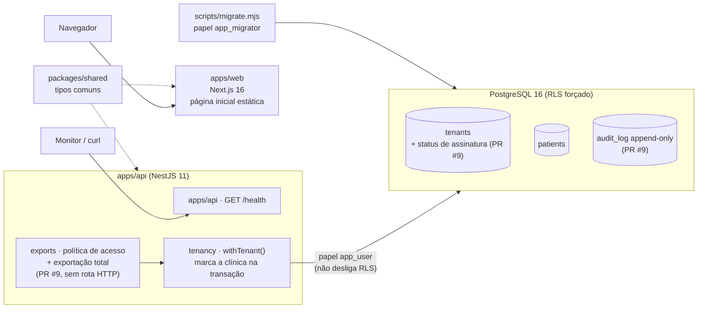

# Relatório geral do projeto Plataforma Saúde

> **Para quem:** os dois sócios (N0). Dá para entender o projeto inteiro só com este documento, sem abrir o resto.
> **Autor:** Maestro (N1) · **Data de referência:** 12/10/2026 (atualizado na rodada 9; versão anterior: 09/10/2026) · **Base:** só fatos do repositório, com o arquivo de origem citado em cada ponto.
> **Escopo:** `main` até o merge do PR **#38** (`9230c7a`), rodadas 1 a 9. PRs ainda abertos: **#43** a **#47** (telas do front), **#36** (PoC da D4, rascunho) e **#49** a **#53** (Dependabot novos). A §6 (rodada 5) fica como registro histórico.
>
> **Legenda de estado:** ✅ pronto · 🛠️ em andamento ou aguardando merge · 📋 planejado (só no papel)

---

## 1. Resumo executivo

**O que é o produto.** Um SaaS (software vendido por assinatura, usado pela internet) de gestão para clínicas e consultórios de **todos os nichos da saúde**, para concorrer com iClinic, Feegow e Ninsaúde. O escopo completo inclui agenda, prontuário por especialidade, receita digital, financeiro, Pix, nota fiscal, WhatsApp, portal do paciente, convênios (TISS) e IA, com a LGPD considerada desde o desenho. Fonte: [CONTEXTO.md](../../CONTEXTO.md) §1.

**Por que pode dar certo.** É um mercado de **troca de sistema**: 92% dos estabelecimentos já usam sistema eletrônico [FATO, TIC Saúde, citado em [relatório executivo de mercado](../01-mercado/relatorio-executivo-mercado.md) §1]. As queixas mais comuns contra os concorrentes são prontuário bloqueado por inadimplência, cancelamento difícil, cobrança escondida e suporte lento. Nossa proposta é atacar exatamente essas dores, com garantias que o código faz cumprir.

**Onde estamos (15/10/2026).** **O núcleo do produto está escrito e testado, mas nada novo entrou na `main` desde 12/10**, porque o GitHub Actions está parado por falta de pagamento e a regra é não mergear código sem CI verde. Estão **prontos em PR, testados localmente contra Postgres real e aprovados pelo Guardião (com ressalvas)**: rotas de **pacientes e agenda** (#57), **vínculo de cuidado** à prova de atalho (#61), **guias de convênio e pacotes** (#62), **prontuário** por nicho, cifrado e versionado (#63), **financeiro** com recibos sem buraco (#65), **telas ligadas à API** (#60), **imagem Docker** (#59) e **Terraform do staging** (#58). Nas rodadas 14 e 15 o Guardião encontrou **3 formas de um profissional ver prontuário alheio** e uma falha que abria todos os registros antigos de psicologia; todas foram corrigidas antes de existir dado real. Fontes: [rodada 14](2026-10-14-rodada-14.md), [rodada 15](2026-10-15-rodada-15.md).

| Pronto | Falta |
|---|---|
| Pesquisa de mercado (11 segmentos) e recomendação de nicho | Confirmar o nicho com 5 a 10 entrevistas reais (D1) |
| PRD, WBS (332 micropartes), roadmap, backlog do MVP (176 histórias, 898 pontos), garantias G1–G9 | Merge dos PRs prontos quando o CI voltar (pacientes, agenda, guias, pacotes, **prontuário** e **financeiro** já escritos); importador de dados dos concorrentes, portal do paciente (backend) e WhatsApp ainda não começaram |
| LGPD: RIPD da plataforma, da IA e do WhatsApp, minuta do DPA, proposta de retenção, plano de incidente, matriz de retenção por conselho, 7 pareceres do Guardião | Advogado validar os itens ⚖️ (D8); nomear o encarregado (DPO); DPA assinado |
| Código-base: isolamento por clínica, **criptografia por clínica**, **auditoria encadeada**, **guarda de schema**, garantia de saída, rate limit em Redis | Login, permissões por perfil (RBAC) e MFA: tudo depende da **D4** |
| Telas do front: design system, Ajudante, Hoje, Agenda, Pacientes (PR #42 na `main`; #43 a #47 abertos) | Telas de pacientes e agenda já ligadas à API (#60, aguardando CI); login real (D4) para usar no navegador; corrigir os 3 vetos do Guardião (#44, #46, #47) |
| 9 checks automáticos no CI, todos verdes na última execução | **O GitHub Actions parou por falta de pagamento**: hoje nenhum CI roda ([fila.md](../00-governanca/fila.md)) |

**As 3 decisões mais urgentes**

1. **D4: autenticação.** É o **gargalo** do projeto: sem login não existe RBAC nem MFA, e sem eles as telas não se ligam à API, a rota de exportação da garantia de saída não existe e nenhuma clínica entra. A PoC do PR #36 já mediu Zitadel × Better Auth. Fonte: [memo D04](../00-governanca/memos/D04-autenticacao.md).
2. **D8: contratar o advogado de saúde + LGPD**, junto com a nomeação do **DPO**. Bloqueia o piloto com dados reais, o DPA, os termos e a publicação da Carta de Compromissos. Fonte: [memo D08](../00-governanca/memos/D08-validacao-juridica.md).
3. **D13: orçamento de infraestrutura e pentest.** Destrava o staging na AWS (Terraform parado) e o pentest obrigatório antes do piloto. Fonte: [memo D13](../00-governanca/memos/D13-orcamento-infra-pentest.md).

Além das decisões, há uma **ação simples e urgente**: **regularizar o pagamento do GitHub** da conta Rocafa. Sem isso o CI não roda e, pela regra do projeto, nenhum PR de código entra (o #43 está pronto e parado só por isso).

---

## 2. Linha do tempo

As datas estão no horário de Brasília. Os merges aparecem no GitHub como 09/10 em UTC.

| Data | Rodada | O que foi feito | PRs / commits |
|---|---|---|---|
| 06/10/2026 | 0 — Fundação | Repositório criado; governança e hierarquia de agentes (Maestro, Guardião LGPD com veto, 4 frentes) | `34a9b6f` |
| 08/10/2026 | 1 — Pesquisa e planejamento | Mercado geral e 8 arquivos de nichos; PRD e WBS; LGPD (mapa, papéis, checklist, RIPD); estratégia de IA; arquitetura e esqueleto do monorepo; registro das decisões D1–D8 | `550e7aa` … `fd863a1`, `3b848c0` |
| 08/10/2026 | 2 — Visão e processo | Visão e posicionamento; playbook (RACI, rituais); modelos de issue; relatório executivo de mercado com matriz de nichos; backlog do MVP; definição de pronto; métricas; plano de piloto | **PR #5** (merge em 08/10) |
| 08/10/2026 | — | Dependabot abre 4 PRs de atualização de dependências | PRs #1–#4 (abertos) |
| 08/10/2026 | 3 — Revisão LGPD + bootstrap | Guardião vetou o PR #5 (1 bloqueante, corrigido); produto incluiu guia, pacotes e agenda simultânea no MVP; engenharia criou API NestJS + site Next.js + teste de isolamento entre clínicas no CI; CodeQL | **PR #6**, **PR #7** (merge em 08/10); `f452407`, `db440d8`, `5bb1d6d` |
| 08–09/10/2026 | 4 — Garantias ao cliente | Garantias G1–G9 contra as queixas do mercado; Guardião vetou a 1ª versão (2 bloqueantes, corrigidos); garantia de saída (G1–G3) em código com 24 testes unitários e 18 contra banco real | **PR #8**, **PR #9** (abertos, CI 5/5) |
| 09/10/2026 | 5 — Testes de segurança e produção | 72 ataques automatizados + ZAP; resiliência (banco fora, carga, backup/restauração); 1 falha crítica de isolamento e 1 bug da biblioteca de banco encontrados e corrigidos (§6) | PRs #10 e #11 (#8 a #12 mergeados em 09/10) |
| 09/10/2026 | 6 — Dependabot | Actions atualizadas (checkout, setup-node, pnpm) com SHA conferido; TypeScript 6.0.3; TS 7 recusado porque quebra o lint | **#1, #2, #3, #13** mergeados; #4 fechado ([relatório](2026-10-09-rodada-6-dependabot.md)) |
| 10–11/10/2026 | 7 — Necessidades de produção | Checklist P0/P1/P2, portões A/B/C, custo estimado de AWS, decisões novas D10–D14; LGPD: RIPD da plataforma, minuta de DPA, retenção (D7), plano de incidente, checklist CFM 2.454 | **#27**, **#28** ([relatório](2026-10-10-rodada-7-necessidades-producao.md)) |
| 11–12/10/2026 | 8 — Fundação de segurança, IA e front | 4 abas em paralelo (ENG, DevOps, LGPD, QA) e depois o front. Entraram: guarda de schema, pendências de produção (build, 25006 → 503, rate limit em Redis), NestJS 12, auditoria encadeada, criptografia por clínica, golden sets e memos D1–D14, ações de auditoria (0006), @Lopesloro no `CODEOWNERS`. PoC da D4 feita (rascunho). Telas do front abertas em pilha (#42–#47) | **#29, #30, #32, #34, #35, #37, #39, #40, #48** mergeados; #36 rascunho ([estado](2026-10-12-estado-rodada-8.md)) |
| 12/10/2026 | 9 — Fila e higiene | `fila.md` compartilhada entre os dois Maestros; merges de #41, #31 e #33 (Dependabot #14–#26 fechados); parecer do Guardião sobre o front: **#44, #46 e #47 vetados**; #42 mergeado; #38 (pareceres LGPD) mergeado. **O GitHub Actions parou por billing** e o #43 ficou pronto mas parado | **#41, #31, #33, #42, #38** ([o que falta](2026-10-12-o-que-falta.md), [fila](../00-governanca/fila.md)) |
| 13/10/2026 | 10 — Sem CI: decisões | Memo de **recomendação da D4 (Better Auth)**, **kit de entrevistas** (D1/D2), **pacote para o advogado** (D8); termo de consentimento das entrevistas revisado e registrado no ROPA | `main` ([rodada 10](2026-10-13-rodada-10-sem-ci.md)) |
| 13/10/2026 | 11 — API, infra e IA | Primeiras **rotas de negócio** (pacientes e agenda), **Terraform do staging** pronto para PR, **golden sets** com 50 casos por nicho | PRs **#57, #58, #56** ([rodada 11](2026-10-13-rodada-11.md)) |
| 13/10/2026 | 12 — Revisões e ligação do front | Guardião **vetou #57 e #58** (nome na URL, exportação impossível de apagar, senha em log) → corrigidos e **reaprovados**; **telas ligadas à API real**; **imagem Docker** + E2E no CI; PR de economia de minutos | PRs **#60, #59, #54** ([rodada 12](2026-10-13-rodada-12.md)) |
| 14/10/2026 | 13 — Ressalvas e guias | **Vínculo de cuidado** no servidor, alerta de anomalia, pseudônimo via KMS; **API de guias e pacotes** (saldo nunca negativo sob concorrência); ressalvas de infraestrutura (break-glass, backup, logs) | PRs **#61**, guias e pacotes, #58 atualizado ([rodada 13](2026-10-14-rodada-13.md)) |
| 14/10/2026 | 14 — Prontuário | **Prontuário** por nicho (cifrado, versionado, bloqueado após finalizar, notas privadas da psicologia); Guardião **vetou 2 vezes o vínculo de cuidado** (encaixe consigo mesmo; remarcar consulta antiga) e **1 vez o prontuário** (troca de sigilo abria registros antigos): tudo corrigido e reaprovado | PRs **#63**, #61 e #62 atualizados ([rodada 14](2026-10-14-rodada-14.md)) |
| 15/10/2026 | 15 — Ressalvas e financeiro | Retenção legal que bloqueia eliminação, custódia do psicólogo substituto, **usuário da sessão travado no banco**; **financeiro** (cobranças, caixa, recibos sem buraco, insumo do Receita Saúde, texto neutro) | PRs **#65**, #61 e #63 atualizados ([rodada 15](2026-10-15-rodada-15.md)) |

Fontes: `git log --oneline --first-parent origin/main`, `gh pr list --state all`, [rodada 2](2026-10-08-rodada-2.md), [rodada 3](2026-10-08-rodada-3.md), [rodada 4](2026-10-09-rodada-4-garantias.md), [rodada 6](2026-10-09-rodada-6-dependabot.md), [rodada 7](2026-10-10-rodada-7-necessidades-producao.md), [rodada 8](2026-10-12-estado-rodada-8.md) e [o que falta](2026-10-12-o-que-falta.md).

---

## 3. O que existe hoje, por área

### 3.1 Governança e agentes

| Item | Onde | Estado | Como verificar |
|---|---|---|---|
| Hierarquia (N0 sócios → N1 Maestro, Guardião, Revisor → N2 líderes → N3 executores) | [hierarquia.md](../00-governanca/hierarquia.md) | ✅ | Ler o organograma (diagrama Mermaid) |
| Fluxogramas (ciclo de demanda, fluxo de dados de paciente, git) | [fluxograma.md](../00-governanca/fluxograma.md) | ✅ | Abrir no GitHub (renderiza os diagramas) |
| Playbook: RACI, rituais, severidade de incidente | [processo-de-trabalho.md](../00-governanca/processo-de-trabalho.md) | ✅ | — |
| 10 agentes configurados | [.claude/agents/](../../.claude/agents/) | ✅ | Abrir o Claude Code na pasta; os agentes carregam sozinhos |
| Guia de skills e automação | [skills-agentes-e-automacao.md](../00-governanca/skills-agentes-e-automacao.md) | ✅ | — |
| Página visual da orquestra | [orquestra.html](../00-governanca/orquestra.html) | ✅ | Abrir no navegador |
| Registro de decisões (D1–D14) | [decisoes.md](../00-governanca/decisoes.md) | 🛠️ todas pendentes | — |
| Memos de 1 página por decisão (D1–D14), com opções, custo e recomendação | [memos/](../00-governanca/memos/README.md) | ✅ (PR #29) | Nenhum memo decide nada |
| Fila de trabalho compartilhada entre os dois Maestros (@Rocafa e @Lopesloro) | [fila.md](../00-governanca/fila.md) | ✅ | Regra: quem abriu o PR faz o merge |
| Regras para agentes (≤ 3 subagentes, commit a cada entrega) | [AGENTS.md](../../AGENTS.md) | ✅ | — |
| `CODEOWNERS` (quem revisa cada pasta) | [.github/CODEOWNERS](../../.github/CODEOWNERS) | ✅ @Lopesloro incluído (PR #48) | — |

### 3.2 Mercado

| Item | Onde | Estado | Como verificar |
|---|---|---|---|
| Mercado geral e concorrentes | [mercado-geral-e-concorrentes.md](../01-mercado/mercado-geral-e-concorrentes.md) | ✅ | Cada número tem URL e data |
| 8 arquivos de nichos (11 segmentos) | [nichos/](../01-mercado/nichos/) | ✅ | — |
| Relatório executivo: TAM/SAM/SOM, matriz de nichos, 10 hipóteses, roteiro de entrevista | [relatorio-executivo-mercado.md](../01-mercado/relatorio-executivo-mercado.md) | ✅ | Marcações [FATO] / [ESTIMATIVA] em cada número |
| Entrevistas com clínicas reais | — | 📋 | Pré-requisito da D1 e da D2 |

Números-chave (fonte: relatório executivo §1): TAM de R$ 0,6 a 2,0 bi/ano e SAM das terapias de R$ 0,18 a 0,82 bi/ano, ambos [ESTIMATIVA]; SOM de R$ 2 a 20 mi de ARR em 3 anos, com R$ 6 mi no cenário base [ESTIMATIVA]. Os números do Reclame Aqui (iClinic nota 6,4; 17,96% das queixas da Doctoralia são "não consegue cancelar") estão marcados como [FATO-snippet] e precisam ser revalidados antes de ir para um investidor.

### 3.3 Produto

| Item | Onde | Estado | Como verificar |
|---|---|---|---|
| PRD (visão, personas, escopo por fase, riscos, preço) | [PRD.md](../02-produto/PRD.md) | ✅ | — |
| WBS: 24 módulos, 332 micropartes (194 MVP, 106 F2, 32 F3; 169 tocam dado sensível) | [WBS-micropartes.md](../02-produto/WBS-micropartes.md) | ✅ | Dependências validadas por script na rodada 3 |
| Roadmap: MVP nov/2026–jun/2027 (estimativa), marcos M0 a M4 | [roadmap.md](../02-produto/roadmap.md) | ✅ | Gantt no §6 |
| Backlog do MVP: 24 épicos, 176 histórias, 898 pontos (M0+M1: 79 histórias, 377 pontos) | [backlog-mvp.md](../02-produto/backlog-mvp.md) | ✅ | Cenários Gherkin no M0 e no M1 |
| Visão e posicionamento | [visao-e-posicionamento.md](../02-produto/visao-e-posicionamento.md) | ✅ | — |
| Jornadas, definição de pronto, métricas (eventos sem dado pessoal), plano de piloto (30 clínicas, 4 ondas) | [jornadas.md](../02-produto/jornadas.md), [definicao-de-pronto.md](../02-produto/definicao-de-pronto.md), [metricas-produto.md](../02-produto/metricas-produto.md), [plano-piloto.md](../02-produto/plano-piloto.md) | ✅ | — |
| Garantias G1–G9 + Carta de Compromissos (rascunho, ressalvas M1–M6 aplicadas no PR #28) | [garantias-ao-cliente.md](../02-produto/garantias-ao-cliente.md) | 🛠️ na `main`; aguarda D9 e advogado | — |
| Necessidades de produção: checklist P0/P1/P2, portões A (staging), B (piloto) e C (lançamento) | [rodada 7](2026-10-10-rodada-7-necessidades-producao.md) | ✅ (documento) | — |
| Telas do front com **dados fictícios** (sem API): design system em cinza, Ajudante (busca e ações por texto, 100% local), Hoje, Agenda, Pacientes | `apps/web/` (PR #42) e [estado do front](2026-10-12-front-estado.md) | ✅ #42 na `main` · 🛠️ #43 pronto, parado sem CI | Capturas em `docs/02-produto/telas/` (no #42) |
| Telas de atendimento/prontuário/documentos, financeiro/guias/mensagens, configurações/acesso, portal do paciente/PWA | PRs #44, #45, #46, #47 | 🛠️ **#44, #46 e #47 vetados** pelo Guardião; #45 aprovado com ressalvas, mas empilhado sobre o #44 | [parecer do front](../03-seguranca-lgpd/revisoes/2026-10-12-front-r8.md) |

### 3.4 LGPD e segurança

| Item | Onde | Estado | Como verificar |
|---|---|---|---|
| Mapa regulatório (CFM 2.454/2026, ANPD, conselhos) | [03-seguranca-lgpd/README.md](../03-seguranca-lgpd/README.md) | ✅ (não é parecer jurídico) | Itens ⚖️ vão ao advogado |
| Papéis: clínica controladora, nós operadores; cláusulas do DPA | [papeis-controlador-operador.md](../03-seguranca-lgpd/papeis-controlador-operador.md) | ✅ | — |
| Bases legais, requisitos técnicos, LGPD e IA | [pasta 03](../03-seguranca-lgpd/) | ✅ | — |
| Checklist de PR e modelo de RIPD | [checklist-pr.md](../03-seguranca-lgpd/checklist-pr.md), [RIPD-modelo.md](../03-seguranca-lgpd/RIPD-modelo.md) | ✅ | — |
| Revisão do PR #5 (vetado → corrigido) | [revisoes/2026-10-08-pr5.md](../03-seguranca-lgpd/revisoes/2026-10-08-pr5.md) | ✅ | — |
| Revisão das garantias (vetado → corrigido; ressalvas M1–M6 aplicadas no PR #28) | [revisoes/2026-10-09-garantias.md](../03-seguranca-lgpd/revisoes/2026-10-09-garantias.md) | ✅ | — |
| RIPD da plataforma, minuta do DPA, retenção e descarte (proposta da D7), plano de resposta a incidente (3 dias úteis), checklist CFM 2.454 | [RIPD-plataforma.md](../03-seguranca-lgpd/RIPD-plataforma.md), [dpa-minuta.md](../03-seguranca-lgpd/dpa-minuta.md), [retencao-e-descarte.md](../03-seguranca-lgpd/retencao-e-descarte.md), [plano-resposta-incidentes.md](../03-seguranca-lgpd/plano-resposta-incidentes.md), [checklist-cfm-2454.md](../03-seguranca-lgpd/checklist-cfm-2454.md) | ✅ rascunho (PR #28) | Itens ⚖️ vão ao advogado |
| RIPD da IA (escriba) e do WhatsApp; matriz de retenção por conselho; pareceres dos PRs #29, #30, #35, #37 | [RIPD-ia-escriba.md](../03-seguranca-lgpd/RIPD-ia-escriba.md), [RIPD-whatsapp.md](../03-seguranca-lgpd/RIPD-whatsapp.md), [matriz-retencao.md](../03-seguranca-lgpd/matriz-retencao.md), [revisoes/](../03-seguranca-lgpd/revisoes/) | ✅ (PR #38) | — |
| Parecer das telas do front (#42–#47): 3 bloqueantes. **B1** recepção e admin não clínico leem evoluções; **B2** atestado com CID emitido por qualquer perfil e em nome de qualquer profissional; **B3** o portal do paciente usa o contrato e os dados da clínica | [revisoes/2026-10-12-front-r8.md](../03-seguranca-lgpd/revisoes/2026-10-12-front-r8.md) | 🛠️ correções com o front (@Lopesloro) | Nenhum exige redesenho |
| RIPD do piloto, DPA assinado, DPO nomeado, termos de uso e política de privacidade | — | 📋 | Dependem da D8 e da nomeação do DPO |

### 3.5 Engenharia e código

| Item | Onde | Estado | Como verificar |
|---|---|---|---|
| Arquitetura (stack, C4, modelo de dados, integrações, DevOps) | [04-arquitetura/](../04-arquitetura/) | ✅ (documento) | — |
| Monorepo pnpm + Turborepo | [package.json](../../package.json), [turbo.json](../../turbo.json) | ✅ | `pnpm install --frozen-lockfile` |
| API NestJS: `GET /health` + contexto de clínica (`withTenant`) | [apps/api/](../../apps/api/) | ✅ | `pnpm turbo run lint typecheck test` |
| Banco: tabelas `tenants` e `patients` com RLS forçado; 6 migrações (0001 a 0006) | [db/migrations/](../../apps/api/db/migrations/) | ✅ | `pnpm db:up`, depois `pnpm --filter @plataforma/api db:migrate` e `test:rls` |
| Site Next.js: telas com dados fictícios (Hoje, Agenda, Pacientes, Mais) e Ajudante; ainda **não fala com a API** | [apps/web/](../../apps/web/) (PR #42) | ✅ fundação do front · 🛠️ #43–#47 abertos | `pnpm turbo run test`; E2E (Playwright) só roda local, ainda não no CI |
| Tipos compartilhados (com build próprio desde o PR #30) | [packages/shared/](../../packages/shared/) | ✅ | — |
| Módulos auth, patients, scheduling, records, prescriptions, billing | `apps/api/src/modules/*` | 📋 **a API não tem rota de negócio**, só `/health` e `/health/ready`; `patients` tem apenas o repositório usado pela exportação, os demais são arquivos de 3 linhas | — |
| Garantia de saída: status de assinatura, política de acesso, exportação, `audit_log` append-only | [explicação](../04-arquitetura/garantia-de-saida.md) | ✅ (PR #9) | Testes `exit-guarantee.rls.test.ts` |
| **Criptografia por clínica:** AES-256-GCM com chave própria de cada clínica (envelope). Destruir a chave deixa os dados daquela clínica ilegíveis, até nos backups; destruição em duas fases | [criptografia-de-campo.md](../04-arquitetura/criptografia-de-campo.md), migração 0004 | ✅ (PR #35) · ainda não protege nenhum campo de negócio, porque eles não existem | `crypto.rls.test.ts` |
| **Auditoria encadeada:** cada registro guarda o hash (impressão digital) do anterior, por clínica; um verificador detecta alteração, exclusão e reordenação. Ações de chave, IA e break-glass no enum (0006) | [auditoria-encadeada.md](../04-arquitetura/auditoria-encadeada.md), migrações 0005 e 0006 | ✅ (PRs #37, #40, #41) · falta âncora externa imutável (depende do Terraform) | `audit-chain.rls.test.ts` |
| **Guarda de schema:** teste que lê o catálogo do banco e reprova qualquer tabela sem RLS forçado, sem policy, com privilégio a mais (inclusive por coluna) ou fora do teste de isolamento | `apps/api/test/guarda-schema.rls.test.ts` | ✅ (PR #34) | Pegou as 8 mutações de teste |
| **Rate limit em Redis** compartilhado entre instâncias, com fallback em memória; build definitivo; erro 25006 → 503 | `apps/api/src/security/` | ✅ (PR #30) · falta R5 (teste do `trustProxyHops`, depende do ALB) | — |
| Interface de LLM com adaptador falso (sem provedor real) | `apps/api/src/modules/ai/` | ✅ (PR #29) · veto prévio do Guardião a adaptador real antes das condições | — |
| Rota HTTP de exportação, login, RBAC, MFA | — | 📋 | Depende da D4; PoC no PR #36 (rascunho) |
| Ambientes de staging/produção na AWS (Terraform) | branch `devops/terraform-staging-b` | 🟡 **parado**: código existe, PR não aberto | — |
| Imagem Docker da API | — | 🟡 **parado**: só o levantamento | — |

### 3.6 IA

| Item | Onde | Estado | Como verificar |
|---|---|---|---|
| Estratégia em fases (API + RAG → ajuste fino com dados anonimizados → modelo próprio no Brasil) | [05-ia-llm/README.md](../05-ia-llm/README.md) | ✅ (documento) | — |
| Casos de uso, dados e treino, avaliação, arquitetura do gateway | [05-ia-llm/](../05-ia-llm/) | ✅ (documento) | — |
| Custo estimado do escriba: R$ 0,30 a 0,70 por consulta [ESTIMATIVA] | [05-ia-llm/README.md](../05-ia-llm/README.md) §1 | — | O [CONTEXTO.md](../../CONTEXTO.md) cita R$ 0,30–0,58; vale o número do README da IA |
| Golden sets sintéticos (8 casos de fisio/TO e 8 de psicologia) e protocolo do gate do M3 | [golden-sets/](../05-ia-llm/golden-sets/), [protocolo-avaliacao-escriba.md](../05-ia-llm/protocolo-avaliacao-escriba.md) | ✅ (PR #29) · o gate exige ≥ 50 por nicho com revisão clínica | — |
| Código de IA: interface de LLM, política de roteamento e adaptador falso (sem rede) | `apps/api/src/modules/ai/` | ✅ fundação · 📋 escriba e adaptador real | Escriba entra no M3; depende da D3 e das condições do Guardião (consentimento em 3 estados, classificação de risco CFM) |

### 3.7 CI e automação

| Item | Onde | Estado |
|---|---|---|
| **GitHub Actions parado por billing** ("recent account payments have failed or your spending limit needs to be increased"): nenhum check roda hoje | [fila.md](../00-governanca/fila.md) | 🔴 bloqueio: ajustar o pagamento da conta Rocafa |
| CI com 4 jobs (gitleaks, qualidade, RLS + guarda de schema, auditoria de dependências) | [ci.yml](../../.github/workflows/ci.yml) | ✅ (quando o Actions volta) |
| Segurança (testes ofensivos + ZAP) e Testes de produção (resiliência/backup + carga k6) | [seguranca.yml](../../.github/workflows/seguranca.yml), [producao.yml](../../.github/workflows/producao.yml) | ✅ (PRs #10 e #11) |
| CodeQL por PR e semanal (segunda, 03h17) | [codeql.yml](../../.github/workflows/codeql.yml) | ✅ (v4 desde o PR #31) |
| Dependabot semanal (npm e Actions) | [dependabot.yml](../../.github/dependabot.yml) | ✅ #1–#26 resolvidos (rodadas 6 e 9); 5 novos abertos (#49–#53, incluindo ioredis 6, versão principal nova) |
| E2E do front (Playwright) no CI | — | 📋 roda só local; falta o job |
| Actions fixadas por SHA (proteção da cadeia de suprimentos) | workflows | ✅ |
| Modelos de issue (feature, pesquisa, decisão, incidente LGPD) e de PR | [.github/ISSUE_TEMPLATE/](../../.github/ISSUE_TEMPLATE/), [pull_request_template.md](../../.github/pull_request_template.md) | ✅ |
| Proteção da `main` (impedir merge com CI vermelho) | — | 📋 exige plano pago em repositório privado |

---

## 4. Como o código funciona hoje (para leigos)

Pense no sistema como três peças.

1. **O site (`apps/web`)** é o que a clínica vai ver no navegador. Hoje tem as primeiras telas (Hoje, Agenda, Pacientes e o Ajudante), mas com dados fictícios. Ainda não conversa com a API.
2. **A API (`apps/api`)** é o "cérebro" que recebe pedidos do site e conversa com o banco. Hoje responde a um único endereço público, `GET /health` ("estou vivo"), que de propósito não revela versão nem dado nenhum.
3. **O banco de dados (PostgreSQL 16)** guarda os dados. Hoje tem a tabela de clínicas (`tenants`) e a de pacientes (`patients`), só com nomes fictícios.

**Isolamento por clínica (a proteção mais importante).** Todas as clínicas ficam no mesmo banco. Para uma nunca ver os dados da outra, usamos duas travas:
- **na aplicação:** toda operação roda dentro de `withTenant`, que diz ao banco "esta transação é da clínica X". Essa marcação some ao fim da transação e não "vaza" para o próximo pedido;
- **no banco (RLS):** o próprio PostgreSQL esconde as linhas que não são da clínica marcada. Se o código esquecer de marcar a clínica, o banco não mostra **nada** (falha fechada).

A API usa um usuário de banco limitado (`app_user`), que não consegue desligar essa trava. As tabelas são criadas por outro usuário (`app_migrator`). Um teste automático com 8 casos tenta furar o isolamento contra um banco real a cada PR. Fonte: [0001_tenants_patients.sql](../../apps/api/db/migrations/0001_tenants_patients.sql) e [tenant-transaction.ts](../../apps/api/src/db/tenant-transaction.ts).

**Garantia de saída (PR #9, na `main` desde 09/10).** É a resposta, em código, à queixa nº 1 do mercado. Fonte: [garantia-de-saida.md](../04-arquitetura/garantia-de-saida.md) (no PR #9).
- Cada clínica tem um **status de assinatura**: em teste, ativa, inadimplente, só leitura ou cancelada.
- **Inadimplente:** não cria registros novos, mas **lê e exporta tudo, sem limite de tempo**.
- **Cancelada:** lê e exporta por **90 dias**. Esse número é configurável, mas não pode ser menor que 90: a API se recusa a subir com valor menor.
- **Status desconhecido:** nega tudo (falha fechada).
- A **exportação total** gera um JSON documentado + uma planilha CSV de pacientes, só com dados da própria clínica.
- Se alguém mudar essa regra, **os testes quebram o CI**. O agente provou isso introduzindo um erro de propósito: 3 testes de banco e 7 unitários falharam (relatório da rodada 4, §3).

**Auditoria (PR #9).** Toda exportação grava uma linha na tabela `audit_log` **na mesma transação**: sem registro de auditoria, a exportação não acontece. A tabela é **append-only** (só aceita inclusões). O usuário da API não tem permissão de alterar nem apagar, e um gatilho do banco rejeita alteração e exclusão vindas de qualquer usuário. A auditoria nunca guarda conteúdo clínico, só quem fez, quando, o quê e as contagens.

> **Atualização de 12/10/2026 (rodadas 6 a 9).** O texto acima foi escrito em 09/10 e continua valendo; a garantia de saída já está na `main`. Desde então entraram: **criptografia por clínica** (cada clínica tem sua chave; apagar a chave torna os dados dela ilegíveis), **auditoria encadeada** (cada registro "assina" o anterior, então alterar ou apagar um deixa rastro), **guarda de schema** (o CI reprova tabela nova sem a trava por clínica) e **rate limit em Redis** (o limite de requisições vale para todas as instâncias juntas, não para cada uma). O site ganhou telas, mas com **dados fictícios** e sem falar com a API. Fontes: [criptografia-de-campo.md](../04-arquitetura/criptografia-de-campo.md), [auditoria-encadeada.md](../04-arquitetura/auditoria-encadeada.md), [estado da rodada 8](2026-10-12-estado-rodada-8.md).

**O que ainda não existe:** login, permissões por perfil, MFA, rotas de negócio, a rota HTTP da exportação, criptografia ligada a campos reais de prontuário, auditoria de leitura de prontuário, a eliminação após 90 dias, filas (BullMQ) e hospedagem na AWS.

### Diagrama da arquitetura atual (só o que existe)



---

## 5. O CI explicado

O **CI** é um robô do GitHub que, a cada PR e a cada mudança na `main`, roda verificações automáticas. Hoje são **9 checks**: os 5 da tabela abaixo mais os 4 da rodada 5 (testes ofensivos, ZAP, resiliência/backup e carga k6, ver §6). Desde o PR #34, o check de RLS também roda a **guarda de schema**.

> ⚠️ **Bloqueio atual (12/10/2026): o GitHub Actions da conta parou por falta de pagamento** (mensagem do GitHub: "recent account payments have failed or your spending limit needs to be increased"). **Nenhum check roda** até o billing da conta Rocafa ser ajustado. A regra continua: **não fazer merge de código sem CI verde**. Por isso o PR #43, já pronto, está parado. Fonte: [fila.md](../00-governanca/fila.md).

| Check (nome no GitHub) | O que faz | O que protege | Se falhar |
|---|---|---|---|
| **Secret scanning (gitleaks)** | Procura senhas, chaves e tokens em todo o histórico do git | Vazamento de segredo (um token exposto dá acesso a sistemas) | PR fica vermelho; o segredo precisa ser trocado (revogado) e removido. Lint e RLS nem começam, porque dependem dele |
| **Lint, typecheck e testes** | Confere estilo e erros comuns, tipos do TypeScript e testes unitários de API, site e `shared` | Bugs bobos e regressões, incluindo a tabela de regras da garantia de saída | PR vermelho; quem abriu corrige |
| **Isolamento entre tenants (RLS)** | Sobe um PostgreSQL real, cria os papéis, aplica as migrações e roda os testes de isolamento e da garantia de saída com o usuário limitado | Uma clínica ver dados de outra; quebra da garantia de saída; auditoria editável | **É o check mais crítico.** Falha = risco de vazamento entre clínicas. Não se faz merge |
| **Auditoria de dependências** | `pnpm audit`: bibliotecas de terceiros com falha conhecida grave | Vulnerabilidade herdada de pacote externo | Bloqueia em nível alto/crítico; atualizar ou trocar o pacote |
| **Análise estática de segurança (CodeQL)** | Lê o código procurando padrões perigosos (injeção, XSS etc.); também roda toda segunda-feira | Falhas de segurança no nosso próprio código | Falha se houver achado de nível "error"; o relatório fica como artefato (SARIF), porque o repositório privado não tem a aba Security |

**Limite importante:** sem a proteção da `main` (que exige plano pago), o GitHub **não impede** um merge com CI vermelho. Hoje a regra é de disciplina: ninguém faz merge com check vermelho. Fonte: [rodada 3](2026-10-08-rodada-3.md) §6.

---

## 6. Rodada 5: testes de segurança e produção

**Pedido dos sócios:** "testes de segurança e de produção para que o sistema consiga suportar qualquer tipo de problema".
**Resposta honesta:** nenhum sistema suporta *qualquer* problema. O que fizemos foi listar os modos de falha (ataques, banco fora do ar, sobrecarga, perda de dados, deploy) e criar, **para cada um, um teste automático que roda no CI** e prova o comportamento esperado. Os testes encontraram **problemas reais**, todos corrigidos antes de existir qualquer dado de paciente.

**Agentes:** 3 de no máximo 3 (testes de segurança, testes de produção e este relatório). **PRs:** #10 (segurança) e #11 (produção), empilhados sobre o #9.

### 6.1 Testes de segurança (PR #10): "um atacante tenta; o teste prova que falha"

| O que o atacante tenta | Resultado |
|---|---|
| Trocar de clínica no meio de uma operação para ler ou gravar dados de outra (`set_config`, `SET LOCAL`, savepoint, `RESET`) | **🔴 FUNCIONAVA (crítico).** Corrigido: migração 0003 trava a clínica por transação |
| Criar uma tabela temporária `patients` para "sombrear" a real numa conexão reaproveitada | **🟠 FUNCIONAVA (alto).** Corrigido: `REVOKE TEMPORARY` (**precisa ser repetido ao criar o banco de produção na AWS**) |
| Assumir outro papel (`SET ROLE`), desligar ou apagar a proteção por clínica (RLS), criar tabelas ou funções | ✅ Bloqueado |
| Alterar ou apagar a trilha de auditoria; gravar auditoria em nome de outra clínica | ✅ Bloqueado (inclusive para o dono do banco) |
| Ler as senhas do banco (`pg_authid`, `pg_shadow`) | ✅ Bloqueado |
| Injeção de SQL (payloads clássicos, Unicode, bytes nulos) pela API interna | ✅ Tratado como dado comum |
| Injeção em planilha no CSV exportado (`=`, `+`, `-`, `@`, inclusive variações escondidas) | **🟡 Parcial.** Corrigido para cobrir as variações |
| HTTP: cabeçalhos inseguros, CORS de site desconhecido, corpo gigante, rajada de requisições, erro que vaza detalhes internos | **🟡 Faltavam proteções.** Adicionados helmet, CORS por lista, limite de 100 kb (413), rate limit (429) e erros genéricos |
| Scanner **OWASP ZAP** atacando a API em execução | ✅ Nenhum alerta de risco alto |

**Números:** antes das correções, **11 de 47 ataques ao banco funcionavam**. Hoje passam **72/72 testes ofensivos** no CI, contra PostgreSQL 16 real.

### 6.2 Testes de produção e resiliência (PR #11): "o que acontece quando algo quebra"

| Falha simulada | Comportamento provado pelo teste |
|---|---|
| Banco de dados cai | A API **continua viva**; `/health` responde 200 e `/health/ready` responde 503 em menos de 2,5 s, sem detalhes internos |
| Banco volta | A API volta a usar o banco **sozinha**, sem reiniciar (antes da correção: até 20 s) |
| Rede "pendurada" (conecta, mas nada responde) | A requisição falha por prazo (antes: ficava travada ~16 s) |
| Consulta lenta, transação esquecida aberta, todas as conexões ocupadas | Cancelada por timeout ou 503 em ~300 ms; nada trava |
| Erro no meio de uma operação | Rollback completo: nada parcial é gravado, nem a auditoria |
| Deploy (SIGTERM) com requisição em andamento | A requisição termina, as conexões fecham e o processo sai limpo |
| **Backup e restauração** (`pg_dump`/`pg_restore` reais no CI) | 23 checagens no banco restaurado: contagens, migrações, proteção por clínica e auditoria imutável continuam valendo |
| **Carga (k6)** | Rampa até 20 usuários simultâneos: p95 abaixo de 300 ms e menos de 1% de erros |

**Problemas reais encontrados e corrigidos:**
1. **🔴 Bug na biblioteca de banco (postgres.js 3.4.9, versão mais recente).** Se a conexão de uma transação cai, o processo podia travar ou cair, e consultas da transação morta podiam ir para a **transação de outra requisição**. A proteção por clínica barrou tudo nos testes, mas corrigimos com um patch mínimo (`patches/postgres@3.4.9.patch`). **Ação:** reportar ao projeto do postgres.js (rascunho pronto em [bug-postgresjs-3.4.9.md](../04-arquitetura/bug-postgresjs-3.4.9.md)) e remover o patch quando houver versão corrigida.
2. **🟠 Requisição travava ~16 s** com a rede parada → prazo por transação (15 s, configurável).
3. **🟠 Reconexão lenta (até 20 s)** → limitada a 1 s.
4. **🟠 O teste de carga encontrou um problema de produção.** O rate limit da segurança respondia 429 para `/health`, e o balanceador da AWS, que consulta essas rotas sem parar a partir de poucos IPs, **tiraria do ar instâncias saudáveis**. Corrigido: as sondas de saúde ficam fora do limite (caminho exato), e o readiness agrupa chamadas simultâneas num único ping ao banco. Testes novos garantem as duas coisas.

### 6.3 Estado no GitHub
| PR | Checks |
|---|---|
| #10 Segurança | ✅ 7/7: testes ofensivos, ZAP, RLS, CodeQL, gitleaks, auditoria, lint/testes |
| #11 Produção | ✅ 9/9: os 7 acima + resiliência/backup + carga (k6) com SIGTERM real |

### 6.4 O que **ainda não** está coberto (honestidade)
- **Infraestrutura de produção (não existe ainda):** falha de uma zona inteira da AWS (Multi-AZ), troca automática para o banco reserva, restauração de snapshot/PITR do RDS, recuperação de desastre em outra região. Estão documentados em `docs/04-arquitetura/testes-de-producao.md` e só podem ser testados quando a AWS for montada.
- **Execução arbitrária de SQL** (várias instruções) ainda permite abrir outra transação e escolher uma clínica. A trava protege contra injeção numa única instrução; a defesa principal continua sendo a consulta parametrizada (já usada).
- **Réplicas de leitura:** a trava de clínica grava a cada transação e não funciona em réplica somente leitura. Precisa ser resolvido quando houver réplicas.
- ~~**Rate limit em memória, por instância:** com várias instâncias, migrar para Redis.~~ ✅ Resolvido em 10/10/2026 (PR `eng/pendencias-producao`): Redis compartilhado com fallback em memória.
- ~~**Banco em modo somente leitura** (erro 25006) ainda vira 500 em vez de 503.~~ ✅ Resolvido em 10/10/2026: 25006 vira 503 com Retry-After.
- ~~**Build da API:** `node dist/main.js` não sobe sozinho, porque `packages/shared` é TypeScript puro.~~ ✅ Resolvido em 10/10/2026: o `shared` tem build próprio e o carregador foi removido.
- **Teste de penetração externo** (pessoa contratada) segue obrigatório antes do piloto (pré-requisito P2 do plano de piloto). Testes automáticos não o substituem.

### 6.5 Ordem de merge
**#8 → #9 → #10 → #11.** Depois do #9, mudar a base do #10 para `main`; depois do #10, a do #11.

---

## 7. Decisões pendentes dos sócios (D1–D14 + DPO)

Fonte: [decisoes.md](../00-governanca/decisoes.md) e um memo de 1 página por decisão em [memos/](../00-governanca/memos/README.md). Ordem sugerida em [o que falta](2026-10-12-o-que-falta.md) §5: **D4 → D8 + DPO → D1/D2 → D13 → D3 → D7 → demais**.

| # | Decisão | Recomendação dos agentes | Impacto de adiar |
|---|---|---|---|
| **D1** | Nicho de entrada | Fisio/TO (clínicas de 2 a 10 profissionais) + psicólogos autônomos; TEA/ABA na onda 2. Confirmar com 5 a 10 entrevistas usando o roteiro do relatório de mercado | **Alto.** O M1 já foi desenhado para esse nicho; mudar depois gera retrabalho e atrasa o piloto |
| **D2** | Preço | Validar a hipótese H1, de R$ 99 a 129 por profissional por mês, com WhatsApp e IA incluídos e sem fidelidade, nas mesmas entrevistas | Médio. Não trava código agora, mas trava a página de preço e a garantia G5 |
| **D3** | Provedor de LLM para dado sensível | Gemini (Vertex, São Paulo) ou Maritaca/Sabiá no Brasil; Claude/GPT só com dado pseudonimizado; psicologia nunca sai do país | Médio. Trava o escriba (M3) e a frase "IA no Brasil" no marketing |
| **D4** | Autenticação | Descartar login escrito do zero. Escolher entre servidor de identidade no Brasil (Keycloak ou Zitadel) e a biblioteca Better Auth dentro da API. A PoC (PR #36, rascunho) mediu Zitadel × Better Auth em 14 critérios ([memo D04](../00-governanca/memos/D04-autenticacao.md)) | **Alto e imediato: é o gargalo.** Sem login não há RBAC, MFA, rota de exportação nem ligação das telas à API |
| **D5** | Provedor Pix | Asaas, Efí, Pagar.me ou Stripe ([integracoes.md](../04-arquitetura/integracoes.md)) | Baixo agora; entra com o financeiro |
| **D6** | Provedor de vídeo | LiveKit (recomendado) | Baixo; teleconsulta é da Fase 2 |
| **D7** | Retenção da trilha de auditoria | Proposta do PR #28: 20 anos para a auditoria de prontuário, 5 anos para a administrativa, 12 meses para logs de acesso ([retencao-e-descarte.md](../03-seguranca-lgpd/retencao-e-descarte.md)) | Médio. A auditoria encadeada já existe; o prazo precisa estar definido antes do piloto |
| **D8** | Validação jurídica | Advogado de saúde + LGPD revisar os itens ⚖️: CFM 2.454/2026, DPA, Carta de Compromissos, sigilo na exportação e enquadramento ANVISA da sugestão de CID | **Alto.** Sem o advogado não há DPA, não há piloto com dado real e não se publica a Carta |
| **D9** | Garantias ao cliente | Aprovar a Carta (G1–G9) e antecipar o roadmap público e a status page para o MVP | Médio. A Carta é o argumento de venda contra os concorrentes; adiar enfraquece o discurso do piloto |
| **D10** | Receita controlada (SNCR da Anvisa) | Integrar direto ao SNCR ou usar parceiro já integrado ([memo D10](../00-governanca/memos/D10-receita-controlada-sncr.md)) | Baixo no nicho de entrada; trava a venda para nichos com médico |
| **D11** | Inscrição no CRM como plataforma de prescrição | Inscrever a empresa com responsável técnico ou delegar a prescrição a parceiro inscrito ⚖️ ([memo D11](../00-governanca/memos/D11-inscricao-crm-prescricao.md)) | Baixo no nicho de entrada |
| **D12** | Certificação SBIS S-RES | Seguir o manual desde o M0 e certificar depois do lançamento ([memo D12](../00-governanca/memos/D12-certificacao-sbis.md)) | Médio. Influencia o desenho da auditoria e da assinatura já no M0 |
| **D13** | Orçamento de infraestrutura e pentest | ~US$ 750–1.050/mês de AWS (staging + produção) e pentest de US$ 5–30 mil [ESTIMATIVA]; inclui uma chave por clínica no KMS ([memo D13](../00-governanca/memos/D13-orcamento-infra-pentest.md)) | **Alto.** Trava o staging (Terraform parado) e o pentest obrigatório antes do piloto |
| **D14** | Receita Saúde no MVP | Gerar o arquivo de lote e conciliar, sem prometer emissão automática (não há API pública) ([memo D14](../00-governanca/memos/D14-receita-saude-mvp.md)) | Médio. Afeta a promessa de venda para psicólogo pessoa física |
| **DPO (J4)** | Nomear o encarregado de dados, com canal público | — | **Alto.** Trava o plano de incidente, o RIPD e o piloto com dado real |

Também aguardam os sócios: **regularizar o pagamento do GitHub Actions** (sem CI nada de código entra), a ratificação da decisão "não treinar LLM do zero", e decidir se as correções dos vetos B1–B3 do front entram antes de qualquer nova tela.

---

## 8. Riscos principais (top 12)

| # | Risco | Tipo | Mitigação | Dono |
|---|---|---|---|---|
| 1 | Vazamento de dados entre clínicas | Técnico / LGPD | RLS forçado + `withTenant` + teste de isolamento obrigatório no CI + guarda de schema (reprova tabela nova sem a trava) + criptografia por clínica | Engenharia + Guardião |
| 2 | Piloto com dado real antes de RIPD, DPA e pentest | LGPD | Gate LGPD do M1 no roadmap; Guardião com veto | Guardião + Sócios |
| 3 | Falta de validação jurídica (D8) | LGPD / negócio | Contratar o advogado agora; os itens ⚖️ já estão listados | Sócios |
| 4 | Publicidade com garantia absoluta (CDC art. 37) | Negócio / jurídico | Regra "garantia sem mecanismo não vai para o marketing"; Carta só publicada depois da D8 | Sócios + Produto |
| 5 | Nicho errado ou preço errado | Negócio | 5 a 10 entrevistas antes de fechar D1 e D2; hipóteses H1–H10 no relatório de mercado | Sócios + Pesquisa de mercado |
| 6 | Escopo do MVP grande (194 micropartes, 898 pontos) e atraso do lançamento | Negócio / técnico | Corte pré-acordado no roadmap §8 (lista de itens que podem ir para a F2) | Produto + Maestro |
| 7 | Exportação total usada por quem invadiu a conta (exfiltração) | Segurança | Controles da EXP-01.5 e do parecer M1: MFA recente, link pessoal de 24 h, alerta "não fui eu", janela de segurança | Engenharia + Guardião |
| 8 | Dado sensível processado fora do Brasil (IA, WhatsApp/Meta) | LGPD | D3 com provedor no Brasil; psicologia nunca sai do país; "IA no Brasil" só no marketing depois da D3 | IA + Guardião |
| 9 | Merge na `main` com CI vermelho (sem proteção de branch) **ou sem CI nenhum** (Actions parado por billing desde 12/10) | Técnico | Disciplina + revisor de código; regularizar o billing já; avaliar o plano pago do GitHub quando houver código de produção | Sócios + DevOps |
| 10 | IA errando em conteúdo clínico (CFM 2.454/2026) | Regulatório / técnico | Revisão humana obrigatória ("rascunho para revisar e assinar"); golden sets só sintéticos; avaliação antes do gate do M3 | IA + Guardião |
| 11 | Telas ensinarem o modelo de acesso errado e a API real herdar (B1–B3: recepção lendo evolução, atestado por qualquer perfil, portal com dados da clínica, risco de IDOR, ou seja, um paciente acessar dado de outro trocando um número na requisição) | LGPD / segurança | Vetos do Guardião em #44, #46 e #47; correções no contrato `ApiClinica`, criação de um `ApiPortal` separado e testes E2E por perfil | Front + Guardião |
| 12 | D4 parada segurando tudo: telas prontas sem backend, trabalho acumulando em pilha | Negócio / técnico | Decidir a D4 com o memo e a PoC #36; enquanto isso, só infra (Terraform, Docker) e correções do front | Sócios + Maestro |

Fontes: [roadmap.md](../02-produto/roadmap.md) §8, [PRD.md](../02-produto/PRD.md) §8, revisões do Guardião em [revisoes/](../03-seguranca-lgpd/revisoes/), [05-ia-llm/avaliacao-e-seguranca.md](../05-ia-llm/avaliacao-e-seguranca.md), [o que falta](2026-10-12-o-que-falta.md).

---

## 9. Próximos passos recomendados (próximas 3 rodadas, até 3 agentes cada)

> As rodadas 6 a 8 sugeridas na versão de 09/10 foram feitas (ver §2). Abaixo, a sequência atual, de [o que falta](2026-10-12-o-que-falta.md) §7 e da [fila](../00-governanca/fila.md).

**Antes de tudo (sócios):** regularizar o billing do GitHub Actions; decidir a D4.

**Fechar a rodada 9**
- Front (@Lopesloro): corrigir B1 e B2 no #44 (e a linha da tabela no #46) e B3 no #47; rebasear a pilha #43 → #47.
- Maestro: merge do #43 assim que o CI voltar; depois #44 a #47, na ordem, após nova revisão do Guardião.

**Rodada 10: infraestrutura**
- `devops-ci`: PR do Terraform do staging + workflow `infra.yml`.
- `devops-ci`: Dockerfile + `imagem.yml` + job de E2E do front no CI.
- `engenharia`: reportar o bug do postgres.js 3.4.9; teste R5 do rate limit.

**Rodada 11: produto real** (depois da D4)
- `engenharia`: login, RBAC e MFA conforme a D4.
- `engenharia`: rotas de clínica, paciente e agenda seguindo o contrato `ApiClinica` do front.
- `qa-testes`: E2E real do login à agenda + auditoria de leitura de prontuário.

---

## 10. Glossário

| Termo | Explicação em 1 frase |
|---|---|
| **ANPD** | Autoridade Nacional de Proteção de Dados, que fiscaliza a LGPD e hoje é agência reguladora |
| **API** | A parte do sistema que recebe pedidos do site/app e conversa com o banco |
| **Append-only** | Tabela em que só se incluem linhas; não dá para editar nem apagar |
| **Branch** | Uma "cópia de trabalho" do código onde se faz uma mudança sem mexer na versão oficial |
| **CI** | Integração contínua: robô que roda verificações automáticas a cada mudança |
| **CodeQL / gitleaks** | Ferramentas que procuram, respectivamente, falhas de segurança no código e segredos vazados |
| **Commit** | Um "salvamento" registrado no histórico do git, com autor e descrição |
| **Controlador / operador** | Controlador decide o uso do dado (a clínica); operador trata em nome dele (nós) |
| **DoR / DoD** | Definição de pronto para começar / para considerar uma entrega concluída |
| **DPA** | Contrato de operador: diz o que podemos fazer com os dados da clínica |
| **Escriba de IA** | Recurso que ouve a consulta e escreve um rascunho de evolução para o profissional revisar |
| **Gate LGPD** | Ponto de controle: sem RIPD, pentest e plano de incidentes aprovados, não entra dado real |
| **Golden set** | Conjunto de exemplos de referência para medir a qualidade da IA (no nosso caso, só sintéticos) |
| **ICP-Brasil** | Infraestrutura oficial de certificados digitais, exigida para receita e prontuário assinados |
| **LGPD** | Lei Geral de Proteção de Dados (Lei 13.709/2018); dado de saúde é "sensível" |
| **LLM / RAG** | Modelo de linguagem (como Claude ou Gemini) / técnica de responder consultando documentos próprios |
| **Merge** | Juntar uma branch à versão oficial (`main`) |
| **MFA** | Login com segundo fator (código no celular, por exemplo) |
| **Migração** | Script que cria ou altera tabelas do banco de forma versionada |
| **Monorepo** | Um único repositório com site, API e bibliotecas juntos |
| **MVP** | Primeira versão vendável, com o mínimo que resolve a dor do cliente |
| **PR (pull request)** | Pedido para fazer o merge de uma branch, com revisão e CI |
| **RBAC** | Permissões por perfil (recepção, profissional, gestor…) |
| **RIPD** | Relatório de Impacto à Proteção de Dados, a análise de risco exigida pela LGPD |
| **RLS** | Row-Level Security: regra do banco que mostra a cada clínica só as linhas dela |
| **ROPA / LIA** | Registro das operações de tratamento / teste de legítimo interesse |
| **SARIF** | Formato de arquivo com o resultado de análises de segurança |
| **Tenant** | Cada clínica cliente; "multi-tenant" = várias clínicas no mesmo sistema, isoladas |
| **TISS / TUSS** | Padrão da ANS para troca de dados com convênios / tabela de procedimentos |
| **TAM / SAM / SOM / ARR** | Mercado total / mercado atendível / fatia alcançável / receita recorrente anual |
| **WBS** | Quebra do produto em micropartes (no nosso caso, 332) |
| **Épico / história / pontos** | Bloco grande de funcionalidade / pedaço entregável / medida relativa de esforço |

---

## 11. Como navegar no repositório e pedir trabalho aos agentes

### Mapa de pastas

```
CONTEXTO.md              Resumo de 5 minutos (comece por aqui)
AGENTS.md / CLAUDE.md    Regras para os agentes de IA
.claude/agents/          Os 10 agentes (maestro, guardiao-lgpd, revisor-codigo, produto, engenharia, ...)
.github/                 CI (workflows), Dependabot, CODEOWNERS, modelos de issue e de PR
apps/api/                API NestJS (migrações em db/migrations, testes de RLS em test/)
apps/web/                Site Next.js
packages/shared/         Tipos compartilhados
infra/local/             Script que cria os papéis do banco (app_migrator, app_user)
docker-compose.yml       PostgreSQL 16 + Redis locais
docs/00-governanca/      Hierarquia, fluxos, processo, decisões, orquestra
docs/01-mercado/         Pesquisa de mercado e nichos
docs/02-produto/         PRD, WBS, roadmap, backlog, piloto, garantias
docs/03-seguranca-lgpd/  LGPD, checklist, RIPD e revisões do Guardião
docs/04-arquitetura/     Stack, dados, integrações, DevOps
docs/05-ia-llm/          Estratégia de IA
docs/relatorios/         Um relatório por rodada + este relatório geral
```

### Como pedir trabalho

1. Abra o Claude Code na pasta do projeto (`claude`). Os agentes carregam sozinhos.
2. Peça ao **Maestro** em linguagem normal, dizendo o resultado esperado. Exemplo: *"Maestro, implemente o login com MFA conforme a D4 = Keycloak."* Ele quebra o pedido em micropartes, pergunta se toca dado de saúde, chama o Guardião quando necessário e usa no máximo 3 agentes ao mesmo tempo.
3. Para decisões, use o modelo de issue **Decisão** em `.github/ISSUE_TEMPLATE/`, ou responda direto no chat ("D1 decidido: fisio/TO"). O Maestro registra em [decisoes.md](../00-governanca/decisoes.md).
4. Cada entrega chega como **PR** com CI. A decisão de merge é de vocês. Veto do Guardião só pode ser derrubado pelos sócios.
5. Ao fim de cada rodada, há um relatório em `docs/relatorios/`.
